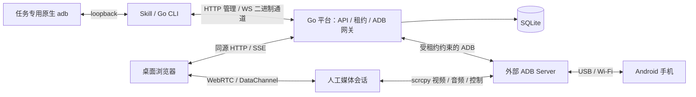

# 架构设计

## 系统边界

DroidHarbor 是单宿主、约 3–10 台 Android 真机的设备池。Windows 原生与 Linux Docker 使用同一 Go 平台；手机经 USB/Wi-Fi 接入外部 ADB。AI 使用 Skill/CLI 与原生 adb，人工使用桌面浏览器；二者授权和生命周期独立。应用提供 HTTP/WS，在可信内网或 VPN 运行，不管理 TLS、域名或公网穿透。

## 身份、授权与任务访问

- 管理员以部署令牌换取 HttpOnly、SameSite Cookie；写请求校验 Origin/CSRF。调用方凭证可撤销，任务使用独立秘密；数据库保存凭证摘要，不把 taskId 当作凭证。显式 bearer 无效时不回退 Cookie。
- `caller/task/lease/generation` 分开；原子认领只选择已核验在线、可分配、标签全部匹配且资源健康的设备。同一设备至多一个有效 AI 租约。可按完整 ID 或精确名称指定，重名报歧义，指定设备不可用不换机，显式空值拒绝。
- 初次认领及每次显式续租均为服务端处理时刻起 15 分钟，不累加剩余时间、不限制累计时长；CLI、流量及连接保活不续租。过期或撤销不可复活。
- 原子认领与结果持久化；调用方预存任务秘密及幂等键，响应丢失后查询或使用原请求取回结果，不换身份重复领用。外部动作结果无法确认时明确返回未知，不自动重放。
- CLI 按任务运行，使用独立配置、ADB Server 和 loopback 入口，经认证的 WS 二进制通道转发原生 ADB；管理 API 不另造一套 AI 点击/截图协议。连接、子流、重连和实际派发均检查租约及代次，不暴露宿主 ADB 管理权。
- 不同端口/进程不是操作系统沙箱；CLI 不理解任意 shell 的业务副作用，也不保证用户手机后台任务结束。人工观看/控制不认领、续租、暂停或释放 AI 租约。

## 设备与资源生命周期

- 稳定 `deviceId` 对应硬件身份，USB/Wi-Fi 是可变化链路；用硬件序列号、型号和产品代号核验同机，不按 IP 或广播名归并。厂商和系统版本不参与核验。失效链路须重新核验，不自动换路冒充原连接。无线扫描只读 mDNS，配对、连接、登记分别显式执行，配对码不保存。
- 连接状态、分配状态和网页媒体状态独立。新登记默认不可分配；在线且 `available` 才可认领，维护/占用/回收/隔离不等于可分配。关闭 AI 分配或删除占用设备须确认当前任务代次，拒绝过期确认。
- ADB 重新发现原链路后自动重读开机阶段暂不可用的身份信息；核验同一硬件后即上线，不等待屏幕尺寸。尺寸失败单独重读，同一硬件跨链路的显示转储互斥并完整消费；逻辑唤醒和共享封面不等待网页。
- 在线设备使用独立 control-only 保活，逻辑 Awake、实体黑屏，无网页也保持；不改休眠时限或解除密码锁。空闲保活不编码音视频，断开/移除/停平台后结束。CPU、内存、电池温度、电量与实际充电状态共享五秒采样，只作运行时缓存。
- 释放、到期、撤销先取消授权、关闭旧 transport/全部子流及待派发数据，再回收平台资源；完成且连接健康才能回池。失败或归属不明保持隔离，不清应用、账号、文件或用户后台程序。已送达 Android 的动作不能撤回。
- 重启使全部旧租约失效，先恢复账本并定向回收，再开放分配。原生残留按硬件身份、boot ID、进程出生标识及资源定位核验，只处理平台拥有的进程/映射，不做全局清理。
- 手机重新上线时，回收流程等待旧链路的采集收尾，再在新核验链路上按账本继续确认；旧链路失效本身不代表资源已回收。
- 撤销访问后永久删除设备登记；设备端残留不阻塞删除，也不留待回收记录。旧认领仅保留脱离设备的请求指纹，重发返回已结束。重新添加按新设备登记，默认不可分配。

## 浏览器与媒体

- React/TypeScript、Vite、shadcn Base UI Nova；TanStack Query 管服务端状态。SSE 只通知状态变化，断线后读取权威快照；运行态事件按权限隔离。前端缓存不授予操作权。
- 同设备共享 scrcpy 视频采集；手机编码 H.264，Pion 转发 RTP，浏览器解码，服务端不持续转码。DataChannel 承载会话/采集代次绑定的控制；只读在服务端拒绝写入，失焦/离开释放触点与按键，新帧确认前不开放输入。
- 全局帧率/码率目标默认 60 fps/12 Mbps，设备长边默认 1920。保存不打断在途或保留采集，下次新建生效；实际输出受编码器和内容约束。仅原生明确拒绝配置时，有限回退至最近成功且不高于目标的档位或 30 fps/4 Mbps，保持分辨率；有效关键帧后才记成功，并通知目标/实际值及原因。网络、权限和清理故障不降档。
- 每个已访问设备独立保留完整采集、PeerConnection、轨道、video 和解码器 15 秒；回切取消自身期限，下次离开重新计时，不预热未访问设备，保留成员计入 64 会话容量。后台立即撤销输入，回切重新确认权限与实际帧。
- 当前目标瞬时故障按 1/2/4/8/15 秒恢复，稳定十秒重置；离线等核验，切走/关闭取消。登录失效、不兼容或回收未确认停止恢复，不重放输入、不改变 AI 租约。健康后台保留，失败后台不主动重建。
- 观看队列有界至八帧/4 MiB；瞬时积压丢弃不可解码旧段并在原连接等待新关键帧，重复请求合并。单帧越界或五秒仍未完整发送恢复关键帧才终止；发送完成不等于浏览器呈现。
- 设备池五秒共享截图，同设备合并、不同设备无固定并发门槛；工作台仅从当前视频取最新帧，切走冻结，不轮询截图。持久屏幕/视频几何用于加载前布局，不用旧图冒充新流；视频完整等比显示，物理旋转与网页旋转独立。
- 独立小窗由同源 SharedWorker 协调浏览器唯一实例，关闭创建页不结束它；倍率以视频原始像素计，默认有序 0.5/1/2，系统可增补，超桌面等比适配并通知。
- `RESET_VIDEO` 重启共享视频编码而保持观看连接，可能短暂影响同设备其他观看者；重新连接只关闭本观看会话后新建音视频连接，不重启或重新配对 ADB。

## 音频与偏好

- 独立 scrcpy-audio 采集媒体输出，不采麦克风；静音/设备播放/网页播放独立于视频，默认静音，临时选择随最后视频成员及其 15 秒保留，流释放后重置。系统默认值变更不修改在途选择。
- Opus 48 kHz、双声道、128 Kbps 直通；接收 SDP 明确请求立体声，RTP 由首包 PTS 锚定后按编码实际采样数推进，不用抖动 PTS 填充空洞。
- 网页只向选定的可见前台会话播音，以单一 Web Audio GainNode 输出主音量乘增强；主音量 0–100%，增强默认 1.0、初始上限 3.0，上限可配置且至少 1.0。下调越界立即限制并通知，临时音量不持久化。
- 路由与网页增益不改手机系统音量；手动设备音量遵循手机按键策略，逐次读回媒体真实档位，非普通模式拒绝，连续两次无变化明确失败。音频故障按当前播音归属处理、单独通知，不终止正常视频或假报静音。

## 存储与部署

- SQLite 存设备/链路、租约、操作结果、资源账本、几何、画质成功档位及系统偏好，不存视频或指标历史。WAL、FULL 同步、外键、IMMEDIATE 短写事务与单连接保证单宿主原子占用；设备/网络 I/O 不在事务内。
- `serve/migrate` 获取同一数据库的 OS 文件锁；仅空库或已识别迁移历史可初始化/升级，未知库报错。当前 schema 5：显示几何、全局画质及成功档位、软删除及偏好、网页增强上限均启动自动事务迁移；偏好有独立 revision，失败不重建覆盖。
- Go 单进程内嵌网页和锁定 scrcpy-server；运行不依赖 Node、Go 工具链或外置网页。双击 EXE 缺配置时生成 `.env`、随机令牌并初始化数据库；管理员令牌只读文件，轮换撤销旧登录，无独立 init/启动脚本。
- Linux Compose 将平台与 ADB 分容器，分别持久化数据库/配置和 ADB 授权；平台更新不要求重启 ADB。备份恢复不复活旧租约，回退程序须使用匹配数据库。
- 日志为 UTC+8 的固定时间/级别/八位设备 ID/msg/诊断值 pattern，按日期及大小轮转，不记录配对码、请求正文或普通凭证；首次令牌交付日志按凭据保护。健康 HTTP 不代表设备或媒体就绪。

## 详细合同

| 范围 | 权威入口 |
| --- | --- |
| API 字段、鉴权、错误与版本 | [OpenAPI](../api/openapi.yaml) |
| 租约、ADB、设备池与网页场景 | [首版设计](../openspec/changes/build-droidharbor-v1/design.md)及[能力规格](../openspec/changes/build-droidharbor-v1/specs/) |
| 删除、音频、倍率与系统偏好 | [增量设计](../openspec/changes/device-preview-audio-settings/design.md)及[能力规格](../openspec/changes/device-preview-audio-settings/specs/) |
| 客户端使用、能力和退出语义 | [产品 Skill](../skills/droidharbor/SKILL.md) |
| 配置、升级、备份恢复与部署 | [Windows](../deploy/windows/README.md)、[Compose](../deploy/compose.yaml)、[备份](../deploy/backup-linux.sh)、[恢复](../deploy/restore-linux.sh) |

版本以依赖锁文件及 API 能力为准；上述合同保留字段和逐场景细节，本文件不复制操作手册、验收流水或任务进度。
