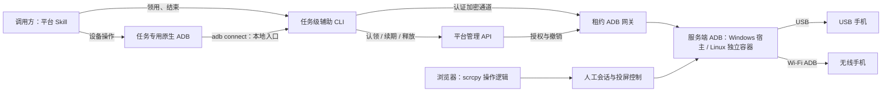
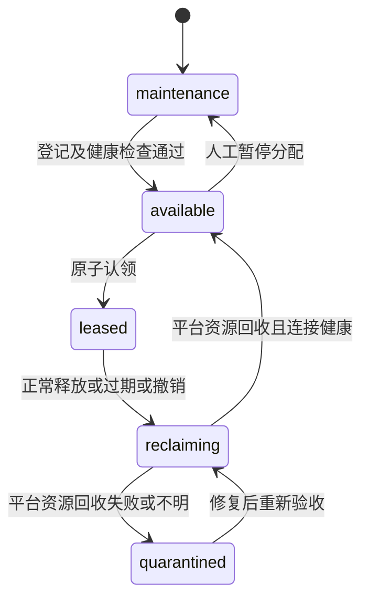

# DroidHarbor：开发目标、技术选型与首版边界

状态：核心业务边界与架构决策已确认，工程设计及实施待评审。  
本文记录已确认的开发目标、技术选型、首版边界和接口约束；仍标为建议的工程细节与性能目标不视为已获批准。当前不开发业务代码、不创建数据库 schema、不制作 UI 原型。

## 1. 项目定位与依据

DroidHarbor 是供不同机器上的 AI 任务共享使用的 Android 真机设备池，同时提供与 scrcpy 操作逻辑一致的浏览器工作台。初期约 3 台、未来最多约 10 台手机；现有手机通过 USB 接入 WinServer，首版同时支持 Wi-Fi ADB。服务端支持 Windows 原生及 Linux Docker，内网/VPN 访问；浏览器正式支持桌面 Chrome/Edge 和 Android Chrome。人工入口统一为网页，不要求保留或兼容 eScrcpy。

核心场景：调用方安装平台配套 Skill，声明所需账号环境标签；平台原子认领匹配设备，提供绑定本次任务租约的远程 ADB 入口。每次认领/显式续租有效 15 分钟，续租次数和任务累计时长不限。结束、到期或服务重启后，平台撤销旧访问并回收自身资源，连接健康后重新分配；保留手机应用及账号状态，不保证手机后台程序停止。用户可以同时从浏览器查看并按 scrcpy 的习惯操作，不自动释放或暂停 AI 租约。

依据与优先级：

1. 当前要求：独立重写，不复制 WebAppFlaskscrcpy 应用代码；手机支持 USB/Wi-Fi 接入；平台向调用方暴露受租约约束的远程 ADB；交付平台配套操作 Skill；网页操作对齐 scrcpy；Appium、uiautomator2 仅预留接口；前端采用指定 frontend-library skill，使用 OpenSpec。
2. [需求依据](../ref/需求&选型.md)：设备规模、任务租约、标签调度、网页人工入口及可调画质；已同步本次确认内容。
3. 参考项目和上游文档：用于验证可复用技术及识别风险，不把其全部功能自动加入首版。

用户已实际使用参考项目并确认不满足要求，因此直接独立重写，不再安排参考项目试用或以其为底座的评估。新项目仍需完成自身的真机、交互、异常恢复和性能验收，不承诺兼容参考项目的 URL、数据库或前端数据格式。

### 1.1 已确认与未确认

| 类别 | 内容 |
| --- | --- |
| 已确认技术 | Go 后端与 Go CLI；Pion WebRTC；SQLite；Windows 原生/Linux Docker 服务端；Linux 使用 Compose 分别部署平台与 ADB；Windows/Linux 调用方，不限制 harness；frontend-library；OpenSpec |
| 已确认业务边界 | 约 3–10 台；USB/Wi-Fi；标签分配；15 分钟显式续租且无累计上限；重启旧租约失效；只回收平台资源；内网/VPN；指定浏览器；第 5 节首版功能包；不含音频/录屏；Appium/uiautomator2 仅预留 |
| 已确认画质 | 分辨率、帧率上限和目标码率独立调整，保持手机画面比例；默认长边 1920、30 fps、4 Mbps；同设备网页观看者共享配置；性能先测量再定数值门槛 |
| 已有约束 | 当前手机在 WinServer；不得分配错账号环境；协议网关强制约束旧任务访问；人工入口统一网页，不承担 eScrcpy 共存兼容 |
| 待工程评审 | 数据库 schema、OpenAPI/ADB 协议细节、版本矩阵、UI 原型及部署配置；性能门槛在取得真机数据后确认；不视为业务开发已获授权 |
| 不具备的证据 | 新实现的手机/Android 兼容矩阵、生产宿主资源、参考项目性能剖析、新实现浏览器验收结果；不否认用户已完成的参考项目使用结论 |

## 2. 开发目标与不可破坏的约束

### 2.1 开发目标

- **自动领用正确环境**：任务声明标签，服务端分配匹配且确实可用的手机；用户不用逐任务选机。
- **租约真实生效**：同一设备最多存在一个有效 AI 任务租约；认领、续期、释放、超时与重启行为可解释、可验证。
- **实时人工入口**：浏览器使用 scrcpy 的操作语义与实时投屏，不用连续截图或自创按钮操作流程代替直接控制。
- **适合小规模常驻**：不引入与十台规模不相称的集群、消息队列和多层服务；无人打开画面时不持续维持无用视频流。
- **独立、可维护**：复用 ADB、scrcpy-server、成熟媒体库和 UI 组件；不移植参考项目的 Flask/Vue 实现，也不自己重写 USB 驱动或视频编码器。
- **原生 ADB 与配套 Skill**：管理 API 管租约，租约 ADB 入口承载设备操作，Skill 管使用流程；Appium/uiautomator2 当前只保留扩展合同，不部署或验收其运行环境。

### 2.2 强制约束

1. 身份包含调用方和任务，不能把“共用一个 AI 账号”当成任务隔离。任务名本身不是凭证。
2. 租约到期立即拒绝新的 AI 操作，不依赖后台定时清理是否及时运行。
3. 既有 ADB transport、其内部 shell/sync 等子流、待派发数据及重新连接都属于撤销范围，不能只在建连接或 HTTP 入口检查一次。
4. 离线、未授权、回收中、回收失败、人工维护中的设备不得被分配。
5. 标签描述用途和已配置的账号环境，不保存密码，也不能证明账号此刻仍登录有效；人工需能暂停分配并修正标签。
6. 浏览器和 AI 不得得到无约束的服务端 ADB Server 代理；人工操作走网页授权会话，AI 操作走租约入口。
7. 回收只撤销任务连接及平台拥有的资源；不清应用数据、不退出账号、不恢复出厂、不主动停止用户应用或任意手机后台程序。平台保证访问撤销，不保证整机任务副作用清零。
8. 人工操作默认不修改 AI 租约，也不承诺 AI 自动暂停；若用户需要独占接管，应另行确认暂停协议。

## 3. 参考项目的借鉴范围与性能判断

参考源码核查基线：WebAppFlaskscrcpy `9feaceac170cff4c0c82f3db3981137bea0f8ae9`。

| 可以借鉴的流程 | 本项目必须重新设计的部分 |
| --- | --- |
| 设备发现、投屏启动与结束、浏览器触控 | 按标签选择与原子认领，不让客户端先挑设备再抢占 |
| 多浏览器接收画面、连接恢复 | 任务身份、租约版本和在途操作撤销 |
| 占用到期后关闭相关连接 | 平台资源回收、清理失败隔离及重启恢复；不假定应用副作用已经消除 |
| 文件、shell 和设备操作的组织方式 | 所有 AI 路径统一执行授权，不留终端或原生 ADB 绕过入口 |
| 服务端集中管理 ADB/scrcpy 生命周期 | 区分 AI 租约、人工会话与共享采集资源，避免清理一个任务时影响其他有效会话 |

**性能证据不能简化成“Python 会转码，所以改 Go”。** 用户报告参考项目存在性能瓶颈；当前公开源码的 `ScrcpyVideoTrack` 接收 H.264 压缩数据，以 `av.Packet` 交给 aiortc 打包发送，并非视频主链路解码再编码。scrcpy core 在存在图像监听者时另做解码，但在该判断之前仍进行 `codec.parse`。

[INFERENCE] 跨线程投递、Python 对象与包处理、每观看端排队、截图解码、设备端编码及浏览器解码都可能影响资源与时延；没有 profiler 和同机基准，不能断言其中哪个是实际瓶颈，更不能给出语言切换后的性能倍数。

新项目的结构目标：手机端编码，服务端只做必要的协议解析、分包、鉴权和转发，浏览器解码；截图按需获取，不为了随时截图维持服务端全量视频解码。慢观看端必须使用有界缓冲，丢帧后在可解码关键帧处恢复，不能无限堆积或随机丢掉参考帧后继续假装正常播放。

## 4. 后端与媒体技术选型

### 4.1 已确认的技术路线

后端与任务级辅助 CLI 均使用 **Go**，浏览器投屏使用 **Pion WebRTC**。前端继续遵循指定的 React/TypeScript 组件体系；Node.js 用于前端构建和 OpenSpec 工具，不作为设备服务或辅助 CLI 的生产运行环境。

| 部分 | 已确认方向 | 选择依据与代价 |
| --- | --- | --- |
| 平台后端 | Go | 适合常驻连接、ADB 网关及二进制数据处理；需管理并发、背压与撤销，语言本身不保证正确性 |
| 调用方 CLI | Go 可执行程序，支持 Windows/Linux，不限制 harness | 通过标准命令与机器可读结果接入，不依赖 Python/Node 或特定 harness 插件；仍需提供或验证兼容的原生 ADB |
| 浏览器视频 | 手机 H.264 → Pion RTP/WebRTC → 浏览器 video | 服务端不持续解码转码；需处理时间戳、参数集、关键帧、慢观看端和连接恢复 |
| 设备协议 | 官方 ADB 与配套版本 scrcpy-server | Pion 不负责连接手机或实现 scrcpy；需要维护 ADB 网关与 scrcpy 协议适配 |
| 网络与浏览器 | WebRTC 能力与目标环境逐项验收 | 媒体端口和可能的 TURN 由部署范围决定，不能因使用 WebRTC 就承诺任意网络可用 |

该选择基于常驻服务、可执行文件分发及媒体生态，不以“换 Go”作为性能验收。资源、延迟、异常恢复仍按第 8 节实测。

租约 ADB 网关是首版核心工作。“能连接 ADB Server 的客户端库”不等于“能供原生 adb connect 连接的服务端”；认证、任务连接隔离、能力协商与到期撤销不能由投屏库代替。Go 和 Pion 的具体版本在实施时按支持状态锁定，本次不安装业务依赖或创建业务骨架。

### 4.2 组件与确认状态

Go、Pion、SQLite 及部署/访问范围已确认；下表中仍写为建议的路由、事件等细节在工程设计中落实。SQLite 的批准不包含具体表结构、事务约束或迁移执行。

| 层次 | 选择或建议 | 边界 |
| --- | --- | --- |
| 后端 | Go 单服务（已确认）；HTTP 层使用标准库 net/http 的工程提案 | 同一进程提供网页、API、租约网关与投屏，内部模块分工，不拆业务微服务 |
| 辅助 CLI | Go（已确认），调用方支持 Windows/Linux | 按任务启动，管理租约及认证通道；不依赖特定 harness 的结束钩子或内部会话协议 |
| WebRTC | Pion WebRTC（已确认）；v4 为当前组件建议 | H.264 直通；首版不依赖 FFmpeg 常驻转码 |
| Android | 官方 platform-tools ADB + 官方 scrcpy-server | Windows 使用宿主 ADB，Linux 使用独立 ADB 容器；同一 USB 设备只由一个服务端 ADB 实例接入；锁定 scrcpy 协议版本 |
| 数据 | SQLite（已确认），本地持久化存储 | 保存设备配置、身份、租约和必要记录，不存视频；具体 schema 单独评审 |
| 管理 API | HTTP JSON + OpenAPI 3.1 | 负责标签、身份、租约和 ADB 连接信息；不为 AI 重建一套与原生 ADB 重复的操作 API |
| AI 数据入口 | 任务级辅助 CLI + 认证加密通道 + 租约 ADB 网关（已确认） | 原生 adb 连接辅助 CLI 的本地入口；不直接开放宿主 5037；生命周期边界见 D2 |
| 实时状态 | SSE（工程提案） | 设备、租约、回收状态；断线取权威快照，不与视频/ADB 数据共用无边界队列 |
| 浏览器控制 | 会话绑定的 WebRTC DataChannel | 离散按键/触控边界需可靠有序，移动事件可合并，不能让丢失 UP 造成持续触摸 |
| 文件传输 | AI 使用 ADB sync；网页按交互需要提供传输接口 | 两者都绑定各自授权，保留进度、取消、错误与覆盖语义；不强制照搬 DataChannel 传文件 |
| 部署 | Windows 原生及 Linux 双容器（已确认）；Go 同一服务提供静态前端、API、网关和投屏 | Linux 分别运行平台与 ADB；两种方式均验收 USB/Wi-Fi、持久化、自启动与媒体可达性 |

SQLite 适合单宿主、小规模元数据和事务认领，不代表它负责实时视频。后续如改为多服务副本共同写入，则需重新评审存储与租约协调；仅仅把 SQLite 换成 PostgreSQL 不会自动获得分布式正确性。现在不为未确定的集群引入外部数据库。

### 4.3 前端方向

用户已指定 frontend-library skill，按其规范组合 React、TypeScript、shadcn/ui Nova、Tailwind CSS、Lucide。建议使用 Vite 构建 SPA：本项目不是 SEO 内容站，不需要仅为设备工作台引入 SSR。

- 设备池页：整张设备卡片点击即进入工作台，管理按钮独立；显示用途标签、在线/授权状态、任务占用、回收结果及默认每 5 秒更新的共享截图小图。
- 单设备工作台：画面是主体，左侧带预览的设备列表用于直接切换，不用下拉框；必要操作入口靠近画面。独立小窗仅放手机画面和底部一排按钮，不堆叠管理信息或可展开面板。
- 管理页：设备标签、启停分配、任务访问凭证、租约与回收记录；不扩展成企业权限平台。
- 窄屏采用单设备视图，不把桌面多面板机械压缩。视觉与布局需下一阶段原型确认，本文件不选具体配色。
- Zustand 仅用于确有跨组件需求的客户端状态；服务端状态推荐由 TanStack Query 管理，不再复制成第二份可写的租约状态。
- Motion、Resizable、dnd-kit 按实际交互需要安装；首版没有设备排序需求就不引入拖拽。
- 不照搬参考项目 Vue 页面；也不以“自己写更简单”为由重写成熟通用控件。视频播放和设备坐标映射是业务能力，不是重写通用按钮或弹窗的许可。

## 5. 首版范围

本表功能包及排除项已确认；工程设计不得自行增加音频、录屏、群控、应用仓库、MCP 或完整权限管理后台。

| 能力 | V1 交付范围 | 不在 V1 |
| --- | --- | --- |
| 设备接入 | Windows 原生/Linux Docker；USB/Wi-Fi ADB；管理员登记/授权/必要配对；掉线与重连；同机去重；常驻恢复 | 多宿主统一调度；不以自动换链路隐藏断连 |
| 标签 | 人工维护用途/账号环境标签、全部所需标签匹配、暂停分配 | 自动登录、账号密码托管、自动判定平台登录有效性 |
| AI 租约 | 任务身份、原子认领、15 分钟显式续租、释放、到期；无累计时长/续租次数限制；重启旧租约失效 | 自动续租窗口、等待队列、预约日历、优先级抢占、跨设备原子批量认领 |
| AI 操作 | 通过租约 ADB 入口使用原生 shell、exec-out、push/pull，完成截图、点击、滑动、输入等操作 | 无约束 ADB Server；Appium/uiautomator2 当前不实现、不做兼容承诺 |
| AI 使用入口 | 平台随版本交付操作 Skill 与必要辅助工具，组织管理 API、ADB 连接、续期、使用和释放 | 首版 MCP Server、多语言 SDK、可视化自动化编排 |
| 人工入口 | 统一网页入口；工作台内切换设备；独立小页面；按 scrcpy 操作语义控制；独立人工授权；保持 AI 租约不变 | eScrcpy 入口及共存兼容；Document PiP/强制置顶；自动暂停/恢复外部 AI、多人工控制仲裁扩展 |
| 画面 | 列表共享低频截图预览；单台实时交互；每设备共享视频采集；三项画质参数独立可调；无人观看停止无用采集 | 音频、录屏、直播分享、多机语义/坐标同步群控 |
| 运维 | 基本健康状态、结构化日志、租约与回收记录、备份恢复说明 | 完整监控平台、多租户计费、集群高可用 |
| 应用管理 | scrcpy 式拖入 APK 安装、普通文件推送；明确执行状态 | 独立 APK 仓库、完整应用商店、复杂 Logcat 工作台 |
| 身份管理 | 管理员访问令牌登录、可退出/轮换的网页会话；可撤销 AI 调用凭证及任务独立授权 | 账号密码登录、公共注册、组织架构、SSO、完整 RBAC 后台 |
| 回收 | 撤销旧任务访问，清理平台拥有的连接/转发/会话等资源；健康检查后回池 | 不停止用户应用或任意后台程序，不清账号数据；平台资源清理失败仍隔离 |
| 访问与浏览器 | 内网/VPN；桌面 Chrome/Edge、Android Chrome | 公网直接访问；Safari/Firefox 不纳入首版正式验收或兼容承诺 |

AI 通过原生 ADB 操作手机，不等于获得服务端 ADB 管理权。kill-server、transport 选择及手机无线调试配置由平台管理，网关只能映射当前租约对应设备。原生 ADB 服务集合和可转发通道应显式声明，不能用“原生”暗示所有工具和服务已兼容。

Unicode 文本输入、长按、拖动、横竖屏坐标及文件覆盖行为必须明确；不能把只支持英文输入的实现验收为通用文本输入。原生 ADB 的流式行为不能伪装成平台能精确识别每条 shell 命令的副作用。

### 5.1 两段独立的 ADB 连接



手机无线接入与调用方远程连接是两回事：USB 手机也能通过平台远程 ADB 使用，调用方不直连手机的 IP/端口。

- 平台支持登记已开启 TCP/IP ADB 的设备，并处理支持无线调试配对的 Android 设备；配对授权是管理员动作，不由每个 AI 任务重复执行。具体 Android/platform-tools 版本进入兼容矩阵。
- 已登记设备由平台维护连接；配对撤销、地址或端口变化需正确反馈，不能把无线 ADB 永久在线当成承诺。
- 同一手机同时出现在 USB 和 Wi-Fi 时只对应一个池设备和一份租约。无法确认是否同机时不得自动当作两台可用设备；地址也不能作为永久设备身份。
- 不默认 USB 断开就切 Wi-Fi，或无线失败就切 USB。切换必须使旧 transport 失效、重新确认设备身份和状态，不能沿用旧连接假装操作成功；自动切换不是本次已确认需求。
- 手机原始无线 ADB 地址不得成为调用方绕过平台的备用入口。若调用方网络上仍可直接访问并已获授权，平台无法阻止该旁路；设备网络与任务入口隔离属于部署约束。

### 5.2 平台配套操作 Skill

这是交付给调用方 AI 使用的产品能力，与开发人员使用的 frontend-library/OpenSpec skills 无关。当前只定义合同，尚未实现可运行的产品 Skill。

1. 配置平台地址和调用凭证，查询 API/ADB 能力；不将账号密码或长期凭证写入任务记录。
2. 使用任务身份、所需标签和幂等键认领设备，取得 leaseId、到期时间和租约连接描述。
3. Skill 启动本任务的辅助 CLI，由其建立认证加密通道，并配置任务专用的本地 ADB Server 和入口；原生 adb 连接本地入口，所有操作显式选择本租约目标，不依赖默认 ADB Server 或“恰好只有一台设备”。
4. 在有效租约内执行截图、shell、触控、文本及文件操作。Skill 指导调用方主动续租；每次以服务端当前时间为基准授予未来 15 分钟，不叠加囤积租期。CLI 不自行续租，次数和任务累计时长不限；长操作期间也必须显式续租，具体规则见 D6。
5. 续期失败、撤销或断连时停止派发新操作，查询权威状态；不自动重放点击等可能产生重复副作用的命令，也不自动换手机或重新认领掩盖失败。
6. 正常结束时释放租约并清理本任务本地连接资源；异常退出仍由服务端 TTL 和撤销保证旧入口失效。Skill 不保证设备后台任务已终止。
7. Skill、辅助程序和平台声明兼容版本。服务端不信任“已按 Skill 执行”的自述，绕过 Skill 直接调用 adb 也必须受同样的租约约束。

#### 已确认的辅助 CLI 边界

- 随产品 Skill 交付 Windows/Linux 的 Go 可执行程序，按任务启动、按任务清理，不做全局常驻守护服务，不安装到手机上；仍需兼容的原生 ADB。
- CLI 仅负责租约管理、连接环境和 ADB 二进制数据传输，不另造截图/点击协议，不理解全部 shell 命令语义，不参与浏览器视频编解码。
- 本地入口仅监听 loopback；每个任务使用独立 ADB Server 实例、配置和资源归属，只清理本任务资源，不影响调用方其他 ADB 工作。
- loopback、不同端口和不同进程用于避免误用，不是操作系统安全隔离。若任务可以读取彼此凭证或访问彼此端口，对抗恶意跨任务访问需要运行环境提供独立用户、容器或同等权限边界，不能宣称 CLI 已提供。
- 平台通道认证绑定任务、租约及代次；服务端持续执行过期和撤销，不能只依赖 CLI 主动断开。本地端口不是可复用的长期设备身份。
- 通道采用成熟的认证加密传输；具体实现建议使用 WebSocket over TLS 二进制消息，经 HTTPS 入口接入，保持有界缓冲与背压，不转 JSON/Base64，不自创加密协议。协议细节在设计阶段落实。
- 不后台自动升级；客户端、平台和 ADB 版本声明兼容范围，建连时检查能力，不兼容直接失败。Windows/Linux 均为首版调用方支持范围，具体系统版本和架构矩阵在发布设计中列明。
- 不自动换设备、不重放设备操作、不以无限重连或续租掩盖任务失败。断线时可能已有操作执行，应报告中断或结果未知。
- 不限制 harness：通过标准 CLI、退出码和机器可读结果接入，Skill 不绑定专用工具调用协议、插件、父进程名称或结束钩子；不原生加载 Skill 的 harness 仍可按同一说明执行命令，不另建控制路径。
- 平台不承诺自动识别 AI 任务结束。正常结束由调用方显式释放，未释放时依靠服务端有限租期撤销访问；CLI 残留、连接保活、ADB 有流量都不能单独证明任务仍需占用。续租政策见 D6。
- 未来 Appium/uiautomator2 应接入同一任务连接环境；所需转发和设备端服务另做兼容验收，不开放第二条绕过租约的路径。

### 5.3 网页与 scrcpy 的操作一致性

以 scrcpy 默认 SDK 控制模式为交互基准，不照搬其桌面窗口，也不将“操作一致”扩大成首版覆盖全部桌面驱动、音视频和虚拟显示功能。

| 操作 | 网页目标行为 |
| --- | --- |
| 鼠标/触摸 | 左键或单指点击、长按、持续拖动、滑动、滚轮；按真实画面尺寸与旋转映射坐标，不把拖动拆成重复点击 |
| 次级鼠标键 | 右键在屏幕关闭时唤醒，否则 BACK；中键 HOME；第 4 键最近任务，第 5 键通知栏；Shift 修饰后的行为按 scrcpy SDK 模式处理 |
| 键盘 | 输入、按下/抬起、组合键以及 Home/Back/最近任务/音量/电源；手机应用处理普通 Ctrl 组合键，不把 Ctrl+C 一律改成网页复制 |
| 多指模拟 | Ctrl + 拖动模拟缩放/旋转，Shift 及 Ctrl+Shift + 拖动按 scrcpy 语义模拟双指滑动；手机端是否响应由当前应用决定 |
| 剪贴板 | 文本复制/剪切/粘贴与手机剪贴板联动；中文按真实输入验收；浏览器权限及用户手势限制显式处理，不承诺后台任意读写系统剪贴板 |
| 文件拖入 | APK 执行安装；其他文件默认推送到 /sdcard/Download/；网页提供真实进度与结果，不把开始上传当成安装成功 |
| 显示与设备动作 | 全屏、显示旋转/翻转、暂停/恢复画面、重置采集、设备旋转、关手机屏但保持投屏、通知与设置面板；区分仅改变网页显示和实际操作手机 |
| 只读会话 | 禁止按键、触控、剪贴板写入、文件拖入等所有设备写操作，不是仅隐藏按钮 |
| 焦点和断连 | 离开画面、失去焦点或断连时结束未完成的触摸/按键状态，避免卡住长按；不向重连后的新会话重放旧输入 |

浏览器可能截获 Alt/系统键组合、额外鼠标键，也可能拒绝全屏或剪贴板访问。网页提供明确的等价操作入口，并在对应浏览器验收中列出差异；不能静默改键后宣称完全一致。桌面窗口管理、AOA/OTG、UHID 外设模式、摄像头、虚拟显示、录音录像不由“交互一致”自动纳入本次需求；若需要，应单独确认。

### 5.4 已确认的网页画质控制

分辨率、帧率上限、编码目标码率提供三个独立设置，不将它们捆绑为不可拆分的画质档位。

| 参数 | 首次使用默认值 | 行为 |
| --- | --- | --- |
| 分辨率 | 长边上限 1920 像素 | 按手机当前画面比例等比缩放，不拉伸、不裁切；旋转后同步更新画面尺寸与输入坐标映射 |
| 帧率 | 上限 30 fps | 独立调整，不保证静止画面或性能不足设备始终达到上限 |
| 编码码率 | 目标 4 Mbps | 独立调整，不表示含协议、重传开销在内的绝对网络限速 |

例如手机画面为 1080×2400，长边限制为 1920 时对应 864×1920。实际输出尺寸受原画面与编码器支持约束，界面应显示实际尺寸；不能通过 CSS 拉伸或裁切来伪装满足比例。ADB 原生截图不因网页投屏参数而降分辨率。

同一设备的全部网页观看者共享一份采集流和设备级画质配置。修改前明确作用范围，生效后各观看者看到一致的实际参数；不为每个浏览器额外创建独立编码流，也不在服务端转码适配。参数调整不修改 AI 租约。

调整需要重建采集时，允许短暂重新出画面，但必须明确显示切换状态；输入坐标使用新画面的尺寸与方向，不向新会话重放旧触控。不能在失败时报告新参数已生效，或未经确认静默降档。

### 5.5 已确认的预览、切换和小页面

- **列表预览**：设备池及工作台左侧列表默认每 5 秒更新可见设备；列表或条目不可见、网页隐藏后停止对应请求，恢复后读取当前结果，不补发轮次。两处列表按设备/链路代次共享截图采集和有界小图缓存，服务端按需解码静态截图、等比缩小并编码 JPEG，不持续解码视频。显示真实拍摄时间，离线/失败/授权失效清掉失效画面。预览要求管理员授权，不改变 AI 租约、工作台画质或原始截图分辨率。
- **切换设备**：完整工作台左侧常设带预览的设备列表，点击直接切换。停止向旧设备发送输入，释放本窗口未完成按键/触控并清掉旧帧，再等待新设备有效画面；旧设备迟到响应不得污染新设备。切换失败明确显示，不自动改选其他手机，不改变其他观看者和 AI 租约，也不隐式提升只读权限。
- **独立小窗**：仅呈现打开时指定的一台手机及底部一排必要按钮，不放设备选择、信息、模式切换或可展开工具；完整工具保留在主工作台。各窗口独立持有人工会话并复用设备采集，主页面关闭或切换不影响它；显式退出登录仍撤销关联窗口授权。不依赖 opener，不在 URL 放秘密，不接入 Document PiP 或强制置顶。
- **窗口尺寸**：只用浏览器 window.open popup，不增加桌面客户端；允许移动和手动缩放，不锁定外框。底部提供小/标准/大窗口按钮，按屏幕可用空间及浏览器边框生成目标尺寸，通过 resizeTo 请求调整窗口。画面等比适配，不改变视频编码参数；浏览器拒绝或约束尺寸时明确反馈，不把 CSS 变化当作窗口成功调整，不循环回弹用户拖动后的尺寸。普通标签页、多标签窗口和移动端的限制如实呈现。
- 此次增量不改数据库 schema；预览缓存为有界临时内存。预览的 CPU、网络开销以及多列表复用纳入首轮真机测量。


## 6. 租约、人工介入与回收

### 6.1 两个维度，不用一个“在线”覆盖全部状态

- 连接状态：online、offline、unauthorized。
- 分配状态：available、leased、reclaiming、quarantined、maintenance。

分配条件是连接正常且分配状态 available，标签和能力都匹配。重新插回 USB 只改变连接状态，不意味着旧任务已经回收。



图为建议的分配状态模型，不是数据库 schema。正在占用的设备进入维护时，要先走显式撤销/回收流程，不能直接改状态后绕过清理。

### 6.2 任务隔离与撤销顺序

1. 持久化原子认领结果，返回 deviceId、leaseId、失效时间和受限租约凭证。按标签查询与占用必须在一个协调边界内完成。
2. AI 的 ADB transport 及其全部子流绑定当前任务租约和递增的 generation（占用代次），不是每条原生 adb 命令都能额外携带 HTTP token。辅助 CLI 配置任务专用 ADB 实例与凭证，避免共享默认连接导致误用；对具有相同系统权限的恶意任务，仍需调用方运行环境提供隔离。
3. 建连接、打开服务子流及数据实际派发时，网关持续执行租约状态和代次约束。租约检查与派发有确定先后关系，不能只握手鉴权一次；平台不承诺理解 shell 字节流中每条命令的业务语义。
4. 释放/到期先使旧代次失效，再拒绝重连、关闭旧 transport 及全部子流、清空待派发数据，并回收本任务的平台资源。已发送至 Android 的动作不能撤回；用户已选择保留应用运行状态，不保证这些动作或后台程序停止。
5. 平台资源回收确认前保持 reclaiming；回收失败或无法确认则 quarantined，拒绝新认领。回收完成且设备连接健康后可回池；available 不表示应用状态已重置或后台程序已终止。
6. 服务重启后所有旧租约失效，即使原到期时间尚未到达也不得恢复。先核对持久状态、撤销旧入口并回收平台拥有的残留资源，再开放分配；数据库恢复或连接重建不得复活旧租约。

认领请求重发使用幂等键关联同一结果，防止丢失 HTTP 响应后再占一台手机。点击、付款、发消息等非幂等操作不能自动重放；响应丢失时返回结果未知并让调用方核对设备，而不是盲目重试。

### 6.3 已确认的回收范围：平台资源，不重置应用

首版保留手机应用、登录账号、文件和后台运行状态，只回收本任务在平台内的访问权及平台拥有的资源。该政策适用于正常释放、到期、撤销和服务重启后的回收。

- 回收对象：任务 ADB transport/子流、待派发数据、平台创建且归属该任务的转发或会话，以及不再使用的平台自有采集资源。共享资源按实际使用者清理，不影响独立人工会话。
- 不主动执行应用 force-stop、清数据、退出账号、删除任务业务文件、重启手机或终止任意用户后台程序；平台自有进程的定向清理不等于清理用户应用。
- 平台资源已回收、旧访问确实失效、设备连接正常且不在维护状态，即可重新分配；不把“确认任意后台程序均已停止”作为回池条件。
- 平台资源清理失败、归属不明或旧访问无法确认失效时隔离设备；离线/未授权不参与分配。单纯存在用户后台程序不触发隔离。
- 旧任务已在手机上启动的程序或已交给 Android 的动作可能继续执行，甚至影响下一任务；这是已确认的状态保留策略，不对外宣称设备执行环境隔离或副作用清零。

Skill 要求下一任务先观察当前手机状态再操作，不假定手机回到桌面、应用已关闭或页面已复位。未来若需要应用级复位或后台任务清理，另行评审，不加入隐式清理脚本。

### 6.4 网页人工入口与资源归属

浏览器查看与控制使用人工会话，不冒充 AI 租约。AI 到期只撤销该任务的资源，不应无条件杀掉独立人工观看连接。人工正在操作时可以显示明确状态，但不会自动暂停 AI。

不交付 eScrcpy 入口，不承担其共存、版本或部署兼容验收；本次范围调整不授权卸载或修改用户现有软件。平台也不宣称能阻止具有宿主或手机管理权限的程序直接操作设备。

AI 连接、网页会话和设备级共享采集须有明确资源归属；关闭一个任务或观看者只清理其资源，不执行全局 kill-server 或删除全部 forward 代替定向回收。Linux 平台容器更新不应要求同时重启独立 ADB 容器。

## 7. 需要保留的兼容接口

保留的是领域边界、版本和可验证合同，不是预建空接口、插件框架或备用实现。Go、Pion、SQLite、辅助 CLI、固定 15 分钟显式续租、平台资源回收及部署访问范围均已确认；Appium/uiautomator2 仅预留。后续按这些决策细化 API、ADB 协议和 OpenSpec 场景，数据库 schema 及具体工程方案仍需评审。

| 边界 | 首版必须稳定的语义 | 为后续保留什么；现在不做什么 |
| --- | --- | --- |
| 设备标识 | 稳定 deviceId；USB serial、无线地址、当前 transport 是内部映射；同一手机多链路不重复分配 | 可增加宿主归属，但首版不开放跨宿主调度 |
| 身份/租约 | caller、task、lease、generation、expiry 分开；所有关联 transport/子流同生共灭 | UI、Skill、未来 Appium/uiautomator2 复用同一租约边界 |
| ADB 连接描述 | leaseId、设备身份、有效期、连接方式、认证参数及支持的服务能力 | 不把固定端口当设备身份；允许替换网关内部实现，不暴露宿主管理接口 |
| 执行结果 | 原生 shell 的 stdout/stderr/退出码、文件协议结果按协商能力保留；取消连接不等于撤销副作用 | 不承诺给任意原生 ADB 命令分配平台 operationId 或解析全部语义 |
| 设备适配 | USB/Wi-Fi 发现、授权/配对、重连、shell、文件、截图及资源清理 | 隔离平台差异，不首版承诺所有 ADB 协议服务 |
| 投屏适配 | 打开/关闭、codec/实际尺寸/方向、会话 epoch、观看及输入授权；设备级画质读取/修改，分辨率/帧率/码率独立 | 所有网页观看者共享实际配置；协议支持能力与实际生效结果，不将 scrcpy 字节协议直接作为公开 API |
| 回收 | 原因、平台资源归属、访问撤销与资源清理结果、健康检查、失败原因 | 未来可评审应用级清理；首版不检查任意后台任务是否结束，不实现清理脚本插件 |
| 人工介入 | 人工会话与 AI 租约独立，有明确操作身份 | 可扩展暂停/恢复事件，但当前不发出假的“AI 已暂停”状态 |
| 客户端能力 | API major、ADB 服务及设备能力可查询；Skill 声明兼容版本 | Appium/uiautomator2 的服务集合、端口映射、设备端进程和回收约定可扩展；当前不启动相关服务或报告兼容 |

### 7.1 API 轮廓

建议统一 `/api/v1`；不兼容变化使用新的 major，新增可选字段保持向后兼容。客户端忽略未知字段，对不支持的必要能力明确报错。

| 功能 | 建议入口 | 关键合同 |
| --- | --- | --- |
| 能力发现 | `GET /api/v1/capabilities` | API、ADB 服务、认证及媒体能力；不泄露无权访问的设备信息 |
| 设备列表 | `GET /api/v1/devices` | 管理和展示，不代替服务端原子选机 |
| 认领 | `POST /api/v1/leases` | taskId、requiredTags、幂等键；全部标签匹配；固定有效期 15 分钟，返回 expiresAt，不由调用方选择任意 ttl |
| 续期 | `POST /api/v1/leases/{id}/renew` | 仅有效租约持有者；expiresAt = 服务端本次续租时间 + 15 分钟；不叠加、不限次数/累计时长；过期租约不能复活 |
| 释放 | `DELETE /api/v1/leases/{id}` | 幂等撤销；允许返回回收中并给出查询状态，不伪报 available |
| 租约 ADB 连接 | `POST /api/v1/leases/{id}/connections` | 验证当前任务身份，返回 CLI 建立认证通道所需的连接描述；本地 ADB 入口由 CLI 管理，不返回无约束宿主管理端口 |
| 连接查询/关闭 | 租约范围内的 connection 查询/关闭接口 | 只能管理本任务连接；关闭一个连接不等于释放租约或完成设备回收 |
| 人工观看/操作 | `POST /api/v1/devices/{id}/sessions` | 人工授权；返回 sessionId、媒体协商信息，不修改 AI 租约 |
| 事件 | `GET /api/v1/events` | eventId、类型、设备/租约标识、时间及状态版本；无权订阅的内容不推送 |

事件通道首版不必承诺永久重放；断线或版本缺口时读取权威状态快照。事件不是数据库的替代来源。

错误至少区分：没有匹配且可用设备、设备离线/未授权、租约过期/撤销、任务不匹配、回收未完成、操作不支持、操作结果未知。不得将这些状态统一包装成“成功但空数据”。具体 HTTP 状态与错误字段由 API 设计统一确定。

### 7.2 原生 ADB 首版合同与未来工具兼容

调用方的原生 adb 连接任务辅助 CLI 的 loopback 入口，由 CLI 经认证加密通道访问平台租约网关，这是首版已确认路线。`adb -H/-P` 访问 ADB Server 的 smart socket 与 `adb connect` 访问设备侧协议不同；任务专用 ADB Server 和本地设备入口也使用不同端口，不能混用。

- 租约入口只映射一台已认领手机；需完成原生 ADB 握手、能力协商及指定设备服务的桥接，不是简单 TCP 转发服务端 ADB Server。
- 首版覆盖 shell/exec-out、文件 sync 及所需设备信息能力，使截图、输入和文件操作可通过原生 adb 完成。具体命令矩阵和协议版本在实现前列明，不声明无限兼容。
- 认证绑定任务租约；随机端口不能代替平台认证，旧任务凭证和密钥不能直接认证新任务网关。首版将共享调用机视为可信环境，不提供本机任务沙箱；原生 ADB Server 不认证本地命令来自哪个任务，因此不承诺旧命令在端口复用后绝不借用新 Server 的授权。不互信任务需要调用方提供独立网络环境，不能仅更换 OS 用户。
- 撤销既影响新连接，也影响已建立的 shell、文件及其他子流。若未来支持 forward/reverse，所有转发与派生连接也必须登记归属并一并撤销，不能形成永久旁路。
- 通用 shell 可以启动后台服务，网关关闭本身不能消除副作用；不以命令字符串过滤声称实现完整沙箱。回收政策和可访问设备网络共同决定强制边界。
- Appium、uiautomator2 仅预留连接提供者、能力声明、必要端口映射以及设备端服务启动/停止/回收的扩展合同；当前不部署 Appium Server、不安装自动化 agent、不实现定位器 API、不做其兼容验收，也不对外发布空实现接口。

### 7.3 scrcpy 协议版本

上游明确说明 scrcpy client/server 内部协议没有跨版本兼容承诺。DroidHarbor 锁定配套 server 与适配器版本，升级通过真机与媒体验收；不依赖其他桌面控制软件附带的 server 文件。ADB 与 scrcpy 的具体版本在发布设计中声明。

## 8. 部署与性能验收

### 8.1 已确认的部署与访问范围

首版同时交付 **Windows 原生**与 **Linux Docker** 两种服务端部署方式。它们使用相同业务与协议合同，各自运行设备池；本选择不扩大为多宿主统一调度或多副本高可用。

- **Windows 原生**：适配当前 WinServer 和 USB 驱动，使用宿主 ADB；提供开机启动、日志及异常退出后的恢复。明确服务端 ADB 启动责任，不让多个实例争用同一 USB 设备；不要求兼容其他桌面投屏软件。
- **Linux Docker**：已确认 Docker Compose 部署平台、ADB 两个容器。ADB 容器负责 USB/Wi-Fi 接入及必要配对，平台容器通过受控内部连接使用它；平台更新不必重启 ADB，宿主不再另启 ADB 争用同一 USB 接口。交付设备权限、热插拔、网络、日志及独立重启配置，不把原始 ADB 管理端口暴露给调用方。
- **持久化**：Windows 使用本地数据目录；Linux 分别持久化平台 SQLite/配置及 ADB 授权材料，容器替换不得丢失。备份/恢复不得复活旧租约；不让多实例共享同一 SQLite 文件承担集群协调。
- **网络**：仅支持内网或 VPN 访问，仍使用 HTTPS/认证加密通道。必须验证浏览器与平台的 WebRTC 媒体可达性及 Docker 网络配置；VPN 能访问网页不代表媒体端口必然可达，失败明确报错，不静默切换备用媒体路线。
- **公网/TURN**：公网直接接入不纳入首版；不默认引入公网穿透或 TURN 服务。若目标内网/VPN 实际需要中继，先说明具体网络限制并确认部署调整。
- **浏览器**：正式验收桌面 Chrome/Edge（Windows/Linux）和 Android Chrome；桌面验证鼠标/键盘/剪贴板/文件，Android 验证触控、响应式、播放及可用交互。Safari、Firefox 与 iOS 浏览器不在首版正式兼容承诺内。

具体系统版本、CPU 架构、Android/platform-tools 版本和镜像基础版本在工程设计及验收矩阵中锁定；尚未运行的新部署不视为已通过兼容验证。

### 8.2 必须覆盖的真实场景

| 场景 | 验收结果 |
| --- | --- |
| 两任务同时认领唯一匹配手机 | 恰好一个成功；另一个明确不可用；不重复占用 |
| 其他手机空闲但标签不同 | 不得分配错误账号环境 |
| 同一 AI 调用身份、不同 task | 租约互相隔离，不能复用另一任务凭证 |
| 续期与过期同时发生 | 结果确定；已过期凭证不能恢复操作 |
| 15 分钟续租及无累计上限 | 每次 expiresAt 等于本次服务端时间加 15 分钟；连续续租不累加囤积时间，也不因任务已运行多日而拒绝有效续租 |
| 旧连接存在时到期/释放 | 后续输入、shell 写入、文件流和排队动作均失效；新任务不接收旧代次动作 |
| 旧 ADB 入口复用给新租约 | 旧任务的连接、认证材料和重连请求均不能操作新租约设备 |
| 同机多个 AI 任务使用原生 adb | 任务专用实例、配置和显式设备选择避免误操作；任务认证不能跨租约复用；系统级恶意访问按已声明的运行环境权限边界验收 |
| 手机仅通过 Wi-Fi 接入 | 完成授权/必要配对后可领用、投屏和控制；掉线、端口变化、撤销配对正确反馈 |
| 同机同时 USB/Wi-Fi 可见 | 只占设备池一个名额；不能从不同链路被重复认领 |
| Skill 完整流程与异常退出 | 真实原生 adb 连通、续期、操作、释放；辅助程序退出后服务端仍使过期入口失效 |
| AI 停止调用但 CLI 未退出 | 没有显式续租时，服务端按到期时间撤销连接；CLI/连接保活/ADB 流量均不延长有效期，不依赖 harness 通知 |
| 客户端版本不兼容或断线 | 明确失败/结果未知；不自动升级、换设备或重放命令 |
| Windows/Linux 与 harness 无关接入 | 两个平台使用相同 CLI 合同完成领用、连接、续租和释放；不安装 harness 专用插件、不要求结束钩子；分别验证进程与本地 ADB 清理 |
| 手机掉线再插回 | 状态更新；回收未完成前不恢复可分配 |
| 手机后台程序仍在运行 | 平台不主动终止它、不清应用或账号；旧访问撤销且平台资源回收/连接健康后可回池，不声称后台副作用已消除 |
| 平台资源回收失败 | 保持隔离，不向下一任务分配；不得把后台应用保留政策当作跳过平台连接清理的理由 |
| Windows 服务或 Linux 容器重启 | 所有旧租约失效，旧凭证不得续租/重连；回收平台资源后恢复分配；持久配置保留且不复活旧租约 |
| 双服务端部署与浏览器范围 | Windows 原生、Linux Docker 分别验收 USB/Wi-Fi/持久化/自启动及内网/VPN 媒体链路；桌面 Chrome/Edge 与 Android Chrome 完成对应交互验收 |
| 人工在 AI 租约期间查看和操作 | 不自动释放、续期或暂停 AI；记录正确身份 |
| AI 租约到期时人工观看 | 人工会话不因粗暴的全设备清理而被无条件关闭 |
| 平台与 ADB 两容器生命周期 | 平台单独更新/重启不重启 ADB；平台重启仍撤销旧租约。ADB 容器重启能恢复授权材料、报告连接中断，不静默重放设备操作 |
| 视频晚加入、刷新、旋转、丢包、慢观看端 | 可重新获得可解码画面；不会无限排队或影响其他观看端 |
| scrcpy 交互矩阵 | 验证右键唤醒/返回、中键 Home、多指模拟、中文/剪贴板、APK/文件拖入、只读和焦点丢失；浏览器差异明确可见 |
| 三项画质独立调整 | 分别修改分辨率、帧率上限、目标码率，其他参数不被捆绑修改；画面保持比例，不影响 ADB 原生截图尺寸 |
| 同设备多个网页调整画质 | 共享采集及一致的生效参数；切换不改变 AI 租约，旧坐标/旧输入不进入新画面会话 |
| 列表低频预览与隐藏恢复 | 默认 5 秒、同设备多列表复用一次截图/小图；不可见停止，恢复无补发，离线/失败不伪装新图，原始截图不降分辨率 |
| 工作台内切换设备 | 释放本窗口旧输入、清掉旧帧，拒绝迟到响应；只读意图和其他观看者/AI 租约不变 |
| 独立小窗生命周期与尺寸 | 仅画面和底部按钮；关闭主页面仍可操作选定设备，同设备共享采集；关闭只释放自身，注销撤销关联窗口。按钮调整真实浏览器窗口，手动缩放后画面等比，拒绝时明确反馈；不锁边框、不增加客户端、不承诺置顶 |

### 8.3 已确认的性能测量政策

先测量新实现，再确认性能数值门槛；当前不将延迟、建流时间或稳定运行时长写成已获批准的硬指标。不得以 Go/Pion 选型或带宽算术替代真机测量，也不以“已有测量数据”冒充通过尚未确定的验收门槛。

| 项目 | 测量口径 |
| --- | --- |
| 规模 | 先用现有 3 台；目标 10 台容量需实际设备或明确说明代理压测的覆盖限制 |
| 画质 | 基准采用长边上限 1920、30 fps、目标 4 Mbps；记录实际输出尺寸/帧率/码率，并覆盖三个参数分别改变后的影响 |
| 可见操作延迟 | 输入到画面响应的分位数，不用 HTTP 耗时代替；局域网与 VPN 分开记录，明确客户端、手机、宿主、网络和负载 |
| 建流时间 | 分别记录冷启动采集、附着已有采集及参数切换重建；包括实际可解码出画面的时间 |
| 稳定性 | 持续运行并反复认领/释放/重连/调画质，观察连接、进程、内存及不可恢复占用；持续时长和通过门槛依据首轮数据另行确认 |
| 资源 | 空闲、单台、3 台及目标满载的服务/ADB/浏览器 CPU、RSS、实际网络流量、帧丢弃与重连时间；分别记录两种部署方式 |
| 多观看者 | 同设备共享采集，分别测单观看者和多观看者，不假定网络发送也只有一份 |

按默认目标码率估算，10 台每台 4 Mbps、各一个观看者，视频载荷出站约 40 Mbps；每台两个观看者约 80 Mbps，均不含协议、重传和文件流。实际编码码率并非恒定，此估算不是吞吐实测或严格限速承诺。

## 9. OpenSpec 与项目 skill 的使用

### 9.1 当前接入

- 项目级 frontend-library 位于 `.omp/skills/frontend-library/`，保留入口和两个 references 文件。来自指定仓库；未安装 shadcn/Motion 上游 skill、MCP 或全部前端业务依赖。
- OpenSpec 固定为 1.16.0，项目内开发依赖，入口为 `npm run spec -- <命令>`；不需要修改全局安装。
- `.omp/skills/` 和 `.omp/commands/` 已生成 OpenSpec 的 Oh My Pi 集成。
- `openspec/config.yaml` 提供项目业务上下文、中文产物要求以及架构/schema 确认门槛。
- 当前是 explore/项目定义阶段，没有业务 change，也没有代表已交付能力的正式 specs；这比把未批准方案写成已生效规范更准确。

安装依赖后可执行：

```sh
npm ci
npm run spec -- list --json
npm run spec -- context --json
```

核心架构决策已完成。下一阶段按 `/opsx-propose` 细化变更，产出 proposal、design、specs 和 tasks；数据库 schema、UI 原型及工程方案经用户评审后才进入 `/opsx-apply`。真实验收完成后再 archive，将实际交付能力合入正式规格；决策完成不代表功能已经实现。

### 9.2 建议开发顺序

1. **工程合同与验收设计**：按已确认的存储、租约、回收、双服务端部署和共享画质，细化 OpenAPI、ADB 服务集合、版本矩阵及部署配置。schema 单独评审；先明确性能测量场景，取得真机数据后再确认数值门槛，不重新选择已定架构或试用参考项目。
2. **设备池与 AI 闭环**：USB/Wi-Fi 设备发现与登记、标签、任务身份、租约 ADB 网关、回收、配套操作 Skill 与辅助工具；schema 在此阶段先评审。
3. **浏览器原型与工作台**：先确认真实布局，再接入设备、媒体和人工操作；可与已定 API 的后端工作交错，但不以 mock 交付。
4. **运行交付**：生产自启动、凭证配置、备份与恢复、实际负载和异常验收。

建议按可验收能力拆 OpenSpec change，而不是按“写前端/写后端”割裂同一行为。每次变更明确对调用方的影响，避免接口和 UI 同步遗漏。

## 10. 架构决策状态

### D1：Go 后端、Go 辅助 CLI 与 Pion WebRTC——已确认

后端及调用方辅助 CLI 使用 Go，浏览器投屏使用 Pion WebRTC，沿用手机编码、服务端转发、浏览器解码的主链路。具体组件和工程代价见第 4 节；业务实施仍需下一阶段授权。

### D2：任务级辅助 CLI 连接路线——已确认

采用 Skill 调用任务级辅助 CLI，由 CLI 建立认证加密通道并向原生 ADB 提供本地入口；使用任务专用 ADB Server 与配置，不做全局常驻服务。具体约束见第 5.2 节。

调用方支持 Windows/Linux，不限制 harness，不依赖专用结束钩子。固定 15 分钟显式续租按 D6 执行；连接协议、具体系统版本等在工程设计中落实。辅助 CLI 与平台资源回收不等于手机后台程序管理。

### D3：平台资源回收与服务重启——已确认

保留手机应用、账号和后台状态，只撤销任务访问并清理平台拥有的资源。完成后连接健康即可回池；平台资源清理失败或无法确认旧访问失效时隔离。任意后台程序是否结束不作为回池条件，不承诺设备执行环境隔离。服务重启使全部旧租约失效，先回收再开放分配。

### D4：首版部署、网络与浏览器——已确认

服务端支持 Windows 原生和 Linux Docker，后者使用 Compose 分别部署平台与 ADB。调用方支持 Windows/Linux，不限制 harness；访问仅限内网/VPN。正式支持桌面 Chrome/Edge 和 Android Chrome，不含 Safari/Firefox、公网直接接入或 eScrcpy 共存兼容，详见第 8 节。

### D5：SQLite——已确认，schema 另行评审

SQLite 保存设备配置、身份、租约与必要记录，不保存视频。Windows 本地目录与 Linux Docker 持久化卷分别纳入备份恢复设计；具体表结构、事务约束与迁移方案尚未批准。

### D6：固定 15 分钟显式续租，无累计上限——已确认

初次认领有效 15 分钟；每次调用方显式续租后，有效期更新为服务端本次处理时间起 15 分钟，不在原截止时间上累加。续租次数和任务累计运行时长不设上限，完成任务时主动释放。CLI 不自行续租，首版不实现自动续租窗口。

- 正常完成任务时显式释放；异常退出或忘记释放时，由服务端在租约到期后撤销访问。
- CLI 存活、连接保活、父进程状态及 ADB 数据流都不延长租期；无流量也不表示任务结束，不据此提前释放有效租约。
- 长操作期间仍须在到期前显式续租；开始前续租最多获得未来 15 分钟，不能一次申请覆盖任意长操作。持续续租可使任务一直运行；忘记续租或超过有效期会被断开，不为 shell/文件流隐式延期。
- 续租由服务端验证当前任务身份、租约代次及失效时间；已过期或撤销的租约不能通过迟到的续租请求复活。
- 到期先撤销旧连接与待派发数据，再回收平台资源；连接健康且回收完成后回池，不停止用户应用或保证后台程序结束。

租约到期判断以服务端为准，定时清理不能成为授权判断的唯一入口。服务重启直接使旧租约失效，不恢复其剩余 15 分钟；对设备已产生的副作用不重放、不回滚。

### D7：首版功能包及可调画质——已确认

采用第 5 节功能包：设备池、标签租约、Skill/CLI、网页投屏与 scrcpy 式控制、截图、剪贴板、APK 安装和文件传输。音频、录屏、群控、应用仓库、MCP 和完整权限管理后台不在首版；人工入口统一网页。

分辨率、帧率上限、目标码率独立调整，保持手机画面比例；默认长边 1920、30 fps、4 Mbps。同设备的全部网页观看者共享一份采集及配置，不为各观看者独立编码。

补充确认：设备列表采用默认 5 秒共享截图预览，工作台内直接切换设备，提供独立可操作小页面；不采用低帧率视频预览，不接入 Document PiP。细节见第 5.5 节。

### D8：先测量，再确定性能门槛——已确认

采用第 8.3 节测量口径。数值门槛需基于新实现的真实设备、宿主及网络测量后确认；不预先承诺延迟、建流或连续运行时长。


### D9：单 Go 平台服务与管理员令牌登录——已确认

一个 Go 服务统一提供网页静态文件、管理 API、租约网关和投屏；Linux 的平台/ADB 两容器边界不变。管理员使用部署时生成的访问令牌登录网页，提供退出和令牌轮换，不增加账号密码体系。任务凭证与协议细节见首版工程设计。

首版业务与架构决策已定。[首版 OpenSpec 提案](../openspec/changes/build-droidharbor-v1/proposal.md)和[工程设计](../openspec/changes/build-droidharbor-v1/design.md)作为实施合同。用户已授权实施并明确批准第 9 节 SQLite schema（9 张业务表及迁移记录、所列字段和唯一约束）；允许创建新库及对应版本化迁移，不涉及旧系统数据迁移。UI 实际布局另行评审，性能门槛在真机测量后确定；测试机由用户稍后提供。

## 11. 本次核查与工作记录

- 读取 `ref` 全部需求，确认当前工作区尚无业务代码。
- 用户已使用参考项目并确认不适用，直接重写；本会话核对公开源码而非重跑其使用过程，尚无新实现的真机性能数据。
- 核对 Pion、scrcpy 内部协议版本约束、ADB 连接模型及 SQLite 事务资料；仅将已批准的 Go/Pion 路线作为当前技术方案。
- 初始化 OpenSpec Oh My Pi 项目集成；安装器不接受 Oh My Pi 作为 frontend-library 安装目标，因此采用上游明确支持的完整目录手动安装方式。
- 本次交付范围为文档、项目 skill 与规划工具配置；所有业务代码、数据库变更和 UI 开发均未开始。
- OpenSpec 工具初始化验证完成：版本 1.16.0，list/context 正确发现项目，doctor 返回 healthy；首版规划变更为 `build-droidharbor-v1`，尚未实施。
- 检查规划文档和 frontend-library 的 7 个本地引用均可解析，skill 入口元数据及三个文件完整，依赖锁定版本正确；未进行 UI、真机或性能验收。
- 本轮需求确认：Appium/uiautomator2 仅预留；平台配套 Skill + 原生远程 ADB 为首版入口；用户明确选择手机 USB/Wi-Fi 与调用方远程 ADB 两端均支持。
- 同步管理 API 与 ADB 数据职责、scrcpy 网页交互矩阵、原生 ADB 撤销及无线设备去重验收；移除参考项目试用安排。连接采用任务级辅助 CLI，回收范围按已确认的平台资源政策执行。
- 本轮验证：OpenSpec doctor 返回 healthy，context 正确解析项目；两份需求文档的本地链接可解析、代码块闭合，已移除旧试用计划及“是否支持原生 ADB”的未决表述。当前仍无产品 Skill、ADB 网关或网页业务实现，因此未执行其运行验收。
- 用户确认辅助 CLI 方案；同步连接图、客户端职责和验收场景，明确 CLI 存活不等于任务续租授权。
- 用户确认后端及辅助 CLI 使用 Go、浏览器投屏使用 Pion WebRTC。同步已确认技术栈、组件状态和剩余决策；删除未选定的并列后端路线，不安装业务依赖或开始开发。
- 用户确认调用方支持 Windows/Linux，且不限制 harness。同步客户端范围和验收，去掉特定运行器结束钩子的前置要求，不声称能自动识别 AI 结束。
- 用户确认显式续租，CLI 不自行续租、不实现自动续租窗口；后续将认领与续租有效期固定为 15 分钟，任务累计时长和续租次数不限。
- 本次批量确认 SQLite、Windows 原生/Linux Docker、内网/VPN、桌面 Chrome/Edge 和 Android Chrome、重启旧租约失效、只回收平台资源且保留应用状态；同步首版范围、API 合同和验收。核心决策已完成，schema 与工程实施未获授权。
- 用户确认首版功能包不含音频/录屏，Linux 使用 Compose 分别部署平台和 ADB；画质三参数独立可调并保持比例，默认长边 1920、30 fps、4 Mbps，同设备网页共享配置；性能先测量再定门槛。同步接口语义与验收场景。
- 用户确认人工入口统一网页，不保留 eScrcpy 产品入口；移除共存兼容、版本及验收要求，不改动用户已有软件。保留已确认的双容器部署和任务/人工会话资源隔离。
- 本轮验证：OpenSpec doctor 返回 healthy，context 正确识别项目；两份 Markdown 的代码块闭合，3 个本地链接可解析。未创建业务实现、数据库 schema 或 UI，尚无真机/媒体性能实测。
- 用户确认单 Go 服务统一提供前端/API/网关/投屏，以及管理员访问令牌登录。创建 `build-droidharbor-v1` 的 proposal、design、七份行为规格和可验证实施任务；schema 仅以评审提案列出，未建库。
- 协议核查明确设备侧 ADB 与 smart socket 的区别、scrcpy 版本绑定及自动降分辨率行为；设计禁用静默降档，声明原生 ADB 服务范围，不用模拟客户端替代原生 adb 验收。
- 首版提案验证完成：OpenSpec strict validate 通过，status 报告全部规划产物齐备，doctor 为 healthy。共 7 项能力、55 条需求、109 个场景和 59 项未执行实施任务；12 份文档结构及 13 个本地链接检查通过。尚未运行业务、真机或 UI 验收。
- 用户授权开始实施，并通过确认批准现有 SQLite schema；测试机稍后提供，不连接或操作局域网发现的非指定设备。已读取全部 apply 上下文，59 项任务尚未完成产品验收。
- 环境实查：Windows 11 10.0.26200 x64，Node 24.14.1，npm 11.11.0，platform-tools 37.0.1；Go 未在 PATH 中。WSL Ubuntu 24.04.4 x86_64 的 Docker Engine 29.3.1 可通过 root 运行，默认 Linux 用户无 Docker socket 权限；未改组权限。ADB 当前无连接设备，mDNS 有无线广播，但不能作为测试授权。
- 项目范围安装并校验 Go 1.27.3；后端锁定 SQLite 驱动 v1.61.1。前端初始化遇到根目录仅有工具 package.json、shadcn 无法识别框架，改为先创建独立 Vite React/TypeScript 工作区，再用官方 CLI 配置 Base UI Nova 和组件，未引入第二套组件方案。
- 首次存储运行暴露 Windows SQLite URI 盘符解析错误；按 file URI 规则修正。数据库约束、未知版本保留、迁移回滚/恢复及 TLS 会话测试通过；原生命令实际建库，确认 9 张业务表和迁移记录。Windows/Linux 服务与 CLI 的版本命令均实际运行；这不代表设备操作 CLI 或双部署已验收。
- 已实现管理员随机令牌初始化、摘要配置、HTTPS 网页会话、Origin/CSRF 检查和退出撤销。原生 HTTPS 服务实测登录、错误凭证、错误来源、错误 CSRF、退出及保存旧 Cookie 重访，结果符合合同；未连接手机。
- 原生服务换用新管理员凭证配置后，旧令牌和重启前保存的管理员 Cookie 均被拒绝，新令牌登录成功。Go HTTPS 入口实际提供 React 构建产物；当前 CLI 仅完成版本入口，不标记任务操作或产品 Skill 完成。
- 网页原型已实现设备筛选、工作台切换、管理弹窗、独立画质草稿与只读控件状态。实际浏览器发现上游 Slider 未将可访问名称转发给 Thumb，补齐该属性；验证搜索空状态、状态筛选、键盘调帧率不改变其他参数、只读禁用、弹窗 Escape 关闭及 390px 窄屏无横向溢出。仅桌面 Chromium 的窄屏模拟，不代替 Android Chrome 真机验收。
- Linux 原生二进制在 WSL 实际初始化 SQLite 成功；浏览器通过 Go HTTPS 服务载入并执行构建后的 React 原型成功，未依赖 Vite 提供该次页面。前端构建与 OpenSpec strict validate 通过；截至原型评审，已完成 1.1、1.4、2.1、2.2，共 4/59 项。原型布局待用户批准，真机相关项保持未完成。
- 用户在原型评审中要求工作台内切换设备、列表低频预览和可操作小窗，并选择共享低频截图与独立小页面。已同步需求、提案、设计、网页规格及实施任务，新增三个明确验收任务；不修改 schema，不把原型或尚无真机的采集路径标记为完成。
- 原型增量复用官方 shadcn Select、Collapsible 和 Alert；首次类型检查暴露示例设备联合类型推断问题，视觉检查进一步发现对象值被显示成 JSON，统一改用稳定 deviceId 作为选择值。小窗初次布局的工具入口超出首屏，收紧小窗间距与快捷键行后，440×780 和 390×844 均无横向溢出，工具入口位于首屏。
- 实际浏览器验证工作台内切换在线/离线示例设备、只读意图保持、独立小窗与主页面选中项互不影响、关闭主页面后小窗继续切换、刷新保持设备及模式、展开工具与独立画质草稿、无效设备/模式明确失败。通过主页面 JS 上下文注入 window.open 返回 null 验证弹窗拒绝反馈；此项为错误分支注入，不是生产浏览器权限策略验收。预览区域无真实截图或伪造时间，设备控制和 5 秒采集仍未验收。
- 2026-11-06：用户明确要求整卡进入工作台、左侧带预览列表及仅含画面和底部按钮的小窗。已移除下拉选择和小窗管理面板，复用一个预览区域组件；删除失去调用方的 Select/Collapsible 组件。为纵向设备列表补齐上游 ToggleGroup 的 orientation 转发，使用库内置上下键焦点导航。
- 实际浏览器点击卡片预览区域进入正确工作台，管理按钮仅打开管理弹窗；左侧列表能点击和上下键加 Space 切换，保留只读意图，390px 页面无横向溢出。独立小窗在主页面关闭后仍可交互；前端构建及 OpenSpec strict validate 通过。真实截图与设备操作未验收。
- 用户明确保留纯浏览器路线，放弃固定外框要求，改为底部一键调整窗口尺寸，不引入桌面框架。窗口实查发现测试浏览器可用工作区仅 800×600，固定请求高度受到浏览器限制；因此小/标准/大窗口按屏幕可用空间、浏览器边框和底部操作栏生成目标尺寸，并检查实际结果，未采用尺寸回弹或客户端替代。
- 本轮 Chromium 实测三档窗口内容分别为 240×301、240×388、240×476，对应真实外部窗口 264×401、264×488、264×576；这是 800×600 测试工作区下的结果，不是写死的产品尺寸。将外部窗口手动改为 500×350 后，画面区域保持 9:20、按钮同排、页面无横向溢出；普通标签页拒绝 resizeTo 时明确提示，关闭主页面后独立 popup 仍可调整尺寸。
- 身份阶段新增调用凭证创建/元数据列表/撤销及能力查询接口，并补充 OpenAPI。创建和操作结果记录原子提交；撤销先在当前进程拒绝调用方及关联任务，再写库，失败仍保持拒绝并要求修复后显式重试。能力查询不宣称尚未实现的设备、租约、ADB、媒体或自动化兼容。
- 使用实际 Windows HTTPS 进程验证凭证生命周期、CSRF 拒绝无副作用、其他调用方不受影响，以及临时 SQLite 操作记录失败时创建回滚、撤销失败仍拒绝访问、显式重试持久化成功；运行日志和操作记录检查未发现令牌、任务秘密或注入的错误正文。已保留对应行为回归测试；任务数据仅用于身份验证，未连接手机，未将任务首次绑定或真实连接撤销标为完成。
- CLI 已接入实际能力查询，凭证从受保护 JSON 文件读取，不进入命令参数；只接受 HTTPS、验证 CA、不跟随重定向。实际 Windows CLI 验证正常查询、未信任证书拒绝、HTTP 地址拒绝和撤销后失败；错误输出保留 requestId。完整任务 CLI 与产品 Skill 未标为完成。
- 按用户补充要求使用既有 Luna 角色并行开发 ADB 适配与租约核心，主 agent 负责合同、HTTP/CLI/设备源集成与最终验收。ADB 主审发现并退回配对参数顺序、多词状态解析、返回连接取消监听失效等问题；租约主审要求将慢回收与到期调度分离，并处理写库跨期限、失败重试及运行索引历史增长。当前并行模块仍处于主审/集成，未连接未指定手机，未以子 agent 的完成报告代替验收。
- ADB 适配、设备登记和租约控制面已完成主审集成：明确 transport 的属性核验、同机去重、原子认领、任务秘密绑定、900 秒显式续租、撤销失败仍拒绝授权、维护/回收及启动失效已接入 HTTP。新 API 和信息可见范围同步 OpenAPI；原生 ADB 数据通道及设备资源清理仍不能据此宣称完成。
- 实际 Windows HTTPS 进程在显式 ADB 协议夹具上验证并发认领、响应重发复用、任务越权拒绝、释放/撤销写库故障与显式重试、代次递增、发现源断开和保留租约重启失效。另用关闭 USB/模拟器/mDNS 的独立官方 ADB Server 验证 smart-socket 版本、列表、订阅与取消；未连接手机，也不把夹具称为原生网关验收。
- Linux race 验证暴露旧回收请求会重复执行；补充真实临时资源回归后，确认该路径可删除已进入新任务的资源。已在外部清理前检查当前分配仍为 reclaiming，修复后新资源/授权保留，租约与 HTTP race 检查通过。维护回归改为验证清理失败隔离及显式重试，不依赖偶然的调用次数。
- 已验证 Windows 运行中拒绝第二个服务/迁移进程、停止后允许迁移；Linux 原生 HTTPS 与 CLI 在 WSL 实际运行登录、凭证创建/撤销、能力查询、发现源不可用和同库第二进程拒绝。WSL 测试服务采用显式禁止 MSYS 路径转换的启动方式；没有改动用户代理、组权限或默认 ADB。
- 继续使用既有 Luna 角色并行实现任务 CLI 与设备侧 ADB 协议。主审要求 CLI 严格区分平台响应、结果未知和本地状态错误，不用未声明的成功响应伪造释放完成；任务秘密及幂等键先落盘，任务目录并发操作直接报忙。网关正在按官方 AUTH、字节序、流控和关闭语义修订，尚未通过原生 adb 验收。
- Windows 和 Linux 原生 CLI 已完成实际 HTTPS 认领、状态、显式续租、释放与终态重发；Linux 另验证 0700/0600 及权限过宽拒绝。Windows 用临时 TLS 代理丢弃服务端已经成功执行的首个认领响应，CLI 返回结果未知；数据库仅一条租约，显式重发复用同一 leaseId、秘密和幂等键。6.2 据此完成，原生 ADB 长连接与产品 Skill 仍未交付。
- 无线端口变化已增加原 linkId 的地址更新入口：保留硬件身份、撤销旧 transport、新地址重新核验，释放旧地址占用；迟到 connect 结果不能恢复旧地址。设备与 HTTP 回归通过，实际 API 验证更新、旧版本拒绝、标识不变及旧地址可重新登记；未尝试无线连机，真实端口变化场景仍待指定手机。
- ADB 网关主审继续修正载荷归还、ACK 派发顺序、pending/closing 名额与 worker 回收。Linux race 运行发现取消时 supervisor 可能先移除流、遗留上游连接；改为关闭上游后等待 worker，最后归还名额。修正 ACK 回归的握手误拦截与循环等待；Windows 检查及 Linux race 已通过。
- 用官方 Windows adb 生成两套独立任务密钥，对隔离回环网关完成 AUTH 和 legacy shell；错误密钥的独立 Server 连接失败。实际复用本地 Server/虚拟设备端口后，旧客户端环境仍能使用新 Server 的授权，证明本地原生 Server 不是任务认证边界。调用机信任/网络隔离要求待用户确认，尚不勾选旧端口复用隔离验收。
- 注入一小时回拨，确认有效租约续期被 SQLite 时间先后约束拒绝，旧授权保持原状。移除该约束属于 schema 变更，尚未实施；与调用方隔离边界一起提交用户决策。
- 已补充“取消的慢 OPEN 仍占用容量直到后台返回”的回归，Windows 包测试和 Linux race 通过；CLI、设备和 HTTP 的 Linux race 检查通过，OpenSpec strict validate 通过。OpenAPI 校验通过，推荐规则提示缺少许可证及存活接口未列 4xx，未为消除提示虚构许可证或响应。临时调用凭证已撤销，自建 ADB/HTTPS/代理服务、临时密钥和数据库已清理；15173 网页原型继续运行。
- 用户确认共享调用机可信，不提供本机任务沙箱；保留平台网关的任务认证、代次和撤销要求，修正本地原生 Server 端口隔离承诺。用户同时选择保留现有 schema，接受大幅时钟回拨时续租失败且不延长原期限；已同步设计、相关规格及验收边界，继续实施，不变更数据库。
- 2026-11-06：服务端接入一次性 WSS、连接资源登记及回收。派发授权绑定具体链路代次，热路径不获取租约/SQLite 全局锁；设备服务 OPEN 与后续写入均再次授权，取消先关闭底层连接再等待写入退出。新增撤销发生于创建中途、重复建流、已关闭连接幂等重发、时钟回拨失败不延期等回归；Windows 六个相关包检查及 Linux race 均通过。
- 2026-11-06：当前服务构建已通过官方隔离 ADB Server 连接自建协议端点，实际 HTTPS 完成登记、核验、标签及启用分配；原生 CLI 再执行 claim/renew/status，初次 900 秒、续租重新从处理时刻计算。结合时钟与竞态回归，完成 4.2；该端点不是手机，WSS 原生端到端及完整 connect 仍在集成中。OpenSpec strict validate 和 OpenAPI 校验通过；WebSocket 成功返回 101，因此不为推荐规则虚构 2xx。
- 2026-11-06：Luna 提交 CLI 连接实现后，主审修正 Windows 进程句柄/Job Object 生命周期、Linux 跨重启进程身份、本地退出确认及续租后的 env 状态。用户选择 Windows 原生调用，接受官方默认用户密钥行为；平台仍只认证登记任务密钥，不覆盖或删除既有默认密钥，已同步 OpenSpec 并通过 strict validate。
- 2026-11-06：Windows 原生 CLI 经 WSS、平台和官方 ADB Server 连通自建 loopback 协议端点，legacy shell 与直连原生结果一致，shell_v2 分离 stdout/stderr 并返回 17，PNG 解码像素正确，262181 字节 push/pull 完全一致。持续流期间显式续租保持原连接，env 反映新期限；普通 disconnect 返回 closed、前台进程退出 0，默认密钥文件大小/修改时间未变。端点不是手机；用户提供的无线手机仅允许连接，未执行任何设备操作。
- 2026-11-06：实际运行暴露流关闭后迟到 ACK/WRTE 被误判为整条传输错误；按官方 ADB 协议忽略已关闭流的在途包，并以双方 stream ID 防止旧包进入复用编号后的新流。另核对原生 shell 的 PTY 参数及 Windows 换行行为，夹具补齐 shell_v2 输入消费；Windows 回归及 Linux race 通过。
- 2026-11-06：仅终止经创建时刻核验的 Windows CLI 进程，观察其 ADB 子进程由 Job Object 自动退出；实际崩溃暴露 TLS close_notify 报错但底层 socket 已关闭的问题，已修正为先关闭底层 socket，再回收 WebSocket/adapter。真实 TLS/TCP reset 回归、Windows 检查及 Linux race 通过；重建后再次实际终止父进程，显式清理返回 closed，独立后端仍在线，租约正常释放。
- 2026-11-06：Linux 原生 platform-tools 37.0.1 经完整 WSS 链路验证 legacy shell、shell_v2 stdout/stderr/退出码、PNG 像素和 262181 字节文件往返；未声明的 reverse 被拒绝且不破坏后续连接。普通流量未延长租期，900 秒真实到期后连接退出并确认本地清理；长流中显式续租及正常断开也通过。修正官方 adb keygen 创建的公钥权限后，新任务私钥/公钥为 0600、目录为 0700，独立 HOME 的 Server 实际加载任务密钥。
- 2026-11-06：Linux 用 boot UUID、启动 ticks 和 pidfd 核验身份后仅 SIGKILL CLI 父进程，专属 ADB 子进程随之退出；显式恢复返回 closed、独立后端仍在线、租约释放为 ended。以上均使用自建协议端点，不代表真机投屏、控制或性能验收。继续由两路 Luna 分别接入租约和设备状态通知，主 agent 负责预览、HTTP 集成及最终实际验收。
- 2026-11-06：状态事件与低频预览完成实际 HTTPS 联调：8 个并发预览请求复用一次截图并返回相同 JPEG；断开后不返回缓存旧图，重连后链路代次更新。SSE 验证管理员/任务可见范围、续租与终态、调用方隔离、登出及撤销；撤销通知实测约 3.111 秒。相关 Windows 包检查、Linux race、OpenSpec strict validate 和 OpenAPI 校验通过，未操作用户手机。
- 2026-11-06：Linux 原生长流中释放租约后，租约 ended、设备 available、旧 env 失效且后端仍在线；另通过受控 PID 身份不匹配及真实端口复用模拟，确认无关进程和监听器不被清理。此项不是 Windows PID 复用或全部系统版本验收。原生 exec-out 在中断时可能返回 0，不能据此判定设备动作完成。
- 2026-11-06：新原生适配器实际向自有端点上传 262181 字节，再由官方 adb 拉回逐字节核对；shell_v2 保留独立 stderr 和退出码 17，取消在 250ms 内中断真实流。修正成功上传未关闭连接和 SEND 完整路径长度校验；针对性协议测试通过。
- 2026-11-06：媒体主审修正 scrcpy 视频/控制 socket 建连顺序、启动阶段授权切换、控制取消与清理结果语义；采集运行时仍需整体集成验收。Pion 修正消息超时回调代次、回调锁边界及意外候选地址处理；RTC、ADB 和 scrcpy 包检查通过。
- 2026-11-06：实际 Chromium 与独立 loopback Pion 端点完成 SDP、DTLS/SCTP 和可靠有序 DataChannel 建连；只协商配置的 127.0.0.1 UDP 地址。浏览器自绘画面经 WebCodecs 生成 H.264，再由 Go RTP 发送回浏览器，观察到 864×1920 解码、44 帧及 2 个关键帧，红绿采样分别为 [224,33,33]、[32,209,64]。另验证 100003 字节消息往返、拆分长度头及控制回调中关闭真实 PeerConnection，无死锁。此为测试画面，不是真机投屏或产品性能结论。
- 2026-11-06：按用户加速要求，复用五路 Luna 并行负责共享媒体会话、采集与回收集成、文件/APK 引擎、独立采集协议夹具和 Windows/Linux 部署。主 agent 继续负责 HTTP/API 合同、审查及实际运行验收；各目录单一写入所有者，禁止子 agent 操作手机或把代码交付当作验收完成。
- 2026-11-06：五路 Luna 交付后完成主审与 Chromium 实际集成：多观看者共享 H.264、晚加入、共享参数重建、横竖屏代次、只读拒绝、输入归属、中文剪贴板、scrcpy 右键及原始 PNG；普通文件 262181 字节往返一致，默认禁止覆盖，显式覆盖生效，阻塞上传随所属会话取消而不影响另一观看者。均为自有协议端点，不代表手机/APK 验收。
- 2026-11-06：补齐采集链路取消的终结流程及离线 ReadLink 锁释放。实际断开模拟链路后两个 DataChannel 关闭，视频 failed；重连不复活旧会话，显式新会话收到新代次和正确图像，全部退出后 idle。单观看者实际 UDP 下行丢包 3 秒、124 个数据报，另一观看者继续解码 90 帧；恢复后重新解码正确图像。主流程不以浏览器模拟参数接受成功替代实际包丢失证据。
- 2026-11-06：Windows PowerShell 5.1 实际安装专用虚拟账户服务、含空格路径、运行官方独立 ADB 和 HTTPS；安装使用服务注册及 CIM 配置以保持准确参数和 NULL password。正常升级、不可用候选程序失败后恢复原程序、停止态备份与恢复均实跑。实际 ADB profile 密钥校验后移除 seed 参数并清理 staging；新主机空 profile 导入、系统重启和真机 USB 仍未验收。
- 2026-11-06：Linux 实际构建并运行平台/ADB 双镜像与 Compose，确认打包网页和 API 可用、管理端口不向宿主发布。单独更新平台保留 ADB PID/启动时间；Windows/Linux 恢复含 active 租约的备份后旧租约 ended/platform_restart、续租返回 410，配置和授权密钥保留。未知 schema 恢复失败且数据保留；文档明确程序回退不代替匹配备份的数据恢复。全部 SDK 验收关闭 USB/模拟器/mDNS 发现，未操作用户手机。
- 2026-11-06：用户继续授权后，复用既有五路 Luna 并行实现正式网页管理、工作台/小窗、WebRTC 会话、共享预览/输入表面及独立协议验收端点；主 agent 负责认证/API/状态同步、接口整合、交付审查与真实浏览器验收。正式网页切换至真实同源 API，移除示例数据及原型实现，安装既定 TanStack Query。
- 2026-11-06：主审修正交付中的缺失导入/状态、设备核验 HTTP 结果理解、管理弹窗版本刷新、媒体运行时代次闭包和旧命令隔离；实际浏览器复现并修复右键越界抬起遗漏、网络离线但 SSE 旧连接未报告断线、横屏小窗未同时约束屏幕宽度。修正后分别观察到原生 down/up、恢复后的权威新标签以及横屏大窗口尺寸可用。
- 2026-11-06：Chrome 157.0.8103.39 实际操作 Go HTTPS 与专用 17337 协议端点：登录失败/成功/退出、标签及维护连续更新、调用凭证创建/清除/撤销、整卡进入、左侧切换、真实 H.264 横竖屏、中文剪贴板、触点/坐标/多指、原始 PNG、262181 字节普通文件与显式覆盖、三项画质独立 PATCH 和 revision 冲突。模拟端点不执行 Android 硬件编码器 alignment，不能据此宣称真机输出或性能通过。
- 2026-11-06：独立小窗实际验证只读/控制、主页面关闭后仍播放并可发设备键、共享同一采集、相关会话注销清除画面、无关管理员退出不受影响。手动调整外框后画面等比，底部保持一行；横屏在 800×600 可用屏幕取得 775×477 外框，浏览器最小尺寸限制明确反馈。存在 active AI 租约时切换离线设备，状态和原期限保持不变；断线重连后只允许显式新会话恢复。
- 2026-11-06：正式页面 390px 无横向溢出；预览离开可视区 6.2 秒无截图，返回后恢复。自动化环境切换标签仍报告 visible，未将此作为自然后台页面验收。TypeScript/Vite 正式构建通过并拆分路由 chunk；Oxlint 退出 0、保留 30 条 warnings。所有图像和动作均来自自有模拟端点，未操作用户无线手机；真机、APK、Android/Edge、VPN/性能及自然后台页面仍不标完成。
- 2026-11-07：主 agent 在固定 900 秒真实等待后观察 AI 租约 `ended/expired`，结束时间恰为原期限；有效人工观看仍 active、28988 帧，之后 Home 产生两条原生键消息。页面及同 owner 直接请求分别验证只读不能上传、调共享画质或写剪贴板；合法 DataChannel 命令得到 READ_ONLY_SESSION。另实际挂起旧设备 FPS PATCH 响应，切换后再放行，未污染新设备 30 fps 草稿。前端工具实际为 Oxlint 1.91.0，检查退出 0/30 warnings；Node/npm 与完整锁文件版本已记录。
- 2026-11-07：继续复用两路 Luna 并行跑 Windows/Linux 官方原生 ADB 与 CLI。原媒体验收夹具缺少 sync RECV 和原生 SDK 的 TERM raw-shell 头，主 agent 增强临时夹具并另起独立 17437/17438 实例，不重启共享 17337/17338；实际验证 stdout/stderr/exit17 和 65539 字节 sync 往返。Linux 仅为验收使用 WSL 私有地址定向 relay，不改变产品部署或增加 fallback。
- 2026-11-07：主 agent 完成实际 API 全标签/错账号/维护分配检查：错标签 NO_MATCHING_DEVICE，失败认领未绑定任务身份，全部标签匹配才领取正确设备；维护请求后拒绝分配。另独立 unauthorized 端点实跑，平台呈现未授权且拒绝认领，整个过程中没有设备服务/身份属性请求。
- 2026-11-07：复用两路 Luna 跑 Windows/Linux 官方 ADB；主 agent 亲自复核 shell_v2 stdout/stderr/exit17、8193/65539 原始二进制 echo、60224 字节原 PNG、262181 字节 push/pull、真实长流中续租/释放、tcp/localabstract 数据旁路和 reverse 拒绝、旧记录重连拒绝、默认 Windows key 不变以及 PID/端口复用不误杀。Linux 错 key 使用官方 SDK 只加载旧任务 key、实际发送签名，当前任务拒绝且从未 ready；没有用 mock 客户端代替认证验收。
- 2026-11-07：同一 Windows Go 平台和同 caller 下两端各领一台独立模拟设备；Linux 通过仅限定 WSL 源 IP 的 TLS relay 进入同平台，不修改防火墙。两路 Luna 实际注入 authenticated OPEN magic 错误、WRTE remote ID 错误和 14.216 秒 slow-receiver hold，Windows 对照始终可续租/读自身 serial/完成 exit17。错误 stream ID 按现有协议丢弃，不要求整连接失败。最初窗口因租约到期、超时协调未完成，不计通过；修正验收协调后取得完整窗口证据。主 agent 再次核对双端同 caller、不同设备，随后 disconnect/release 并撤销 caller。
- 2026-11-07：主 agent 实际复现已结束租约 connect 被明确拒绝后遗留 pending 的 CLI 状态问题；修正首次未提交/明确拒绝的本地尝试回滚，真正未知响应仍保留原 key/幂等键。Windows/Linux 目标包检查与构建通过，实际 SDK 验证拒绝后无伪未知记录、真正丢响应时不假报 closed；不新增依赖外部 SDK 的永久 CI 用例。另用真实 CLI 验证不兼容 API 只读取 capabilities 即失败、写响应丢失结果未知且不自动重发。
- 2026-11-07：原生并发片结束后继续复用采集运行时 Luna，独立验证持久资源创建后的平台崩溃、归属恢复和清理失败隔离；主 agent 统一保留硬件、Android/Edge、VPN/性能未验收项。所有 Android 数据仍来自自有协议端点，用户无线手机未操作。
- 2026-11-07：资源恢复片实际呈现 1920×864 H.264，active ownership 已持久化后强制终止经 PID/命令行/端口核验的独立 Go 进程；同库新 boot 启动后旧记录 cleaned，归属探测后仅删除 owned JAR，无关 marker 保留 71 字节。真实 locator 形状的 owner 冲突注入后 recover 503、quarantined 且不再派发外部清理；主 agent 严格 TLS 接手并验证 cleaned/failed 各一条、新 caller 无法领取且无设备请求。没有为补测旧 AI token 删除故障行；该场景无旧 AI 租约，重启租约证据沿用此前独立实跑。协议端点无 RECV，不声称 marker 字节对照或真机过程保留。
- 2026-11-07：本轮 OpenSpec 核对为 37/62 完成，strict validate 通过；其余 25 项保持未勾选，包含真机、实际应用/APK、桌面 Edge/Android Chrome、USB 与目标宿主重启、VPN 及性能验收。没有使用模拟端点替代这些证据，也未归档变更。
- 2026-11-07：验收结束后释放主 agent 持有的 Windows/Linux 并行任务、撤销共享 caller 并退出管理会话。按服务归属及独立进程的 exe/数据库/监听端口核验停止自建平台、协议端点与 relay；Windows 显式验收 TCP/UDP 和 Linux 显式验收监听均已关闭，Linux 无归属测试进程。仅定向清理六个 Windows 和两个 WSL 自建临时目录，移除测试凭证、密钥、数据库、二进制及模拟路径；对两份测试证书执行限定用户软件 Provider 的公钥匹配清理，本次删除 1 项匹配密钥。未操作用户手机，未使用默认 ADB 实例，未删除用户原有 ADB key。

## 12. 资料

- [原始需求](../ref/需求&选型.md)
- [WebAppFlaskscrcpy](https://github.com/zhoujun94511/WebAppFlaskscrcpy)
- [核查基线的视频直通实现](https://github.com/zhoujun94511/WebAppFlaskscrcpy/blob/9feaceac170cff4c0c82f3db3981137bea0f8ae9/scrcpy/webrtc/video_track.py)
- [核查基线的 scrcpy core](https://github.com/zhoujun94511/WebAppFlaskscrcpy/blob/9feaceac170cff4c0c82f3db3981137bea0f8ae9/scrcpy/scrcpycore.py)
- [scrcpy 开发与协议说明](https://github.com/Genymobile/scrcpy/blob/master/doc/develop.md)
- [Pion WebRTC](https://github.com/pion/webrtc)
- [SQLite 隔离与事务](https://www.sqlite.org/isolation.html)
- [Frontend Library Skill](https://github.com/4o4E/frontend-library-skill)
- [OpenSpec](https://github.com/Fission-AI/OpenSpec)
- [Android 官方 ADB 连接说明](https://developer.android.com/tools/adb)
- [scrcpy 鼠标操作](https://github.com/Genymobile/scrcpy/blob/master/doc/mouse.md)
- [scrcpy 剪贴板、多指及文件拖入](https://github.com/Genymobile/scrcpy/blob/master/doc/control.md)
- [scrcpy 快捷键](https://github.com/Genymobile/scrcpy/blob/master/doc/shortcuts.md)
- [scrcpy USB/TCP/IP 连接](https://github.com/Genymobile/scrcpy/blob/master/doc/connection.md)
- [Docker 动态设备访问](https://docs.docker.com/reference/cli/docker/container/run/#device-cgroup-rule)
