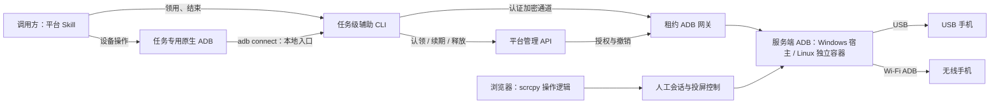
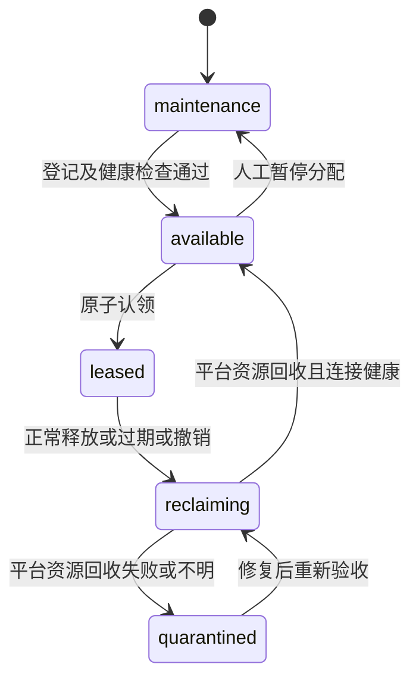

# DroidHarbor：开发目标、技术选型与首版边界

状态：首版持续实施与真机验收，OpenSpec 已完成 **70/93** 项；本轮功能验收通过，发布收尾中，首版完整矩阵仍在推进。
本文记录当前开发目标、已确认架构和首版边界；实施合同与逐项进度见 [OpenSpec 设计](../openspec/changes/build-droidharbor-v1/design.md)及[任务清单](../openspec/changes/build-droidharbor-v1/tasks.md)，操作与验证证据见[开发运行](开发运行.md)。

## 1. 项目定位与依据

DroidHarbor 是供不同机器上的 AI 任务共享使用的 Android 真机设备池，同时提供浏览器工作台。初期约 3 台、未来最多约 10 台；手机通过 USB 或 Wi-Fi ADB 接入。服务端支持 Windows 原生及 Linux Docker，内网/VPN 访问；本轮浏览器范围为桌面 Chrome/Edge。人工入口统一网页，Windows 前台试用直接双击内嵌网页的控制台 EXE。

核心场景：调用方安装平台配套 Skill，声明所需账号环境标签；平台原子认领匹配设备，提供绑定本次任务租约的远程 ADB 入口。每次认领/显式续租有效 15 分钟，续租次数和任务累计时长不限。结束、到期或服务重启后，平台撤销旧访问并回收自身资源，连接健康后重新分配；保留手机应用及账号状态，不保证手机后台程序停止。用户可以同时从浏览器查看并按 scrcpy 的习惯操作，不自动释放或暂停 AI 租约。

依据与优先级：

1. 当前要求：独立重写，不复制 WebAppFlaskscrcpy 应用代码；手机支持 USB/Wi-Fi 接入；平台向调用方暴露受租约约束的远程 ADB；交付平台配套操作 Skill；网页操作对齐 scrcpy；Appium、uiautomator2 仅预留接口；前端采用指定 frontend-library skill，使用 OpenSpec。
2. [需求依据](../ref/需求&选型.md)：设备规模、任务租约、标签调度、网页人工入口及可调画质；已同步本次确认内容。
3. 参考项目和上游文档：用于验证可复用技术及识别风险，不把其全部功能自动加入首版。

用户已实际使用参考项目并确认不满足要求，因此直接独立重写，不再安排参考项目试用或以其为底座的评估。新项目仍需完成自身的真机、交互、异常恢复和性能验收，不承诺兼容参考项目的 URL、数据库或前端数据格式。

### 1.1 已确认与未确认

| 类别 | 内容 |
| --- | --- |
| 已确认技术 | Go 后端与 Go CLI；Pion WebRTC；SQLite；Windows 原生/Linux Docker 服务端；Linux 使用 Compose 分别部署平台与 ADB；Windows/Linux 调用方，不限制 harness；frontend-library；OpenSpec |
| 已确认业务边界 | 约 3–10 台；USB/Wi-Fi；标签分配；15 分钟显式续租且无累计上限；重启旧租约失效；只回收平台资源；内网/VPN；指定浏览器；第 5 节首版功能包；不含音频/录屏；Appium/uiautomator2 仅预留 |
| 已确认画质 | 新设备默认长边 1920、60 fps、12 Mbps；网页帧率/码率独立下拉，长边为后端策略；保持比例、同设备共享采集；性能先测量再定门槛 |
| 已有约束 | 当前手机在 WinServer；不得分配错账号环境；协议网关强制约束旧任务访问；人工入口统一网页，不承担 eScrcpy 共存兼容 |
| 工程合同 | 已批准 OpenSpec 设计和 SQLite schema；本轮明确批准 schema 2 显示资料迁移与 B 档短保活，保留已有登记、标签及配置 |
| 未完成证据 | Edge 完整矩阵、目标宿主重启、USB 授权/热插拔、无线配对失效、APK、VPN、容量和长稳；本机双机切换首帧已有小样本，以未勾选 OpenSpec 任务为准 |

## 2. 开发目标与不可破坏的约束

### 2.1 开发目标

- **自动领用正确环境**：任务声明标签，服务端分配匹配且确实可用的手机；用户不用逐任务选机。
- **租约真实生效**：同一设备最多存在一个有效 AI 任务租约；认领、续期、释放、超时与重启行为可解释、可验证。
- **实时人工入口**：浏览器使用 scrcpy 的操作语义与实时投屏，不用连续截图或自创按钮操作流程代替直接控制。
- **适合小规模常驻**：不引入与十台规模不相称的集群、消息队列和多层服务；无人打开画面时不持续维持无用视频流。
- **独立、可维护**：复用 ADB、scrcpy-server、成熟媒体库和 UI 组件；不移植参考项目的 Flask/Vue 实现，也不自己重写 USB 驱动或视频编码器。
- **原生 ADB 与配套 Skill**：管理 API 管租约，租约 ADB 入口承载设备操作，Skill 管使用流程；Appium/uiautomator2 当前只保留扩展合同，不部署或验收其运行环境。

### 2.2 强制约束

1. 身份包含调用方和任务，不能把“共用一个 AI 账号”当成任务隔离。任务名本身不是凭证。
2. 租约到期立即拒绝新的 AI 操作，不依赖后台定时清理是否及时运行。
3. 既有 ADB transport、其内部 shell/sync 等子流、待派发数据及重新连接都属于撤销范围，不能只在建连接或 HTTP 入口检查一次。
4. 离线、未授权、回收中、回收失败、人工维护中的设备不得被分配。
5. 标签描述用途和已配置的账号环境，不保存密码，也不能证明账号此刻仍登录有效；人工需能暂停分配并修正标签。
6. 浏览器和 AI 不得得到无约束的服务端 ADB Server 代理；人工操作走网页授权会话，AI 操作走租约入口。
7. 回收只撤销任务连接及平台拥有的资源；不清应用数据、不退出账号、不恢复出厂、不主动停止用户应用或任意手机后台程序。平台保证访问撤销，不保证整机任务副作用清零。
8. 人工操作默认不修改 AI 租约，也不承诺 AI 自动暂停；若用户需要独占接管，应另行确认暂停协议。

## 3. 参考项目的借鉴范围与性能判断

参考源码核查基线：WebAppFlaskscrcpy `9feaceac170cff4c0c82f3db3981137bea0f8ae9`。

| 可以借鉴的流程 | 本项目必须重新设计的部分 |
| --- | --- |
| 设备发现、投屏启动与结束、浏览器触控 | 按标签选择与原子认领，不让客户端先挑设备再抢占 |
| 多浏览器接收画面、连接恢复 | 任务身份、租约版本和在途操作撤销 |
| 占用到期后关闭相关连接 | 平台资源回收、清理失败隔离及重启恢复；不假定应用副作用已经消除 |
| 文件、shell 和设备操作的组织方式 | 所有 AI 路径统一执行授权，不留终端或原生 ADB 绕过入口 |
| 服务端集中管理 ADB/scrcpy 生命周期 | 区分 AI 租约、人工会话与共享采集资源，避免清理一个任务时影响其他有效会话 |

**性能证据不能简化成“Python 会转码，所以改 Go”。** 用户报告参考项目存在性能瓶颈；当前公开源码的 `ScrcpyVideoTrack` 接收 H.264 压缩数据，以 `av.Packet` 交给 aiortc 打包发送，并非视频主链路解码再编码。scrcpy core 在存在图像监听者时另做解码，但在该判断之前仍进行 `codec.parse`。

[INFERENCE] 跨线程投递、Python 对象与包处理、每观看端排队、截图解码、设备端编码及浏览器解码都可能影响资源与时延；没有 profiler 和同机基准，不能断言其中哪个是实际瓶颈，更不能给出语言切换后的性能倍数。

新项目的结构目标：手机端编码，服务端只做必要的协议解析、分包、鉴权和转发，浏览器解码；截图按需获取，不为了随时截图维持服务端全量视频解码。慢观看端必须使用有界缓冲，丢帧后在可解码关键帧处恢复，不能无限堆积或随机丢掉参考帧后继续假装正常播放。

## 4. 后端与媒体技术选型

### 4.1 已确认的技术路线

后端与任务级辅助 CLI 均使用 **Go**，浏览器投屏使用 **Pion WebRTC**。前端继续遵循指定的 React/TypeScript 组件体系；Node.js 用于前端构建和 OpenSpec 工具，不作为设备服务或辅助 CLI 的生产运行环境。

| 部分 | 已确认方向 | 选择依据与代价 |
| --- | --- | --- |
| 平台后端 | Go | 适合常驻连接、ADB 网关及二进制数据处理；需管理并发、背压与撤销，语言本身不保证正确性 |
| 调用方 CLI | Go 可执行程序，支持 Windows/Linux，不限制 harness | 通过标准命令与机器可读结果接入，不依赖 Python/Node 或特定 harness 插件；仍需提供或验证兼容的原生 ADB |
| 浏览器视频 | 手机 H.264 → Pion RTP/WebRTC → 浏览器 video | 服务端不持续解码转码；需处理时间戳、参数集、关键帧、慢观看端和连接恢复 |
| 设备协议 | 官方 ADB 与配套版本 scrcpy-server | Pion 不负责连接手机或实现 scrcpy；需要维护 ADB 网关与 scrcpy 协议适配 |
| 网络与浏览器 | WebRTC 能力与目标环境逐项验收 | 媒体端口和可能的 TURN 由部署范围决定，不能因使用 WebRTC 就承诺任意网络可用 |

该选择基于常驻服务、可执行文件分发及媒体生态，不以“换 Go”作为性能验收。资源、延迟、异常恢复仍按第 8 节实测。

租约 ADB 网关是首版核心能力。“能连接 ADB Server 的客户端库”不等于“能供原生 adb connect 连接的服务端”；当前已实现并完成 Windows/Linux 官方 ADB 纵向验收，真机与完整部署矩阵仍分别跟踪。

### 4.2 组件与确认状态

Go、Pion、SQLite、部署/访问范围和现有 OpenSpec 工程设计均已确认；具体表结构与约束见已批准 schema，后续变更另行确认。

| 层次 | 选择或建议 | 边界 |
| --- | --- | --- |
| 后端 | Go 单服务（已确认）；HTTP 层使用标准库 net/http 的工程提案 | 同一进程提供网页、API、租约网关与投屏，内部模块分工，不拆业务微服务 |
| 辅助 CLI | Go（已确认），调用方支持 Windows/Linux | 按任务启动，管理租约及认证通道；不依赖特定 harness 的结束钩子或内部会话协议 |
| WebRTC | Pion WebRTC（已确认）；v4 为当前组件建议 | H.264 直通；首版不依赖 FFmpeg 常驻转码 |
| Android | 官方 platform-tools ADB + 官方 scrcpy-server | Windows 使用宿主 ADB，Linux 使用独立 ADB 容器；同一 USB 设备只由一个服务端 ADB 实例接入；锁定 scrcpy 协议版本 |
| 数据 | SQLite（已确认），本地持久化存储 | 保存设备配置、身份、租约和必要记录，不存视频；现有 schema 见 OpenSpec 设计 |
| 管理 API | HTTP JSON + OpenAPI 3.1 | 负责标签、身份、租约和 ADB 连接信息；不为 AI 重建一套与原生 ADB 重复的操作 API |
| AI 数据入口 | 任务级辅助 CLI + 认证加密通道 + 租约 ADB 网关（已确认） | 原生 adb 连接辅助 CLI 的本地入口；不直接开放宿主 5037；生命周期边界见 D2 |
| 实时状态 | SSE（工程提案） | 设备、租约、回收状态；断线取权威快照，不与视频/ADB 数据共用无边界队列 |
| 浏览器控制 | 会话绑定的 WebRTC DataChannel | 离散按键/触控边界需可靠有序，移动事件可合并，不能让丢失 UP 造成持续触摸 |
| 文件传输 | AI 使用 ADB sync；人工会话保留后端 HTTP 传输接口，网页移除文件入口 | 两者均绑定授权，保留进度、取消、错误及覆盖语义，不通过 DataChannel 传文件 |
| 部署 | Windows 原生及 Linux 双容器（已确认）；Go 同一服务提供静态前端、API、网关和投屏 | Linux 分别运行平台与 ADB；两种方式均验收 USB/Wi-Fi、持久化、自启动与媒体可达性 |

SQLite 适合单宿主、小规模元数据和事务认领，不代表它负责实时视频。后续如改为多服务副本共同写入，则需重新评审存储与租约协调；仅仅把 SQLite 换成 PostgreSQL 不会自动获得分布式正确性。现在不为未确定的集群引入外部数据库。

### 4.3 前端方向

用户已指定 frontend-library skill，按其规范组合 React、TypeScript、shadcn/ui Nova、Tailwind CSS、Lucide。建议使用 Vite 构建 SPA：本项目不是 SEO 内容站，不需要仅为设备工作台引入 SSR。

- 设备池页：整张设备卡片点击即进入工作台，管理按钮独立；显示用途标签、在线/授权状态、任务占用、回收结果及默认每 5 秒更新的共享截图小图。
- 单设备工作台：画面是主体，左侧带预览的设备列表用于直接切换，不用下拉框；必要操作入口靠近画面。独立小窗仅放手机画面和底部一排按钮，不堆叠管理信息或可展开面板。
- 管理页：设备标签、启停分配、任务访问凭证、租约与回收记录；不扩展成企业权限平台。
- 窄屏采用单设备视图，不把桌面多面板机械压缩。视觉与布局需下一阶段原型确认，本文件不选具体配色。
- Zustand 仅用于确有跨组件需求的客户端状态；服务端状态推荐由 TanStack Query 管理，不再复制成第二份可写的租约状态。
- Motion、Resizable、dnd-kit 按实际交互需要安装；首版没有设备排序需求就不引入拖拽。
- 不照搬参考项目 Vue 页面；也不以“自己写更简单”为由重写成熟通用控件。视频播放和设备坐标映射是业务能力，不是重写通用按钮或弹窗的许可。

## 5. 首版范围

本表功能包及排除项已确认；工程设计不得自行增加音频、录屏、群控、应用仓库、MCP 或完整权限管理后台。

| 能力 | V1 交付范围 | 不在 V1 |
| --- | --- | --- |
| 设备接入 | Windows 原生/Linux Docker；USB/Wi-Fi ADB；管理员登记/授权/必要配对；掉线与重连；同机去重；常驻恢复 | 多宿主统一调度；不以自动换链路隐藏断连 |
| 标签 | 人工维护用途/账号环境标签、全部所需标签匹配、暂停分配 | 自动登录、账号密码托管、自动判定平台登录有效性 |
| AI 租约 | 任务身份、原子认领、15 分钟显式续租、释放、到期；无累计时长/续租次数限制；重启旧租约失效 | 自动续租窗口、等待队列、预约日历、优先级抢占、跨设备原子批量认领 |
| AI 操作 | 通过租约 ADB 入口使用原生 shell、exec-out、push/pull，完成截图、点击、滑动、输入等操作 | 无约束 ADB Server；Appium/uiautomator2 当前不实现、不做兼容承诺 |
| AI 使用入口 | 平台随版本交付操作 Skill 与必要辅助工具，组织管理 API、ADB 连接、续期、使用和释放 | 首版 MCP Server、多语言 SDK、可视化自动化编排 |
| 人工入口 | 统一网页入口；工作台内切换设备；独立小页面；按 scrcpy 操作语义控制；独立人工授权；保持 AI 租约不变 | eScrcpy 入口及共存兼容；Document PiP/强制置顶；自动暂停/恢复外部 AI、多人工控制仲裁扩展 |
| 画面 | 可拖宽的大预览设备列表；单台实时交互；每设备共享采集；帧率/码率下拉；长边后端策略；B 档仅最近一台空闲采集最多短留十五秒 | 音频、录屏、直播分享、多机语义/坐标同步群控 |
| 运维 | 基本健康状态、结构化日志、租约与回收记录、备份恢复说明 | 完整监控平台、多租户计费、集群高可用 |
| 应用管理 | 原生 ADB 或后端传输能力执行文件推送和 APK 安装，保留真实结果；网页工作台聚焦画面、画质和剪贴板 | 独立 APK 仓库、完整应用商店、复杂 Logcat 工作台 |
| 身份管理 | 管理员访问令牌登录、可退出/轮换的网页会话；可撤销 AI 调用凭证及任务独立授权 | 账号密码登录、公共注册、组织架构、SSO、完整 RBAC 后台 |
| 回收 | 撤销旧任务访问，清理平台拥有的连接/转发/会话等资源；健康检查后回池 | 不停止用户应用或任意后台程序，不清账号数据；平台资源清理失败仍隔离 |
| 访问与浏览器 | 内网/VPN；桌面 Chrome/Edge | 公网直接访问；移动端、Safari/Firefox 不纳入本轮兼容承诺 |

AI 通过原生 ADB 操作手机，不等于获得服务端 ADB 管理权。kill-server、transport 选择及手机无线调试配置由平台管理，网关只能映射当前租约对应设备。原生 ADB 服务集合和可转发通道应显式声明，不能用“原生”暗示所有工具和服务已兼容。

Unicode 文本输入、长按、拖动、横竖屏坐标及文件覆盖行为必须明确；不能把只支持英文输入的实现验收为通用文本输入。原生 ADB 的流式行为不能伪装成平台能精确识别每条 shell 命令的副作用。

### 5.1 两段独立的 ADB 连接



手机无线接入与调用方远程连接是两回事：USB 手机也能通过平台远程 ADB 使用，调用方不直连手机的 IP/端口。

- 平台支持登记已开启 TCP/IP ADB 的设备，并处理支持无线调试配对的 Android 设备；配对授权是管理员动作，不由每个 AI 任务重复执行。具体 Android/platform-tools 版本进入兼容矩阵。
- 已登记设备由平台维护连接；配对撤销、地址或端口变化需正确反馈，不能把无线 ADB 永久在线当成承诺。
- 同一手机同时出现在 USB 和 Wi-Fi 时只对应一个池设备和一份租约。无法确认是否同机时不得自动当作两台可用设备；地址也不能作为永久设备身份。
- 不默认 USB 断开就切 Wi-Fi，或无线失败就切 USB。切换必须使旧 transport 失效、重新确认设备身份和状态，不能沿用旧连接假装操作成功；自动切换不是本次已确认需求。
- 手机原始无线 ADB 地址不得成为调用方绕过平台的备用入口。若调用方网络上仍可直接访问并已获授权，平台无法阻止该旁路；设备网络与任务入口隔离属于部署约束。

### 5.2 平台配套操作 Skill

产品 Skill 随客户端包交付，与开发使用的 frontend-library/OpenSpec skills 分离；已用 Windows/Linux 官方 ADB 验证任务闭环，并根据 9R 实际应用操作完善指引。

1. 配置平台地址和调用凭证，查询 API/ADB 能力；不将账号密码或长期凭证写入任务记录。
2. 使用任务身份、所需标签和幂等键认领设备，取得 leaseId、到期时间和租约连接描述。
3. Skill 启动本任务的辅助 CLI，由其建立认证加密通道，并配置任务专用的本地 ADB Server 和入口；原生 adb 连接本地入口，所有操作显式选择本租约目标，不依赖默认 ADB Server 或“恰好只有一台设备”。
4. 在有效租约内执行截图、shell、触控、文本及文件操作。Skill 指导调用方主动续租；每次以服务端当前时间为基准授予未来 15 分钟，不叠加囤积租期。CLI 不自行续租，次数和任务累计时长不限；长操作期间也必须显式续租，具体规则见 D6。
5. 续期失败、撤销或断连时停止派发新操作，查询权威状态；不自动重放点击等可能产生重复副作用的命令，也不自动换手机或重新认领掩盖失败。
6. 正常结束时释放租约并清理本任务本地连接资源；异常退出仍由服务端 TTL 和撤销保证旧入口失效。Skill 不保证设备后台任务已终止。
7. Skill、辅助程序和平台声明兼容版本。服务端不信任“已按 Skill 执行”的自述，绕过 Skill 直接调用 adb 也必须受同样的租约约束。

#### 已确认的辅助 CLI 边界

- 随产品 Skill 交付 Windows/Linux 的 Go 可执行程序，按任务启动、按任务清理，不做全局常驻守护服务，不安装到手机上；仍需兼容的原生 ADB。
- CLI 仅负责租约管理、连接环境和 ADB 二进制数据传输，不另造截图/点击协议，不理解全部 shell 命令语义，不参与浏览器视频编解码。
- 本地入口仅监听 loopback；每个任务使用独立 ADB Server 实例、配置和资源归属，只清理本任务资源，不影响调用方其他 ADB 工作。
- loopback、不同端口和不同进程用于避免误用，不是操作系统安全隔离。若任务可以读取彼此凭证或访问彼此端口，对抗恶意跨任务访问需要运行环境提供独立用户、容器或同等权限边界，不能宣称 CLI 已提供。
- 平台通道认证绑定任务、租约及代次；服务端持续执行过期和撤销，不能只依赖 CLI 主动断开。本地端口不是可复用的长期设备身份。
- 通道使用 WebSocket 二进制消息，由任务认证和租约授权约束；应用原生提供 HTTP/WS，配置直接读取 `.env`，不承担 TLS、证书或域名。明文运行于可信内网/隔离网络，保持有界缓冲和背压，不转 JSON/Base64，不自创加密协议。
- 不后台自动升级；客户端、平台和 ADB 版本声明兼容范围，建连时检查能力，不兼容直接失败。Windows/Linux 均为首版调用方支持范围，具体系统版本和架构矩阵在发布设计中列明。
- 不自动换设备、不重放设备操作、不以无限重连或续租掩盖任务失败。断线时可能已有操作执行，应报告中断或结果未知。
- 不限制 harness：通过标准 CLI、退出码和机器可读结果接入，Skill 不绑定专用工具调用协议、插件、父进程名称或结束钩子；不原生加载 Skill 的 harness 仍可按同一说明执行命令，不另建控制路径。
- 平台不承诺自动识别 AI 任务结束。正常结束由调用方显式释放，未释放时依靠服务端有限租期撤销访问；CLI 残留、连接保活、ADB 有流量都不能单独证明任务仍需占用。续租政策见 D6。
- 未来 Appium/uiautomator2 应接入同一任务连接环境；所需转发和设备端服务另做兼容验收，不开放第二条绕过租约的路径。

### 5.3 网页与 scrcpy 的操作一致性

以 scrcpy 默认 SDK 控制模式为交互基准，不照搬其桌面窗口，也不将“操作一致”扩大成首版覆盖全部桌面驱动、音视频和虚拟显示功能。

| 操作 | 网页目标行为 |
| --- | --- |
| 鼠标/触摸 | 左键或单指点击、长按、持续拖动、滑动、滚轮；按真实画面尺寸与旋转映射坐标，不把拖动拆成重复点击 |
| 次级鼠标键 | 右键在屏幕关闭时唤醒，否则 BACK；中键 HOME；第 4 键最近任务，第 5 键通知栏；Shift 修饰后的行为按 scrcpy SDK 模式处理 |
| 键盘 | 输入、按下/抬起、组合键以及 Home/Back/最近任务/音量/电源；手机应用处理普通 Ctrl 组合键，不把 Ctrl+C 一律改成网页复制 |
| 多指模拟 | Ctrl + 拖动模拟缩放/旋转，Shift 及 Ctrl+Shift + 拖动按 scrcpy 语义模拟双指滑动；手机端是否响应由当前应用决定 |
| 剪贴板 | 聚焦画面直接 Ctrl+V，中文按手机实际输入验收；按设备保留当前页面内存历史最多 20 条；手机变化只给控制会话，不自动写电脑剪贴板 |
| 文件与 APK | 使用原生 ADB 或后端传输 API；工作台保持常驻画质与剪贴板，不设文件面板 |
| 显示与设备动作 | 显示旋转/翻转、暂停/恢复、重置采集、手机旋转、息屏投屏、通知/设置面板；区分网页显示与手机动作，操作栏贴着矩形画面竖排 |
| 只读会话 | 服务端拒绝设备写操作和共享画质修改；界面禁用控制，不主动接收新手机剪贴板内容 |
| 焦点和断连 | 离开画面、失去焦点或断连时结束未完成的触摸/按键状态，避免卡住长按；不向重连后的新会话重放旧输入 |

浏览器可能截获系统组合键或额外鼠标键，差异按桌面浏览器实际验收记录。Ctrl+V 使用原生粘贴事件，不要求 HTTPS 系统剪贴板 API。手机旋转沿用 Android 应用/系统方向策略；命令发出但方向未改变时明确提示，不擅自关闭自动旋转或强制覆盖应用策略。网页显示旋转独立完成输入逆变换。

### 5.4 已确认的网页画质控制

网页常驻帧率与码率两个独立下拉：30/60/90/120 fps、4/8/12/20/40 Mbps。长边上限保留为后端策略，默认 1920；已有设备参数不自动改写，新设备通过登记业务设置 60 fps/12 Mbps，不修改现有 schema。请求值不是实际编码性能保证。

| 参数 | 首次使用默认值 | 行为 |
| --- | --- | --- |
| 分辨率 | 长边上限 1920 像素 | 按手机当前画面比例等比缩放，不拉伸、不裁切；旋转后同步更新画面尺寸与输入坐标映射 |
| 帧率 | 上限 60 fps | 独立调整，不保证静止画面或性能不足设备始终达到上限 |
| 编码码率 | 目标 12 Mbps | 独立调整，不表示含协议、重传开销在内的绝对网络限速 |

例如手机画面为 1080×2400，长边限制为 1920 时对应 864×1920。实际输出尺寸受原画面与编码器支持约束，界面应显示实际尺寸；不能通过 CSS 拉伸或裁切来伪装满足比例。ADB 原生截图不因网页投屏参数而降分辨率。

同一设备的全部网页观看者共享一份采集流和设备级画质配置。修改前明确作用范围，生效后各观看者看到一致的实际参数；不为每个浏览器额外创建独立编码流，也不在服务端转码适配。参数调整不修改 AI 租约。

调整需要重建采集时，允许短暂重新出画面，但必须明确显示切换状态；输入坐标使用新画面的尺寸与方向，不向新会话重放旧触控。不能在失败时报告新参数已生效，或未经确认静默降档。

### 5.5 已确认的预览、切换和小页面

- **列表预览**：设备池可见时默认每五秒共享截图，新图解码后替换，失败保留同链路旧图及原拍摄时间并统一通知。工作台不轮询截图，当前小图最多每秒四次取自主视频；离开前同步保留最新已呈现帧，后台冻结，重连不显示加载中或回退观看前截图。侧栏不显示拍摄时间；断连、链路更换和授权失效清除失效资料，原始截图及 AI 租约独立。
- **切换设备**：侧栏、拖动布局及当前/候补视频节点稳定挂载。离开立即隐藏该设备并释放输入、取消旧操作作用域，完整保留它的采集、WebRTC、轨道与解码器十五秒；期限内切回直接显示同设备原流，核验原权限及当前呈现帧后恢复控制。冷目标按保存比例占位等待实际画面，不用其他设备或旧截图冒充。
- **切换交接**：全平台一个后台候补连接，已有目标按精确 sessionId 转入短交接占位，再保留离开窗口；所有保留计入媒体容量，沿用原十五秒期限。前端每页最多当前加一个候补；服务器独立计时，超时、淘汰、关闭、退出、撤权、断连、失败或停服务回收，不自动重放操作，旧 HTTP 作用域不能因恢复同一视频连接复活。
- **独立小窗**：单设备矩形画面和贴屏竖栏，不含列表、详情、模式切换及右侧工具。每窗独立持有人工作用域并共享采集，不依赖 opener；主页面关闭/切换不影响它，显式退出撤销同一登录关联窗口授权，URL 不放秘密。
- **窗口尺寸**：按授权核验时保存的屏幕信息或较新的视频观测预布局，首次按可用高度推算宽度，浏览器边框在解码前校准；保留三档尺寸与手动缩放，视频方向变化使用实时尺寸校正，不因首帧解码再改同尺寸窗口。实际尺寸核对失败明确提示，不持续回弹用户手调。
- **显示资料**：schema 2 保存主屏逻辑宽高/方向与最近实际视频几何，旧设备上线补采，原登记和标签保留。几何缓存仅用于布局，不授予输入；截图预览缓存仍为有界临时内存，资源开销纳入后续测量。
- **桌面布局与主题**：导航竖排左置；侧栏宽度可拖动、选中设备高亮、未连接设备置底置灰。操作栏紧贴视频左边，画质/剪贴板常驻右侧；使用浅色/深色/系统主题背景，视频保留原始矩形及黑色像素。只读/控制为互斥 button group，工作台不展示管理员身份徽标、右侧当前设备详情或全屏入口。


## 6. 租约、人工介入与回收

### 6.1 连接、底层调度状态与页面会话分别呈现

- 连接状态：online、offline、unauthorized。
- 底层调度字段 `allocationState`：available、leased、reclaiming、quarantined、maintenance；保留完整回收与健康状态。
- 网页分配图标：leased 为“已分配”，其余为“未分配”；维护、回收和隔离另用图标表示，不能把未分配等同于可认领。
- 视频状态：仅表示当前页面的人工作用域，连接中、等待画面、就绪、关闭或失败，不代表其他设备或其他窗口。

认领条件仍为连接健康且 allocationState=available、标签/能力匹配。人工观看或控制不认领、续期或释放 AI 租约；重新连接也不代表旧任务资源已回收。



图为建议的分配状态模型，不是数据库 schema。正在占用的设备进入维护时，要先走显式撤销/回收流程，不能直接改状态后绕过清理。

### 6.2 任务隔离与撤销顺序

1. 持久化原子认领结果，返回 deviceId、leaseId、失效时间和受限租约凭证。按标签查询与占用必须在一个协调边界内完成。
2. AI 的 ADB transport 及其全部子流绑定当前任务租约和递增的 generation（占用代次），不是每条原生 adb 命令都能额外携带 HTTP token。辅助 CLI 配置任务专用 ADB 实例与凭证，避免共享默认连接导致误用；对具有相同系统权限的恶意任务，仍需调用方运行环境提供隔离。
3. 建连接、打开服务子流及数据实际派发时，网关持续执行租约状态和代次约束。租约检查与派发有确定先后关系，不能只握手鉴权一次；平台不承诺理解 shell 字节流中每条命令的业务语义。
4. 释放/到期先使旧代次失效，再拒绝重连、关闭旧 transport 及全部子流、清空待派发数据，并回收本任务的平台资源。已发送至 Android 的动作不能撤回；用户已选择保留应用运行状态，不保证这些动作或后台程序停止。
5. 平台资源回收确认前保持 reclaiming；回收失败或无法确认则 quarantined，拒绝新认领。回收完成且设备连接健康后可回池；available 不表示应用状态已重置或后台程序已终止。
6. 服务重启后所有旧租约失效，即使原到期时间尚未到达也不得恢复。先核对持久状态、撤销旧入口并回收平台拥有的残留资源，再开放分配；数据库恢复或连接重建不得复活旧租约。

认领请求重发使用幂等键关联同一结果，防止丢失 HTTP 响应后再占一台手机。点击、付款、发消息等非幂等操作不能自动重放；响应丢失时返回结果未知并让调用方核对设备，而不是盲目重试。

### 6.3 已确认的回收范围：平台资源，不重置应用

首版保留手机应用、登录账号、文件和后台运行状态，只回收本任务在平台内的访问权及平台拥有的资源。该政策适用于正常释放、到期、撤销和服务重启后的回收。

- 回收对象：任务 ADB transport/子流、待派发数据、平台创建且归属该任务的转发或会话，以及不再使用的平台自有采集资源。共享资源按实际使用者清理，不影响独立人工会话。
- 不主动执行应用 force-stop、清数据、退出账号、删除任务业务文件、重启手机或终止任意用户后台程序；平台自有进程的定向清理不等于清理用户应用。
- 平台资源已回收、旧访问确实失效、设备连接正常且不在维护状态，即可重新分配；不把“确认任意后台程序均已停止”作为回池条件。
- 平台资源清理失败、归属不明或旧访问无法确认失效时隔离设备；离线/未授权不参与分配。单纯存在用户后台程序不触发隔离。
- 旧任务已在手机上启动的程序或已交给 Android 的动作可能继续执行，甚至影响下一任务；这是已确认的状态保留策略，不对外宣称设备执行环境隔离或副作用清零。

Skill 要求下一任务先观察当前手机状态再操作，不假定手机回到桌面、应用已关闭或页面已复位。未来若需要应用级复位或后台任务清理，另行评审，不加入隐式清理脚本。

### 6.4 网页人工入口与资源归属

浏览器查看与控制使用人工会话，不冒充 AI 租约。AI 到期只撤销该任务的资源，不应无条件杀掉独立人工观看连接。人工正在操作时可以显示明确状态，但不会自动暂停 AI。

不交付 eScrcpy 入口，不承担其共存、版本或部署兼容验收；本次范围调整不授权卸载或修改用户现有软件。平台也不宣称能阻止具有宿主或手机管理权限的程序直接操作设备。

AI 连接、网页会话和设备级共享采集须有明确资源归属；关闭一个任务或观看者只清理其资源，不执行全局 kill-server 或删除全部 forward 代替定向回收。Linux 平台容器更新不应要求同时重启独立 ADB 容器。

## 7. 需要保留的兼容接口

保留的是领域边界、版本和可验证合同，不是预建空接口、插件框架或备用实现。Go、Pion、SQLite、辅助 CLI、固定 15 分钟显式续租、平台资源回收及部署访问范围均已确认；现有 schema 已批准，后续变更另行确认。Appium/uiautomator2 仅预留。

| 边界 | 首版必须稳定的语义 | 为后续保留什么；现在不做什么 |
| --- | --- | --- |
| 设备标识 | 稳定 deviceId；USB serial、无线地址、当前 transport 是内部映射；同一手机多链路不重复分配 | 可增加宿主归属，但首版不开放跨宿主调度 |
| 身份/租约 | caller、task、lease、generation、expiry 分开；所有关联 transport/子流同生共灭 | UI、Skill、未来 Appium/uiautomator2 复用同一租约边界 |
| ADB 连接描述 | leaseId、设备身份、有效期、连接方式、认证参数及支持的服务能力 | 不把固定端口当设备身份；允许替换网关内部实现，不暴露宿主管理接口 |
| 执行结果 | 原生 shell 的 stdout/stderr/退出码、文件协议结果按协商能力保留；取消连接不等于撤销副作用 | 不承诺给任意原生 ADB 命令分配平台 operationId 或解析全部语义 |
| 设备适配 | USB/Wi-Fi 发现、授权/配对、重连、shell、文件、截图及资源清理 | 隔离平台差异，不首版承诺所有 ADB 协议服务 |
| 投屏适配 | 打开/关闭、codec/实际尺寸/方向、会话 epoch、观看及输入授权；设备级画质读取/修改，分辨率/帧率/码率独立 | 所有网页观看者共享实际配置；协议支持能力与实际生效结果，不将 scrcpy 字节协议直接作为公开 API |
| 回收 | 原因、平台资源归属、访问撤销与资源清理结果、健康检查、失败原因 | 未来可评审应用级清理；首版不检查任意后台任务是否结束，不实现清理脚本插件 |
| 人工介入 | 人工会话与 AI 租约独立，有明确操作身份 | 可扩展暂停/恢复事件，但当前不发出假的“AI 已暂停”状态 |
| 客户端能力 | API major、ADB 服务及设备能力可查询；Skill 声明兼容版本 | Appium/uiautomator2 的服务集合、端口映射、设备端进程和回收约定可扩展；当前不启动相关服务或报告兼容 |

### 7.1 API 轮廓

建议统一 `/api/v1`；不兼容变化使用新的 major，新增可选字段保持向后兼容。客户端忽略未知字段，对不支持的必要能力明确报错。

| 功能 | 建议入口 | 关键合同 |
| --- | --- | --- |
| 能力发现 | `GET /api/v1/capabilities` | API、ADB 服务、认证及媒体能力；不泄露无权访问的设备信息 |
| 设备列表 | `GET /api/v1/devices` | 管理和展示，不代替服务端原子选机 |
| 认领 | `POST /api/v1/leases` | taskId、requiredTags、幂等键；全部标签匹配；固定有效期 15 分钟，返回 expiresAt，不由调用方选择任意 ttl |
| 续期 | `POST /api/v1/leases/{id}/renew` | 仅有效租约持有者；expiresAt = 服务端本次续租时间 + 15 分钟；不叠加、不限次数/累计时长；过期租约不能复活 |
| 释放 | `DELETE /api/v1/leases/{id}` | 幂等撤销；允许返回回收中并给出查询状态，不伪报 available |
| 租约 ADB 连接 | `POST /api/v1/leases/{id}/connections` | 验证当前任务身份，返回 CLI 建立认证通道所需的连接描述；本地 ADB 入口由 CLI 管理，不返回无约束宿主管理端口 |
| 连接查询/关闭 | 租约范围内的 connection 查询/关闭接口 | 只能管理本任务连接；关闭一个连接不等于释放租约或完成设备回收 |
| 人工观看/操作 | `POST /api/v1/devices/{id}/sessions` | 人工授权；返回 sessionId、媒体协商信息，不修改 AI 租约 |
| 事件 | `GET /api/v1/events` | eventId、类型、设备/租约标识、时间及状态版本；无权订阅的内容不推送 |

事件通道首版不必承诺永久重放；断线或版本缺口时读取权威状态快照。事件不是数据库的替代来源。

错误至少区分：没有匹配且可用设备、设备离线/未授权、租约过期/撤销、任务不匹配、回收未完成、操作不支持、操作结果未知。不得将这些状态统一包装成“成功但空数据”。具体 HTTP 状态与错误字段由 API 设计统一确定。

### 7.2 原生 ADB 首版合同与未来工具兼容

调用方的原生 adb 连接任务辅助 CLI 的 loopback 入口，由 CLI 经认证加密通道访问平台租约网关，这是首版已确认路线。`adb -H/-P` 访问 ADB Server 的 smart socket 与 `adb connect` 访问设备侧协议不同；任务专用 ADB Server 和本地设备入口也使用不同端口，不能混用。

- 租约入口只映射一台已认领手机；需完成原生 ADB 握手、能力协商及指定设备服务的桥接，不是简单 TCP 转发服务端 ADB Server。
- 首版覆盖 shell/exec-out、文件 sync 及所需设备信息能力，使截图、输入和文件操作可通过原生 adb 完成。具体命令矩阵和协议版本在实现前列明，不声明无限兼容。
- 认证绑定任务租约；随机端口不能代替平台认证，旧任务凭证和密钥不能直接认证新任务网关。首版将共享调用机视为可信环境，不提供本机任务沙箱；原生 ADB Server 不认证本地命令来自哪个任务，因此不承诺旧命令在端口复用后绝不借用新 Server 的授权。不互信任务需要调用方提供独立网络环境，不能仅更换 OS 用户。
- 撤销既影响新连接，也影响已建立的 shell、文件及其他子流。若未来支持 forward/reverse，所有转发与派生连接也必须登记归属并一并撤销，不能形成永久旁路。
- 通用 shell 可以启动后台服务，网关关闭本身不能消除副作用；不以命令字符串过滤声称实现完整沙箱。回收政策和可访问设备网络共同决定强制边界。
- Appium、uiautomator2 仅预留连接提供者、能力声明、必要端口映射以及设备端服务启动/停止/回收的扩展合同；当前不部署 Appium Server、不安装自动化 agent、不实现定位器 API、不做其兼容验收，也不对外发布空实现接口。

### 7.3 scrcpy 协议版本

上游明确说明 scrcpy client/server 内部协议没有跨版本兼容承诺。DroidHarbor 锁定配套 server 与适配器版本，升级通过真机与媒体验收；不依赖其他桌面控制软件附带的 server 文件。ADB 与 scrcpy 的具体版本在发布设计中声明。

## 8. 部署与性能验收

### 8.1 已确认的部署与访问范围

首版同时交付 **Windows 原生**与 **Linux Docker** 两种服务端部署方式。它们使用相同业务与协议合同，各自运行设备池；本选择不扩大为多宿主统一调度或多副本高可用。

- **Windows 原生**：适配当前 WinServer 和 USB 驱动，使用宿主 ADB；提供开机启动、日志及异常退出后的恢复。明确服务端 ADB 启动责任，不让多个实例争用同一 USB 设备；不要求兼容其他桌面投屏软件。
- **Linux Docker**：已确认 Docker Compose 部署平台、ADB 两个容器。ADB 容器负责 USB/Wi-Fi 接入及必要配对，平台容器通过受控内部连接使用它；平台更新不必重启 ADB，宿主不再另启 ADB 争用同一 USB 接口。交付设备权限、热插拔、网络、日志及独立重启配置，不把原始 ADB 管理端口暴露给调用方。
- **持久化**：Windows 使用本地数据目录；Linux 分别持久化平台 SQLite/配置及 ADB 授权材料，容器替换不得丢失。备份/恢复不得复活旧租约；不让多实例共享同一 SQLite 文件承担集群协调。
- **网络**：仅支持可信内网或 VPN；应用提供 HTTP/WS，不管理证书和域名。必须实际验证浏览器能力、WebRTC 媒体可达性及 Docker 网络，网页可访问不代表投屏可用；失败明确报错，不静默切换备用媒体路线。
- **前台启动**：双击控制台 EXE，缺同目录 `.env` 时自动生成完整配置和随机明文登录令牌，数据库自动初始化；令牌始终读该文件，不再提供示例配置、启动/初始化脚本或独立摘要文件。首次结果写控制台与受保护日志，重启复用；媒体自动协商地址，无需填写 IP。
- **公网/TURN**：公网直接接入不纳入首版；不默认引入公网穿透或 TURN 服务。若目标内网/VPN 实际需要中继，先说明具体网络限制并确认部署调整。
- **浏览器**：正式范围为桌面 Chrome/Edge（Windows/Linux），验证鼠标、键盘、中文剪贴板和媒体；本轮面向桌面布局，移动端不列入验收承诺。

具体系统版本、CPU 架构、Android/platform-tools 版本和镜像基础版本在工程设计及验收矩阵中锁定；尚未运行的新部署不视为已通过兼容验证。

### 8.2 必须覆盖的真实场景

| 场景 | 验收结果 |
| --- | --- |
| 两任务同时认领唯一匹配手机 | 恰好一个成功；另一个明确不可用；不重复占用 |
| 其他手机空闲但标签不同 | 不得分配错误账号环境 |
| 同一 AI 调用身份、不同 task | 租约互相隔离，不能复用另一任务凭证 |
| 续期与过期同时发生 | 结果确定；已过期凭证不能恢复操作 |
| 15 分钟续租及无累计上限 | 每次 expiresAt 等于本次服务端时间加 15 分钟；连续续租不累加囤积时间，也不因任务已运行多日而拒绝有效续租 |
| 旧连接存在时到期/释放 | 后续输入、shell 写入、文件流和排队动作均失效；新任务不接收旧代次动作 |
| 旧 ADB 入口复用给新租约 | 旧任务的连接、认证材料和重连请求均不能操作新租约设备 |
| 同机多个 AI 任务使用原生 adb | 任务专用实例、配置和显式设备选择避免误操作；任务认证不能跨租约复用；系统级恶意访问按已声明的运行环境权限边界验收 |
| 手机仅通过 Wi-Fi 接入 | 完成授权/必要配对后可领用、投屏和控制；掉线、端口变化、撤销配对正确反馈 |
| 同机同时 USB/Wi-Fi 可见 | 只占设备池一个名额；不能从不同链路被重复认领 |
| Skill 完整流程与异常退出 | 真实原生 adb 连通、续期、操作、释放；辅助程序退出后服务端仍使过期入口失效 |
| AI 停止调用但 CLI 未退出 | 没有显式续租时，服务端按到期时间撤销连接；CLI/连接保活/ADB 流量均不延长有效期，不依赖 harness 通知 |
| 客户端版本不兼容或断线 | 明确失败/结果未知；不自动升级、换设备或重放命令 |
| Windows/Linux 与 harness 无关接入 | 两个平台使用相同 CLI 合同完成领用、连接、续租和释放；不安装 harness 专用插件、不要求结束钩子；分别验证进程与本地 ADB 清理 |
| 手机掉线再插回 | 状态更新；回收未完成前不恢复可分配 |
| 手机后台程序仍在运行 | 平台不主动终止它、不清应用或账号；旧访问撤销且平台资源回收/连接健康后可回池，不声称后台副作用已消除 |
| 平台资源回收失败 | 保持隔离，不向下一任务分配；不得把后台应用保留政策当作跳过平台连接清理的理由 |
| Windows 服务或 Linux 容器重启 | 所有旧租约失效，旧凭证不得续租/重连；回收平台资源后恢复分配；持久配置保留且不复活旧租约 |
| 双服务端部署与浏览器范围 | Windows 原生、Linux Docker 分别验收 USB/Wi-Fi、持久化、自启动及内网/VPN 媒体；桌面 Chrome/Edge 完成交互矩阵 |
| 人工在 AI 租约期间查看和操作 | 不自动释放、续期或暂停 AI；记录正确身份 |
| AI 租约到期时人工观看 | 人工会话不因粗暴的全设备清理而被无条件关闭 |
| 平台与 ADB 两容器生命周期 | 平台单独更新/重启不重启 ADB；平台重启仍撤销旧租约。ADB 容器重启能恢复授权材料、报告连接中断，不静默重放设备操作 |
| 视频晚加入、刷新、旋转、丢包、慢观看端 | 可重新获得可解码画面；不会无限排队或影响其他观看端 |
| scrcpy 交互矩阵 | 验证右键唤醒/返回、中键 Home、多指模拟、中文/剪贴板、只读和焦点丢失；文件/APK 通过原生 ADB 或后端 API 验收，浏览器差异明确可见 |
| 三项画质独立调整 | 分别修改分辨率、帧率上限、目标码率，其他参数不被捆绑修改；画面保持比例，不影响 ADB 原生截图尺寸 |
| 同设备多个网页调整画质 | 共享采集及一致的生效参数；切换不改变 AI 租约，旧坐标/旧输入不进入新画面会话 |
| 列表低频预览与隐藏恢复 | 设备池五秒共享截图且解码后替换；工作台当前视频取帧、切走冻结、不发截图；隐藏停止、旧响应及失效资料不污染当前图像，原始截图不降分辨率 |
| 工作台内切换设备 | 保留原连接、轨道、视频节点和解码十五秒，回切不新建媒体；后台操作失效，当前帧确认后恢复输入，超时及关闭回收，AI 租约和其他观看者不变 |
| 独立小窗生命周期与尺寸 | 仅画面和贴屏竖栏；关闭主工作台仍可操作选定设备、共享采集；关闭只结束自身，注销撤销关联窗口。保存几何预布局，按钮调整真实窗口，手调后画面等比，拒绝时明确反馈 |

### 8.3 已确认的性能测量政策

先测量新实现，再确认性能数值门槛；当前不将延迟、建流时间或稳定运行时长写成已获批准的硬指标。不得以 Go/Pion 选型或带宽算术替代真机测量，也不以“已有测量数据”冒充通过尚未确定的验收门槛。

| 项目 | 测量口径 |
| --- | --- |
| 规模 | 先用现有 3 台；目标 10 台容量需实际设备或明确说明代理压测的覆盖限制 |
| 画质 | 新设备基准长边 1920、上限 60 fps、目标 12 Mbps；记录实际尺寸/帧率/码率，分别验证帧率、码率及后端长边策略变化 |
| 可见操作延迟 | 输入到画面响应的分位数，不用 HTTP 耗时代替；局域网与 VPN 分开记录，明确客户端、手机、宿主、网络和负载 |
| 建流时间 | 分别记录冷启动采集、附着已有采集及参数切换重建；包括实际可解码出画面的时间 |
| 稳定性 | 持续运行并反复认领/释放/重连/调画质，观察连接、进程、内存及不可恢复占用；持续时长和通过门槛依据首轮数据另行确认 |
| 资源 | 空闲、单台、3 台及目标满载的服务/ADB/浏览器 CPU、RSS、实际网络流量、帧丢弃与重连时间；分别记录两种部署方式 |
| 多观看者 | 同设备共享采集，分别测单观看者和多观看者，不假定网络发送也只有一份 |

按默认目标码率估算，10 台各 12 Mbps、各一个观看者，视频载荷出站约 120 Mbps；各两个观看者约 240 Mbps，不含协议、重传和文件流。实际编码码率不是常量，此处不是吞吐实测或硬限速承诺。

## 9. OpenSpec 与项目 skill 的使用

### 9.1 当前接入

- 项目级 frontend-library 位于 `.omp/skills/frontend-library/`，前端已采用 React/TypeScript、Vite、Base UI/shadcn 和 TanStack Query。
- OpenSpec 固定为 1.16.0，项目内开发依赖，入口为 `npm run spec -- <命令>`；不需要修改全局安装。
- `.omp/skills/` 和 `.omp/commands/` 已生成 OpenSpec 的 Oh My Pi 集成。
- `openspec/config.yaml` 提供项目业务上下文、中文产物要求以及架构/schema 确认门槛。
- 当前实施变更为 `build-droidharbor-v1`；逐项验收持续记录在该变更，完整首版验收前保持未归档。

安装依赖后可执行：

```sh
npm ci
npm run spec -- list --json
npm run spec -- context --json
```

架构、现有 schema 与实施已获授权。当前按 `/opsx-apply` 完成剩余真实设备、部署和性能矩阵；需求调整同步 change。完整验收后再 archive，将实际交付能力合入正式规格。

### 9.2 建议开发顺序

1. **工程合同与验收设计**：按已确认的存储、租约、回收、双服务端部署和共享画质，细化 OpenAPI、ADB 服务集合、版本矩阵及部署配置。schema 单独评审；先明确性能测量场景，取得真机数据后再确认数值门槛，不重新选择已定架构或试用参考项目。
2. **设备池与 AI 闭环**：USB/Wi-Fi 设备发现与登记、标签、任务身份、租约 ADB 网关、回收、配套操作 Skill 与辅助工具；schema 在此阶段先评审。
3. **浏览器原型与工作台**：先确认真实布局，再接入设备、媒体和人工操作；可与已定 API 的后端工作交错，但不以 mock 交付。
4. **运行交付**：生产自启动、凭证配置、备份与恢复、实际负载和异常验收。

建议按可验收能力拆 OpenSpec change，而不是按“写前端/写后端”割裂同一行为。每次变更明确对调用方的影响，避免接口和 UI 同步遗漏。

## 10. 架构决策状态

### D1：Go 后端、Go 辅助 CLI 与 Pion WebRTC——已确认

后端及调用方辅助 CLI 使用 Go，浏览器投屏使用 Pion WebRTC，沿用手机编码、服务端转发、浏览器解码的主链路。具体组件与边界见第 4 节及 OpenSpec 设计。

### D2：任务级辅助 CLI 连接路线——已确认

采用 Skill 调用任务级辅助 CLI，由 CLI 建立认证加密通道并向原生 ADB 提供本地入口；使用任务专用 ADB Server 与配置，不做全局常驻服务。具体约束见第 5.2 节。

调用方支持 Windows/Linux，不限制 harness，不依赖专用结束钩子。固定 15 分钟显式续租按 D6 执行；连接协议、具体系统版本等在工程设计中落实。辅助 CLI 与平台资源回收不等于手机后台程序管理。

### D3：平台资源回收与服务重启——已确认

保留手机应用、账号和后台状态，只撤销任务访问并清理平台拥有的资源。完成后连接健康即可回池；平台资源清理失败或无法确认旧访问失效时隔离。任意后台程序是否结束不作为回池条件，不承诺设备执行环境隔离。服务重启使全部旧租约失效，先回收再开放分配。

### D4：首版部署、网络与浏览器——已确认

服务端支持 Windows 原生与 Linux Docker，后者分别部署平台和 ADB；调用方支持 Windows/Linux，不依赖特定 harness。访问仅限内网/VPN；本轮浏览器范围为桌面 Chrome/Edge，详见第 8 节。

### D5：SQLite 与现有 schema——已确认，后续变更另行评审

SQLite 保存设备配置、身份、租约和必要记录，不保存视频。现有表结构、事务约束与迁移已按 OpenSpec 批准并实现；本轮用户明确批准 schema 2 的显示资料扩展及原地迁移，保留旧登记和标签。后续 schema 变更仍单独确认，回退使用匹配版本备份。

### D6：固定 15 分钟显式续租，无累计上限——已确认

初次认领有效 15 分钟；每次调用方显式续租后，有效期更新为服务端本次处理时间起 15 分钟，不在原截止时间上累加。续租次数和任务累计运行时长不设上限，完成任务时主动释放。CLI 不自行续租，首版不实现自动续租窗口。

- 正常完成任务时显式释放；异常退出或忘记释放时，由服务端在租约到期后撤销访问。
- CLI 存活、连接保活、父进程状态及 ADB 数据流都不延长租期；无流量也不表示任务结束，不据此提前释放有效租约。
- 长操作期间仍须在到期前显式续租；开始前续租最多获得未来 15 分钟，不能一次申请覆盖任意长操作。持续续租可使任务一直运行；忘记续租或超过有效期会被断开，不为 shell/文件流隐式延期。
- 续租由服务端验证当前任务身份、租约代次及失效时间；已过期或撤销的租约不能通过迟到的续租请求复活。
- 到期先撤销旧连接与待派发数据，再回收平台资源；连接健康且回收完成后回池，不停止用户应用或保证后台程序结束。

租约到期判断以服务端为准，定时清理不能成为授权判断的唯一入口。服务重启直接使旧租约失效，不恢复其剩余 15 分钟；对设备已产生的副作用不重放、不回滚。

### D7：首版功能包及可调画质——已确认

采用第 5 节功能包：设备池、标签租约、Skill/CLI、网页投屏、scrcpy 式控制、原始截图及剪贴板；文件/APK 能力由原生 ADB 或后端传输 API 承担。网页聚焦桌面操作，不含音频、录屏、群控、应用仓库、MCP 或完整权限管理后台。

新设备默认后端长边 1920、60 fps、12 Mbps；网页通过下拉独立调帧率和码率。全部观看者共享采集及配置，保持原始矩形和比例，不按窗口独立编码。

补充确认：设备池默认五秒共享截图，工作台视频取帧并在离开后冻结预览；持久显示资料预布局、程序缓存，以及完整采集/接收/解码链十五秒短保留。后台撤销操作权限，回切复用原流并重新确认实际呈现；不修改 AI 租约，不采用列表低帧率视频或 Document PiP。选中逻辑唤醒、实体黑屏，接受标准 scrcpy 恢复休眠时的短暂亮屏；不改全局休眠时限。

### D8：先测量，再确定性能门槛——已确认

采用第 8.3 节测量口径。数值门槛需基于新实现的真实设备、宿主及网络测量后确认；不预先承诺延迟、建流或连续运行时长。


### D9：单 Go 平台服务与管理员令牌登录——已确认

一个 Go 服务统一提供网页静态文件、管理 API、租约网关和投屏；Linux 的平台/ADB 两容器边界不变。管理员使用部署时生成的访问令牌登录网页，提供退出和令牌轮换，不增加账号密码体系。任务凭证与协议细节见首版工程设计。

首版业务与架构决策已定。[首版 OpenSpec 提案](../openspec/changes/build-droidharbor-v1/proposal.md)和[工程设计](../openspec/changes/build-droidharbor-v1/design.md)作为实施合同。现有 SQLite schema 已批准并实现，网页已接入真实 API；性能门槛需在真机测量后确认，不将部分功能验收扩大为完整首版交付。

## 11. 当前开发进度与已验证范围

OpenSpec 当前 **70/93 项完成，23 项未完成**。完成数表示任务合同已经满足，不按代码量估算；其中本轮发布收尾 1 项，既有完整异常、跨平台及性能矩阵 22 项，不表示同等数量的功能尚未编写。

### 已交付与实测

- Windows 服务端内嵌网页及 scrcpy-server，双击 EXE 无参数启动；缺同目录 `.env` 自动生成配置及随机明文 token，数据库自动初始化，凭证轮换使旧会话失效。服务端和任务客户端独立 ZIP，不含示例、启动或初始化脚本，不处理 TLS 或域名。
- Windows/Linux 官方 ADB 与任务 CLI 已验证认领、连接、shell/原始截图/文件、显式续租、释放、撤销、异常退出和结果未知；模拟协议验收与真机证据分别记录。
- USB 小米平板及 Wi-Fi 一加 9R 完成实际网页登记、核验和投屏，解码分别为 1920×1200、864×1920。新列表“同步状态”已在两台设备验证，不重新配对或解除维护。
- 全局 Toast 已覆盖登录、设备、凭证及工作台操作；弹窗打开时错误可见且可关闭。同一轮询故障不同 requestId 不重复通知，恢复后关闭，新故障重新提示。
- 9R 的发布 CLI/Skill 完成淘宝、闲鱼搜索和详情浏览。拼多多记录登录门槛，用户确认不要求补齐完整流程，验收用于优化 Skill 效率；已补充按需截图/UI 树、启动入口复用、动态页面观察与输入核对。
- 9R 采集隔离经现有恢复入口恢复并实际出画面；代码修复辅助清理进程异步退出竞态，并补充启动/回收阶段诊断。历史日志不足以断定该竞态是用户故障的唯一原因，新版本需另行部署。
- 桌面改版已完成双机验收：大预览/可拖侧栏、AI 占用图标、离线置底、贴屏竖栏、常驻画质与剪贴板、三种主题、完整矩形视频及高度自适应独立小窗。新设备默认 60 fps/12 Mbps，更高参数、中文粘贴、只读隔离、原生旋转与显示变换后坐标均有实际证据；小窗在主页面卸载后仍能控制。
- 显示资料从 schema 1 原地升级到 2，旧设备、标签及配置保留；主界面/小窗在解码前按真实比例预布局。完整视频链保留十五秒，连续温回切复用原采集、PeerConnection、轨道及 video 节点，不重复建立媒体；本机六次下一视频帧中位约 22.4 ms、范围 16.3–58.2 ms，仅为小样本。
- 后台继续解码但服务端禁止设备控制及本人窗口 HTTP 写操作，原操作上下文取消；回切重新确认实际呈现。屏蔽前端计时后，服务端独立十五秒到期回收，前台视频继续。只读、正常退出、逻辑唤醒与实体黑屏均有双机证据；未改休眠时限，接受标准 scrcpy 恢复休眠时的短暂亮屏。
- 通用主屏转储在 Android 13/16 验证，未选中尺寸常显，单台尺寸故障不阻塞其他设备。工作台全列表停止截图，当前视频取帧，离开前冻结最后实际帧；实际像素零通道差异。设备池 HTTP/解码等待及失败保留旧图和原时间，新图解码后替换，失败统一通知，无加载中闪烁。服务器额外手机、Edge 及完整后台/部署矩阵继续保留验收边界。

### 剩余验收重点

- USB 实际拔插/拒绝授权、无线配对失效与端口变化、同机双链路及中断语义。
- 手机应用/后台保留的完整回收矩阵、调用机既有 ADB 下并发任务覆盖。
- scrcpy 式交互、中文/剪贴板及桌面 Chrome/Edge 完整矩阵。
- 共享画质重建、原始截图尺寸对照、文件/APK、隐藏预览及资源开销。
- Windows 目标宿主系统重启、Linux USB 热插拔、目标网络/VPN、容量和长稳；性能门槛仍待完整测量后确认。

具体未完成项目以 [tasks.md](../openspec/changes/build-droidharbor-v1/tasks.md) 为准，不因本轮试用包交付而自动勾选。


## 12. 资料

- [原始需求](../ref/需求&选型.md)
- [WebAppFlaskscrcpy](https://github.com/zhoujun94511/WebAppFlaskscrcpy)
- [核查基线的视频直通实现](https://github.com/zhoujun94511/WebAppFlaskscrcpy/blob/9feaceac170cff4c0c82f3db3981137bea0f8ae9/scrcpy/webrtc/video_track.py)
- [核查基线的 scrcpy core](https://github.com/zhoujun94511/WebAppFlaskscrcpy/blob/9feaceac170cff4c0c82f3db3981137bea0f8ae9/scrcpy/scrcpycore.py)
- [scrcpy 开发与协议说明](https://github.com/Genymobile/scrcpy/blob/master/doc/develop.md)
- [Pion WebRTC](https://github.com/pion/webrtc)
- [SQLite 隔离与事务](https://www.sqlite.org/isolation.html)
- [Frontend Library Skill](https://github.com/4o4E/frontend-library-skill)
- [OpenSpec](https://github.com/Fission-AI/OpenSpec)
- [Android 官方 ADB 连接说明](https://developer.android.com/tools/adb)
- [scrcpy 鼠标操作](https://github.com/Genymobile/scrcpy/blob/master/doc/mouse.md)
- [scrcpy 剪贴板、多指及文件拖入](https://github.com/Genymobile/scrcpy/blob/master/doc/control.md)
- [scrcpy 快捷键](https://github.com/Genymobile/scrcpy/blob/master/doc/shortcuts.md)
- [scrcpy USB/TCP/IP 连接](https://github.com/Genymobile/scrcpy/blob/master/doc/connection.md)
- [Docker 动态设备访问](https://docs.docker.com/reference/cli/docker/container/run/#device-cgroup-rule)
