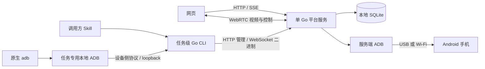
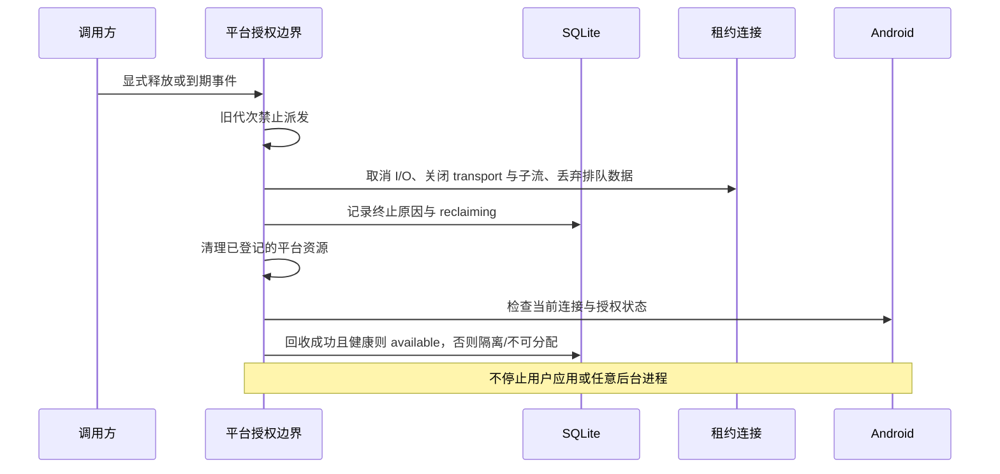

# Design

## Context

动机与交付范围见 [proposal.md](proposal.md)，系统边界见[架构设计](../../../docs/架构设计.md)，已确认选择见[架构决策](../../../docs/架构决策.md)。本文件为实施合同；用户已授权工程开发，并明确批准第 9 节 SQLite schema。

已确认 Go/Pion/SQLite、单 Go 平台服务、管理员访问令牌登录、Windows 原生/Linux 双容器、固定 15 分钟显式续租、桌面网页人工入口及共享可调画质。2026-11-11 用户选择显示预布局与切换优化 B 档，批准对应显示信息持久化及迁移。版本与硬件兼容以实际验证为准，不编造性能数据。

## Goals / Non-Goals

**Goals:**

- 让设备发现、认领、数据派发、撤销与回收使用同一权威状态；即使跳过 Skill，也不能绕过租约。
- 在不解析任意 shell 业务语义的前提下，明确平台能够撤销的访问与不能撤销的手机副作用。
- 为原生 adb、网页和未来自动化工具定义同一设备身份与授权边界，避免在每个入口重复实现租约。
- 通过分离管理流、ADB 数据流和媒体流，保持元数据事务短小；慢浏览器或大文件不能无限占用内存。
- 交付真实可运行的纵向功能阶段，最终验收完整首版，而不是按技术层交付互不连通的骨架。

**Non-Goals:**

- 不复制参考项目应用代码，不继承其接口、数据库或 Python/Vue 实现。
- 不重写 Android USB 驱动、硬件编码器、浏览器解码器或通用 UI 控件。
- 不把任务端口、进程或租约当作操作系统沙箱，不终止任意手机后台程序。
- 不增加微服务、队列、远程数据库、通用插件框架、自动重试设备动作或未经批准的备用媒体路线。

## Decisions

### 1. 单服务、两个产品入口

**已确认**：一个 Go 服务提供静态前端、HTTP 管理 API、SSE 状态事件、WebSocket 租约网关与 Pion WebRTC。Windows 原生运行，Linux 与独立 ADB 容器通过 Compose 部署。相比分离前端 Web 服务，这避免多套部署与跨域认证；相比拆分媒体服务，十台规模不需要额外服务协调。

工程上采用标准 `net/http` 路由与中间件；内部按身份、设备、租约、ADB、媒体、回收、存储分模块，而不是按模块部署。前端使用 React/TypeScript、Vite、frontend-library 指定的 shadcn/ui Nova、Tailwind、Lucide；服务端状态用 TanStack Query，确有共享客户端状态才使用 Zustand。不先安装 Motion、dnd-kit 或面板库。

工程目录为 `cmd/droidharbor`、`cmd/droidharbor-cli`、`internal/`、`web/`、`api/`、`deploy/`、`skills/droidharbor/`。产品 Skill 不放进项目开发 skills 冒充已交付产品。

SSE 只传递状态通知，双向设备字节流使用 WebSocket，网页输入使用可靠有序 DataChannel。相比复用一个无边界 WebSocket 承载全部数据，这使授权、背压和故障范围更清晰；不另引入消息代理。

### 2. 认证、任务凭证与管理员会话

**已确认**：访问令牌登录，无用户账号体系。EXE 缺少 `.env` 时自动创建完整配置和高熵随机 `DROIDHARBOR_ADMIN_TOKEN`，明文保存在该文件；运行时仅用摘要认证，修改 token 并重启使旧版本管理会话失效。不保留管理员摘要文件、初始化脚本或旧凭证迁移；普通日志不回显 token，首次创建仍记录明确初始化结果。

- 网页通过同源 HTTP 提交令牌换取不透明会话，使用 `HttpOnly`、`SameSite=Strict` Cookie；写操作验证本次请求 Host 对应的浏览器 Origin 及 CSRF，不配置固定 origin。退出撤销该会话，管理员令牌轮换撤销所有旧管理员会话。会话使用独立于 AI 租约的可配置有效期，工程默认 12 小时，不因视频流量自动延长。应用不处理 TLS，明文 HTTP 仅用于可信内网/隔离网络。
- 管理员创建命名调用方 API 凭证，秘密仅创建时展示；数据库保存摘要、标识和撤销时间。调用凭证用于能力查询及创建任务，不作为所有任务数据通道的通行证。
- CLI 为每个任务在本地生成 256 bit 随机任务秘密，首次认领时通过管理 API 提交；服务端只保存摘要。后续查询本任务、续租、释放及创建连接使用这个任务凭证。这样即使认领响应丢失，CLI 仍持有任务凭证，不需要保存可回放的明文租约秘密。
- `callerId + taskId` 唯一。认领同时绑定请求幂等键、规范化请求摘要和任务凭证摘要；相同幂等键只接受相同任务秘密及相同参数。仅知道共享调用凭证、另一个 taskId 或旧幂等键，不能取回或重置另一任务秘密。
- 管理员可撤销调用凭证，撤销同时阻断其既有租约和连接并启动回收；调用凭证轮换不自动迁移旧任务。管理员拥有管理权，不是被任务隔离约束的普通任务。
- WebSocket Upgrade 同时校验任务凭证、leaseId、connectionId、generation、平台本次启动标识；token 不放在查询字符串。每次派发仍检查当前授权，握手通过不是永久授权。

这里使用普通随机 bearer 凭证与摘要校验，不自创签名协议，不引入 JWT 自包含授权。相较于长期 JWT，数据库撤销与内存状态能立即作用于现有连接；任务秘密由 CLI 预先生成解决首次响应丢失，不让共享调用凭证具有“找回其他任务凭证”的权限。

**已确认边界**：首版将共享调用机视为可信环境，不提供本机任务沙箱。原生本地 ADB Server 不认证发起命令的客户端；不承诺旧原生命令在本地端口复用后绝不借用新 Server 的授权。独立任务密钥保护 Server 到平台网关这一段；平台仍严格拒绝其他任务凭证和旧代次。若部署者需要运行不互信任务，须提供独立网络环境，仅更换 OS 用户不够。长期调用凭证可以创建新任务，但不能冒充已有任务通过平台认证。

### 3. 设备身份、链路与分配资格

`deviceId` 是平台生成的稳定标识，不使用 IP、动态无线端口或当前 ADB transportId 作为产品身份。每台设备可登记多个 USB/Wi-Fi 链路，一次租约固定到一台设备和明确的当前链路代次。

- 新发现的 endpoint 先处于待登记/维护状态；管理员完成手机授权、必要无线配对及归属确认后才可分配。使用官方 ADB 完成配对，配对码不持久化或写日志。
- 同一手机增加第二条链路时关联原 deviceId；服务端交叉核对已授权设备的硬件序列号、型号和产品代号。三项缺失或冲突时保持不可分配；厂商、Android 版本和 SDK 只供查看。
- 无线地址或端口变化时更新原 linkId，保留原 deviceId 与硬件身份记录；撤销旧 transport，新 endpoint 重新连接并核验，不追加永久占用旧地址的历史链路。已有租约不自动换路或释放，仍须显式重新建立数据通道。
- 连接状态为 online/offline/unauthorized，分配状态为 available/leased/reclaiming/quarantined/maintenance。连接状态来自当前探测，不把上次持久化的 online 当作启动后的事实。
- 标签按规范化集合精确执行“全部所需标签满足”；无匹配返回不可用，不改用其他账号环境。多个合格设备使用稳定顺序选取，不新增公平队列或抢占。
- 活跃链路失联立即关闭相关 transport，反馈连接中断；保留尚未到期的租约供调用方查询/显式续租，不自动选择其他手机或切到另一条链路重放动作。设备恢复后需显式重新建连，原连接不可复活。
- 管理仅保留名称、标签及 AI 分配开关；新设备默认不可分配，打开管理不改已有意图。开启及空闲关闭直接生效；AI 占用时弹窗二次确认，提交当前任务代次，后端在租约锁内核对后撤销与回收，再进入 maintenance。无确认或旧任务确认返回 ALLOCATION_CONFIRMATION_REQUIRED/409，不改变运行授权。
- 已登记设备离线、未授权、待核验或异常时可在列表点击“刷新”。一次性清单查询保留当前 tracker 生命周期，拒绝覆盖较新观测；必要时连接已登记的无线地址，再复用硬件身份核验和异常资源恢复。保留分配意图，不配对、不新增链路、不复活旧任务；地址变化从新增流程显式扫描接入，USB 未连或未授权反馈明确错误。
- 同一硬件 serial 的尺寸读取跨 USB/Wi-Fi 互斥，排队可取消，输出完整消费后才释放，避免设备拒绝并发 dump；不同手机不互相阻塞，不增加重试或旧尺寸 fallback。

- 2026-11-12 用户选择仅 mDNS 的局域网无线 ADB 扫描：通过已配置 ADB Server 的 `host:mdns:services` 读取 `_adb._tcp`、`_adb-tls-connect._tcp` 与 `_adb-tls-pairing._tcp` 广播，不遍历 IP 或端口，不新增发现守护进程。发现范围为该 ADB Server 所在网络，平台与 ADB 分容器时仍由 ADB 负责组播发现。
- 扫描只返回当前广播，不建立连接、配对或登记；连接地址与临时配对地址分别呈现。管理员显式连接后进入现有待添加及批量登记流程，首次配对输入手机配对码且不持久化；新增网络链路复用硬件身份核验与同机合并。已登记 endpoint 或已知 ADB 服务名从连接候选中排除，不按 IP、型号或广播名称推断硬件归属。服务消失或类型不匹配在动作前拒绝，ADB/mDNS 故障明确返回错误并记录原因，网页操作失败只走统一通知。保留手动地址入口，不改 schema、启动参数或 TLS。
- 原生 ADB 的服务名 serial 按当前广播解析为实际 Wi-Fi endpoint，保留 observed serial；待添加清单也排除可确认属于已登记 endpoint 的服务名别名。这里只过滤同一连接地址的别名，不据此改变硬件归属或既有链路，其他同 IP 端口仍需显式接入及核验。批量登记完成后清除旧扫描候选与已登记选择，避免残留重复入口。

### 4. 租约一致性、派发与撤销

每条租约绑定 `callerId / taskId / deviceId / generation / bootId / expiresAt`。`generation` 是设备占用代次；`bootId` 是平台每次启动新生成的随机标识，不从备份恢复，避免恢复旧库时让旧凭证重新有效。

- 认领在短 `BEGIN IMMEDIATE` 事务内完成：验证任务幂等性，选择合格设备，确认无活跃租约，增加 generation，写租约并将设备置 leased。提交成功才返回；响应丢失后相同请求只返回原结果。
- 续租在同一设备的协调边界内检查当前凭证、代次和有效性，然后设为服务端处理时间起 900 秒，不在原 expiresAt 上累加。次数与累计时长不限。
- 运行中的实际到期判断使用单调时钟 deadline；API 返回对应 UTC expiresAt。服务重启不恢复旧 lease，因此无需将单调时钟跨进程持久化；调整系统时间不能延长已授予的 15 分钟。
- **已确认运维边界**：保留 `expires_at > claimed_at` schema 约束。较大日历时间回拨导致该约束不成立时，续租明确失败，既有授权保持原单调时钟期限；不伪造新的 UTC 时间、不修改约束、不自动延长。运维纠正系统时间后，调用方只有在原租约仍有效时才能显式再次续租。
- 过期和续租线性化：在过期前成功提交的续租更新 deadline；到期或撤销先发生则迟到续租失败，不能复活。续租响应丢失由调用方查权威状态，不将未知结果解释为成功。
- 建 transport、打开子流、进入真实派发、向客户端输出数据均检查有效代次和 deadline。设备派发与撤销经过同一个串行授权边界；大块 socket I/O 不长时间持有数据库写锁。
- 释放/到期/撤销先阻断授权，再取消 I/O、关闭全部子流和 transport、清空队列，登记回收。写入设置期限，取消必须能够打断阻塞写，不能让过期事件等待无限 socket 写入。
- 已交给下游 ADB/Android 的字节和动作属于不可撤回的在途副作用；新任务不会接收平台继续派发的旧代次队列，但平台不保证手机已接收的旧动作停止。
- 元数据写失败不得返回认领/续租成功；撤销时持久化失败也先在运行态拒绝访问，设备保持不可分配并报告故障，不能因写库失败继续放行。

### 5. 原生 ADB 网关合同

原生 adb 客户端连接的是任务专用本地 ADB Server 的 smart socket；该 Server 再通过 `adb connect` 连接 CLI 的 loopback 设备入口。CLI 将设备侧 ADB 字节流经 WebSocket 传到平台。`adb -H/-P` 与 `adb connect` 不能混作一个接口。

网关终止设备侧协议，处理 CNXN/AUTH/OPEN/WRTE/OKAY/CLSE，并将每个允许的 OPEN 映射到服务端 ADB 上的指定设备服务。平台到服务端 ADB 使用 smart socket 的长度前缀与 OKAY/FAIL；目标只来自租约映射，不采用调用方提供的真实手机 serial。

- 每任务生成独立本地 ADB 密钥，连接创建时登记其公钥。网关通过标准 ADB AUTH 验证对应私钥；不自动接受未知公钥，不弹出手机配对要求。旧任务凭证和密钥不能直接通过新任务网关的认证；该保证不扩展为可信调用机内原生 ADB Server 的客户端隔离。
- Windows 保持官方原生 adb 调用。官方 Server 会读取默认用户密钥，缺失时可能生成；CLI 不覆盖或删除已有默认密钥，不宣称环境变量能隔离 Windows 用户配置目录。网关支持有界的标准多密钥 AUTH 协商，但只有登记任务公钥的有效签名能通过；默认密钥尝试失败不等于任务密钥无效，不降级为免认证。
- WebSocket 传输二进制，不把 ADB 数据转 JSON/Base64；消息边界不被当作 ADB 包边界。遵守协商 maxdata、包长度、stream ID 和流控，错误关闭该连接，不把无效包转发至手机。
- 功能协商取“网关实现、锁定 platform-tools、目标设备”交集，不原样宣称真实设备所有 features；不宣称支持未实现的 TLS 设备配对协议或 delayed-ack 等扩展。
- OPEN 建立一条专属上游服务连接，WRTE/OKAY 实施有界背压；无需重写 USB、文件系统或 shell。shell_v2 和 sync 内容保留二进制语义，取消同时关闭上下游。
- 服务集合是协议范围，不是 shell 命令沙箱；允许 shell 就可能启动后台服务、改变应用或配置手机，平台不分析全部命令文本来伪称安全隔离。

| 首版命令/行为 | 网关服务与验收合同 |
| --- | --- |
| `adb connect`、`devices`、`get-state` | 本地 ADB 发现租约虚拟设备；不枚举平台其他物理手机 |
| `adb shell`、交互输入 | shell / shell_v2 按协商能力桥接，保留 stdin、stdout、stderr 与退出状态；不支持的设备不能伪造完整 shell_v2 |
| `adb exec-out screencap -p` | exec 原始二进制输出；截图不是网页压缩帧，不修改 PNG 字节 |
| `adb shell input ...`、查询设备属性 | 普通 shell 命令，保留真实退出与错误；原生 input 的字符能力不能冒充通用 Unicode 输入 |
| `adb push/pull` | sync 服务及已协商的文件能力；保留内容、错误、取消和进度；能力不支持时明确失败 |
| 无需额外 agent 的 APK 操作 | AI 可以组合 shell/sync；网页安装见第 8 节，不宣称全部 adb install 快速部署变体已兼容 |
| forward/reverse、任意 tcp/localabstract、root/remount/reboot/无线配置服务 | 不作为首版调用方公开服务；拒绝未声明 OPEN。平台内部 scrcpy 使用另一路受控适配，不受此调用方服务列表限制 |
| Appium/uiautomator2 | 保留连接描述、能力查询和资源生命周期边界，当前不运行、不接受兼容验收 |

本地原生 adb 可能在创建 forward 时仅完成本地监听，真正访问目标服务后才得到拒绝；不将本地 CLI 的“建立监听成功”当作平台支持转发的证据。使用矩阵必须验收到端服务，不仅验 adb 退出码。

### 6. 产品 CLI 与 Skill

CLI 提供 `version`、`capabilities`、`devices`、`claim`、`status`、`renew`、`connect`、`disconnect`、`release`、`env` 和 `app`，输出稳定 JSON 和退出码。管理命令为短进程；`connect` 是本任务的前台长进程，不是全局 daemon。原生 ADB 在线、平台连接 active 且任务目录解锁后才发一条就绪 JSON；Skill 可用 harness 通用后台进程能力消费该信号，不要求专用插件或结束钩子。用户给出标签时从第一次 claim 就携带全部标签。

任务工作目录保存本任务秘密、ADB 密钥、实例端口、leaseId 及资源归属，使用 OS 权限保护，不提交到 Git。原生 adb 命令显式指定独立 Server 和租约虚拟设备，不修改全局环境或 kill 默认 ADB。启动任务 ADB 时禁用无关设备自动发现/自动连接，确保不争用调用机 USB；锁定版本并验证实际支持的参数，不编造可用命令行开关。

Linux 的任务 HOME 与默认密钥位置保持一致，使用任务目录下的 `.android/adbkey`；Windows 通过 `ADB_VENDOR_KEYS` 加载任务密钥，同时接受官方 SDK 的默认用户密钥行为。两者都不修改系统全局环境、不操作默认 Server；任务密钥与平台任务凭证由 CLI 管理，不要求用户手工维护。原生握手不能代替 WebSocket 任务凭证和租约检查。

`connect` 接到停止/撤销时清理本任务 endpoint 和 ADB 进程；CLI 崩溃后下一次运行按记录核对进程身份再清理，不能只凭复用的 PID/端口杀进程。服务端到期撤销独立于本地清理成功与否。

Skill 流程：观察能力 → 生成任务身份/秘密 → 以所需标签认领 → 建立连接 → 先观察手机当前状态 → 使用原生 adb → 到期前显式 renew → 完成后 release。每次续租仍是调用方动作，不在连接进程或定时器里偷偷续租；长命令运行期间通过独立管理命令续租。

错误类别至少区分认证、无匹配设备、租约终止、设备断连、不支持能力、本地资源故障、操作结果未知。原生 adb 的 stdout/stderr 和退出码保持原义，不将上传开始、连接建立或超时当作设备动作成功。不重放点击/付款等副作用，不自动重领或换手机。

应用工具编译进现有 Windows/Linux CLI。每次调用用 `--task-dir` 复用 `env` 的本地进程身份、原生 ADB 在线及远端连接和代次校验，以该任务的 `adbBinary` / `adbArgs` 发出命令。沿用成对发布的 EXE 和 Skill ZIP，不另建连接、服务端 API、SQLite 表或设备生命周期。

`app open` 按包名解析安装版本的 launcher，单次启动并分别返回实际前台、首屏和可选业务条件的证据。`app find` 按资源 ID、文本、描述、类和状态定位；`app wait` 可独立等待同一组条件。`app input` 只编辑当前唯一、已聚焦且能确认可编辑的字段，原生支持时一次替换、按字段精确读回、不隐式提交。`app tap` 以本次观察定位唯一可操作的控件，验证业务条件在操作前尚不满足；随后点击一次并只读等待。条件支持前台包/组件和一组须同时满足的控件；不内置 App 路径、规则表、流程框架或 OCR。

所有探测和动作共享单个调用截止时间，串行按需采样，命中立即返回。原生 UI 树有低频、有限次观察预算；树不可读或查找无证据时，在剩余预算内取一张当前 PNG，标为未能自动验证。只回传命中候选和最近的真实证据，截图保存在任务私有位置。结果单独表明动作未发出、已发出但未证实、送达未知或结果已验证；中断、超时与多候选不触发重放。登录门槛由用户处理。

纯 ASCII 继续使用 Android 原生按键输入。非 ASCII 文本通过已有 `shell_v2` 的 stdin 传入一次性整字段编辑脚本，避免把脚本和输入内容放进 ADB OPEN 参数。CLI 内嵌的只读 DEX 沿用短时 `app_process` 惯例：Android 8+ 上重新校验窗口和焦点控件，核对原值并全选实际旧值，再派发一次系统 `ACTION_SET_TEXT`。临时文件退出时清理；不安装 APK、不启用常驻无障碍服务、不读取或修改剪贴板。输入法连接可随整字段编辑重建；主机仍核对同一 View、当前前台和实际文字。Android 收到的动作不承诺撤回，同一手机上的人工操作仍与任务独立。

仅修改手机端编辑实现时需用 Android SDK 34 / Build Tools 34.0.0 和 JDK 17+ 执行 `node scripts/build-app-input.mjs`，将输出更新到 `cmd/droidharbor-cli/appinput/classes.dex.b64`；常规 CLI 构建使用该内嵌产物，不需要 Android SDK。

`app read-list` 沿用现有任务级原生 ADB，读取调用方指定的纵向列表。原生界面树保留树层级、屏幕方向和可滚动属性；从直属行收集自身及后代的可见标签。边缘被截断的行在完整可见时再读。每次滑动前核对焦点，滑动后核对窗口、同页条件、列表及方向；只有带向上位移的唯一连续后缀／前缀重叠才合并后续行。限额和证据中断返回已确认的前缀，只有实际观察到指定列表末尾控件才报告到达末尾。范围为当前界面树，不补 OCR，不引入手机端组件、服务端 API 或持久状态。

### 7. API 合同

统一 HTTP `/api/v1`，JSON 使用 camelCase，标识为不透明字符串，时间为 UTC RFC3339，HTTP 错误使用稳定 `code / message / requestId / details`。敏感字段不进入日志。默认鉴权，只有基本存活探针不返回设备或身份信息。CLI 接受 HTTP(S) 服务地址，按地址选择 WS/WSS，标准外部传输不引入应用证书参数。

| API | 授权与主要请求 | 成功/失败合同 |
| --- | --- | --- |
| `POST /admin/sessions` | 管理员令牌 | 创建安全 Cookie 会话；不在响应回显令牌 |
| `DELETE /admin/sessions/current` | 管理员会话 | 幂等退出并关闭其人工会话 |
| `GET/POST /callers`、`DELETE /callers/{id}` | 管理员会话 | 列表仅返回元数据；创建一次性可见调用凭证；撤销触发关联租约回收 |
| `GET /capabilities` | 管理员或有效调用/任务凭证 | apiMajor、协议版本、平台/ADB 能力；未实现 Appium/uiautomator2 不宣称支持 |
| `GET /devices`、`GET /devices/{id}` | 管理员完整视图；调用方仅选机必要摘要 | deviceId、标签、连接/分配状态；不泄露真实端口、密钥或其他任务身份 |
| `POST /devices`、`POST /devices/{id}/links` | 管理员；设备登记和 endpoint 归属 | 登记/关联后仍需授权与身份核对；不自动开放未知设备 |
| `GET /device-discovery` | 管理员 | 当前 ADB 快照；发现源不可用返回 503，不以空列表掩盖断连 |
| `PATCH /devices/{id}/links/{linkId}` | 管理员；设备预期 version、新 Wi-Fi endpoint | 保留设备/链路身份，关闭旧代次并重新核验；旧版本或地址占用返回 409 |
| `POST /devices/{id}/links/{linkId}/pair` | 管理员；配对 endpoint/临时配对码 | 通过服务端 ADB 配对，状态反馈；码不保存 |
| `POST /devices/{id}/links/{linkId}/connect`、`/verify` | 管理员；显式连接/归属核验 | connect 不等于身份通过；迟到连接结果不能覆盖更新后的地址；verify 冲突保持不可分配 |
| `POST /devices/{id}/refresh` | 管理员；已登记设备 | 获取当前清单及必要身份核验；较慢查询不能覆盖较新 tracker，保留维护意图，不进行配对或 connect |
| `PATCH /devices/{id}` | 管理员；名称/标签或启停分配、预期版本 | 信息修改与维护请求分别提交，不能伪装为一次原子操作；标签不迁移租约，维护必须撤销回收；冲突返回 409 |
| `POST /devices/{id}/recover` | 管理员 | 显式重试资源核验；清理未确认仍隔离，排队旧请求不得清理已进入新租约的设备 |
| `POST /leases` | 调用凭证；taskId、taskSecret、requiredTags、Idempotency-Key | 原子创建，返回 leaseId/deviceId/generation/expiresAt；没有 ttl 参数；相同请求返回原结果 |
| `GET /leases/{id}` | 对应任务凭证或管理员 | 权威租约、到期和回收结果；不回显任务秘密 |
| `POST /leases/{id}/renew` | 对应任务凭证 | 有效期更新为当前服务端时间 +900 秒；过期/撤销拒绝 |
| `DELETE /leases/{id}` | 对应任务凭证或管理员 | 幂等终止；回收中返回 202 及查询信息，不伪报 available |
| `POST /leases/{id}/connections` | 对应任务凭证；协议版本、任务 ADB 公钥 | 返回 connectionId、WebSocket 路径、有效期、支持能力；不返回真实手机/ADB 管理地址 |
| `GET/DELETE /leases/{id}/connections/{connectionId}` | 对应任务凭证 | 状态/幂等关闭；关闭连接不等于释放租约 |
| `GET /leases/{id}/connections/{connectionId}/tunnel` | 对应任务凭证，WebSocket Upgrade | 建立绑定租约与代次的二进制通道；状态失效立即拒绝 |
| `POST /devices/{id}/sessions` | 管理员；readonly/control、SDP offer | 创建人工 session，返回 answer/会话参数；无观看权限不能建立媒体流 |
| `POST /sessions/{id}/candidates`、`DELETE /sessions/{id}` | 会话所属管理员 | ICE 协商/关闭本人会话；不改变 AI 租约 |
| `GET/PATCH /devices/{id}/video-settings` | 读已授权观看者，写控制会话/管理员 | maxSize、maxFps、bitRate 独立字段；PATCH 带预期 revision；返回 requested/effective/status/revision/captureEpoch |
| `GET /sessions/{id}/screenshot` | 有效人工观看会话 | 原始设备截图二进制；失败明确，不拿陈旧视频帧伪装 |
| `GET /devices/{id}/preview` | 有效管理员网页会话；每次请求先鉴权 | JPEG 小图二进制，响应头携带 capturedAt/deviceId/linkGeneration 并禁止公共缓存；默认 5 秒共享更新，离线/失败明确返回错误，不建立视频会话 |
| `GET /sessions/{id}/files`、`GET /sessions/{id}/apps` | 本人当前控制会话 | 读取手机目录或当前 Android 用户的包清单；绑定原链路 |
| `POST /sessions/{id}/apps/uninstall` | 本人当前控制会话、明确用户 ID 和包名清单 | 逐包卸载第三方应用、回读安装状态；不用 root 或跨 Android 用户 |
| `POST /sessions/{id}/transfers` | 控制会话；文件元数据、用途及覆盖选择 | 返回 transferId；只读拒绝；不把接收请求当作上传/安装完成 |
| `PUT /transfers/{id}/content`、`GET/DELETE /transfers/{id}` | 所属控制会话 | 流式上传、进度/结果、取消；文件不放入 SQLite，不承诺断点续传 |
| `GET /events` | 管理员或本任务凭证 | SSE，仅授权范围，eventId/bootId/entityVersion；断线读取快照，不承诺永久事件重放 |

错误映射：401 凭证无效，403 权限/任务不符，409 无匹配可用设备或配置版本冲突，410 租约过期/撤销，422 参数或能力不支持，503 设备/服务不可用。传输断开时动作可能已执行，客户端必须保留 `RESULT_UNKNOWN`，不能只看 HTTP 可重试性重放动作。一个错误码不能掩盖回收中、离线与不支持的差别。

幂等认领若原租约已终止，返回其终态而不是再分配设备；同 taskId 不允许换秘密夺取已有任务。状态事件只是缓存失效通知，实体快照为权威；先订阅后取快照、按版本忽略过时事件，连接缺口重新取快照。

OpenAPI 3.1 文档由实现与合同共同维护，未实现接口不能宣称可调用。API/CLI major 版本不兼容时显式失败，新增可选字段允许旧客户端忽略。

### 8. 网页媒体、控制和文件

#### 8.1 一台设备一份采集

平台向手机推送锁定版本的官方 scrcpy-server，使用独立 scid/socket 名称，禁用音频及编码失败自动降分辨率。采用设备侧监听、平台主动打开 `localabstract` 服务的连接方式，视频和控制各一条服务连接；通过 ADB smart socket 直达设备服务，避免额外发布 ADB 容器的动态 forward 端口。

每设备一个采集会话，每个浏览器一个 Pion PeerConnection。处理 scrcpy 头、参数集和时间戳后打包 H.264 RTP；不在 Go 中常驻解码/转码，不依赖 FFmpeg。手机旋转、重建编码器及参数修改产生新的 captureEpoch。

晚加入或丢包后的观看者必须从参数集和可解码关键帧恢复，不从任意 P 帧开始播放。使用有限关键帧/GOP 缓冲和每观看者有界队列；等待关键帧超时明确失败。RTCP/NACK/PLI 的行为须和锁定 scrcpy 版本的实际能力匹配，不能假设存在未提供的控制消息；必要采集重建会影响全部观看者，必须报告状态而不是无休止重启。

最后一个观看者正常关闭时回收采集；明确的设备切换按第 14 节对每个离开设备独立保留完整视频链 15 秒。异常或撤权立即清理失效会话；只有当前目标的可恢复视频故障自动建立新媒体会话，后台保留项不主动重建。

视频恢复只重建观看连接，不重放点按、键盘、剪贴板及其他设备写入。主界面与独立小窗复用同一恢复逻辑，连续故障按 1/2/4/8/15 秒退避，稳定呈现十秒后重置；切走、关闭或授权失效取消恢复。设备离线等待重新核验 online 后按原只读/控制模式连接，收到并确认真实新帧才开放输入。协议不兼容、编码配置失败或清理未确认保持明确错误，不绕过隔离、不自动降档。启动取消按取消分类，瞬时传输中断用独立错误码，恢复尝试与新 sessionId、实际呈现帧关联记录。

同设备已有归属回收进行中时，后续请求等待该次结果，等待者取消只结束自身等待；不同设备互不阻塞。只有明确回收完成才解除采集隔离，实际回收失败仍停止自动重建，不能把“正在回收”误报为无法确认回收。

#### 8.2 画质修改与坐标

帧率与码率使用唯一全局配置，默认 maxFps=60、bitRate=12000000；网页提供 30/60/90/120 fps、4/8/12/20/40 Mbps 下拉，切换设备保持相同全局目标。设备长边策略保持原值，默认 1920。全局 PATCH 独立修改字段并校验全局 revision，不接受设备级帧率/码率设置。

保存只更新配置，不重建或打断任何现有共享采集，包括十五秒保留流。同设备新窗口继续共享原流，直到原采集结束；下一次新建采集读取最新目标。明确原生编码配置失败时，按下述已批准规则回退，不把目标值当作实际参数；ADB、网络、权限及资源归属错误保留原故障。

分辨率按手机当前画面比例及编码器 alignment 计算；不能 CSS 拉伸、裁切或伪报标准 1080p。对齐产生的实际像素尺寸透明返回，显示保持比例，输入映射以实际帧尺寸为准。页面留黑边不算裁切；旋转/翻转的逆变换与设备旋转分别处理。

浏览器控制信封包含 sessionId、captureEpoch、序号、事件类型和载荷，服务端验证所属会话、权限及当前 epoch 后翻译为 scrcpy 控制协议。按键/触控边界可靠有序，移动事件只合并同指针中间位置，不丢失 DOWN/UP；焦点丢失、断连或切换释放本会话未完成的输入，不重放到新画面。

#### 8.3 人工操作与文本

使用锁定 scrcpy 默认 SDK 控制语义：右键唤醒/返回、中键 Home、第 4/5 键最近任务/通知栏、Ctrl/Shift 多指、键盘按下/抬起、显示变换、手机旋转、息屏投屏及面板。仅面向桌面 Chrome/Edge，移除全屏按钮。画面聚焦时使用原生 paste 事件携带文本，兼容 HTTP，不依赖后台系统剪贴板读取。

只读会话禁止所有设备写入，包括通过旁路 API 发起剪贴板写入、安装/文件上传、全设备采集配置修改；仍可本地缩放、旋转显示和下载截图。人工控制保持 AI 租约原样，不伪报 AI 已暂停。

网页中文输入通过 scrcpy 文本/剪贴板能力实现并真机验证；原生 `adb shell input` 的 Unicode 限制如实报告，不假设该命令已具备网页同等能力，也不擅自安装手机输入法或自动化 agent。

剪贴板历史仅在当前网页会话中按设备保存至多 20 条手机来源的文本，连续相同内容合并。画面内 Ctrl+V 继续走浏览器 paste 事件，发送回执和手机对平台写入的回显不加入历史。设备通知不带来源；与近期电脑写入同文且无法区分来源时不新增记录。明确点击「复制到电脑」才写系统剪贴板；安全上下文走 Clipboard API，局域网 HTTP 用用户点击触发的 Chromium 兼容复制，拒绝时明确报告。不保存到磁盘或日志。

#### 8.4 文件、应用与网页截图

目录、应用列表和各写操作复用管理会话及原设备链路，不借用 AI 租约。文件入口默认 `/sdcard`；当前 ADB shell 实际 uid 为 0 才可读 `/`，不调用 `adb root` 或 `su`。浏览根目录不授予写权限；文件只写入设备解析后仍在共享存储内的目录，阻止链接绕过。复用流式上传、受限暂存、进度和结果查询；覆盖须明确确认。APK 安装复用 Package Manager 的安装传输。

应用列表显示当前 Android 用户的包和系统/第三方属性。用户确认后，卸载前核对 Android 用户和第三方包，串行执行并回读当前用户安装状态。批次报告各包成功、失败、未执行或结果未知；链接或用户切换停止后续派发，未知不重放。不修改数据库 schema。

文件、应用和剪贴板使用同一个可调宽右栏。目录按展开加载，批量读取文件大小和最后修改时间。宽栏并排树和预览，窄栏上下排列；通过中间分隔线调整两区比例。Monaco Editor 随包延迟加载，按文件名和类型选择语法高亮，文本默认只读；可编辑的完整 UTF-8 文件通过原有文件传输显式保存，手机端内容变更时拒绝覆盖。图片继续按格式有界预览；其他二进制在只读 Hex Editor 按偏移分段读取。

应用标签在数据到达前进入并显示加载动画。默认只向设备请求用户应用的名称与图标；全部应用按需查询，按名称分组，中文取拼音首字母。名称及 PNG 由短时 Android 查询组件读取，已安装清单仍是卸载授权依据。
应用列表滚动条旁显示当前可见首字母组的位置标记，点击后在列表内部滚动到分组。

服务端在运行数据目录 `cache/v<格式版本>/devices/<设备ID>/apps/<Android 用户ID>/presentations.json` 保存名称与 PNG；可配置缓存根目录，默认在数据库旁，不要求服务账号写配置目录。缓存按包名、Package Manager 版本号和名称语言匹配，单包失配只重读该包的资源；新旧控制会话使用同一设备缓存，但每次仍实时读取 Android 用户和安装清单。格式版本变化只清理标明属于 DroidHarbor 的旧格式目录；默认缓存不纳入备份。

文件和目录统一提供同目录重命名、移入回收站与永久删除入口；新建目录在当前目录执行。所有写入仍限共享存储。回收站独立列出和还原，原位置冲突不覆盖；移动整个目录不扫描或删除其中内容。单项永久删除完成两步明确确认后才派发；已发送但结果未知不重放。回收站索引与文件一同保留在手机，不改变平台数据表，不自动清理。
文件树按渲染顺序处理 Shift 范围，只纳入当前展开且可写的文件和目录；Ctrl／⌘ 切换单项。目录箭头与名称共用触发按钮，单击展开或收起，修饰键仅改选区，折叠移除隐藏选区；行尾菜单用于单项操作。新建、上传和刷新常驻固定高度顶栏，选中多项时在同栏显示批量操作，保持树的视口和滚动位置。批量永久删除只显示数量并统一确认一次。父目录与子项同选时只操作父目录。批量逐项复用已有文件操作和会话权限，结果未知时停止剩余派发并报告。

文件树以紧凑缩进显示层级，文件与目录复用相同的主图标尺寸，应用角标向右下错开以保留目录轮廓。仅展开共享存储的 `Android/data`、`Android/media` 或 `Android/obb` 时按需复用应用标签的当前会话「全部应用」缓存；直接子目录按包名精确匹配 PNG 角标，图标查询独立于目录加载。

文件移入回收站、永久删除和回收站清除共用删除弹窗。确认与执行均不改变列表布局；进度以已完成的设备响应计数，执行成功关闭弹窗，失败保留原因和实际完成数，不提供重试同一批次的入口。

状态区分 uploading/transferring/installing/succeeded/failed/cancelled/unknown。进度来源于实际字节传输，安装成功以 Package Manager 结果为准。取消关闭后续传输并清理平台临时文件；已经推到手机或已开始安装的副作用不可保证撤回，结果不明时显示 unknown。源文件不会被当作平台回收对象从手机任意删除。

原始截图按需经设备 exec-out 获得，不维护服务端视频解码后台循环。只读授权可以读取截图，但没有账号/会话授权不能借截图接口看设备。列表预览使用下述独立小图链路，不替代原始截图下载。

#### 8.5 列表共享低频截图

设备池默认每 5 秒请求可见设备预览，不可见或页面隐藏时停止；工作台仅读取上线初始化封面并使用当前视频取帧，未选中设备冻结且不轮询截图。已登记设备核验上线后即初始化一张封面，不等待页面请求；两处共用设备及链路代次绑定的运行时缓存，不各建一套，不创建 AI 租约或 WebRTC 会话。

预览端点要求有效管理员网页授权，逐次鉴权先于缓存读取；调用方通用凭证不能取得未认领设备画面。按稳定 deviceId 及当前链路代次合并初始化、显式刷新与页面请求，每五秒至多启动一次新采集。工作台读取缓存不触发截图，不能以缓存读取伪装新拍摄。在线设备保留最新封面并共享既有缓存容量、像素与字节边界，离线或代次更换失效；不落盘，不建立无查看者的周期截图。

不同设备直接并行截图与 JPEG 处理，不设独立的全局采集并发数上限，也不排队等待其他设备；同链路查看者仍共享原任务。保留最多 128 个链路状态、单次十秒预算和图像/缓存大小边界，状态真实耗尽时明确报错；链路失效或平台关闭取消对应任务，单个查看者取消不打断共享采集。采集频率和缓存新鲜度从本次实际开始采集计时。

返回图像及真实 capturedAt、设备和链路代次；侧栏不显示拍摄时间文案，元数据仍用于校验新鲜度。HTTP 禁止公共缓存；离线、代次变化或失败清掉失效图像，迟到响应不得污染当前设备。

此链路允许按需处理静态图片，不改变实时投屏“手机编码、Go 转发、浏览器解码”的约束；不改变设备 requested/effective 画质配置，不降低原始截图接口分辨率。真实 CPU、网络及多查看者合并效果纳入首轮测量，不预先宣称零开销。

#### 8.6 工作台切换与独立小页面

设备池卡片左侧为手机画面，右侧为名称、状态及“预览”“管理”按钮，离线及异常设备补充“刷新”。仅点击画面或“预览”按钮进入工作台，名称和空白不导航；两个预览入口均支持键盘激活。管理只编辑名称、标签和 AI 分配开关，配对/连接输入放在新增流程，不保留手动加链路或地址编辑。完整工作台左侧常设带预览的设备列表，点击条目直接切换，不使用下拉框。切换只影响本窗口的输入授权及当前设备，保留已访问设备的完整视频链规则按下述 15 秒保留策略；设备离线或授权失败明确显示，不自动选择其他设备。只读模式不能因切换或打开小窗而隐式提升；旧设备的迟到画面/事件/输入不能进入新设备，其他窗口、观看者与 AI 租约保持原样。

独立小窗用同源 URL 传递稳定 deviceId 和只读/控制意图，不携带秘密，独立持有人工作用域。首次直接用设备保存的显示比例计算真实窗口尺寸，视频尺寸未变化时不在解码后再次调整；实际方向或比例改变才校正，保留三档尺寸和手动缩放。

主界面采用左侧全局窄导航、官方 Resizable 设备列表、画面与常驻右侧工具。列表预览放大、状态以 AI 占用图标表示，异常可用性单独说明；离线置底置灰，选中强化。操作栏与手机同容器紧贴画面，不贴列表；右侧保留画质和剪贴板历史。浅/深/系统主题跨页面与小窗一致，移除管理员标识、全屏及画面圆角裁切。空白区域使用正常主题背景，视频自身内容保持原样。

#### 8.7 全局操作通知

登录、设备和凭证管理、工作台及工具的操作结果统一使用既有 Base UI/shadcn 全局 Toast，层级高于弹窗且可关闭；错误保留可换行的 requestId。状态、维护确认、一次性凭证和传输进度仍属于原页面内容。同一轮询故障按错误语义去重，requestId 变化不重复弹出，恢复后关闭；未知写结果只提供状态核对，不重放动作。

### 9. SQLite schema——已批准

用户已明确批准以下表、字段和约束，允许创建新库和对应版本化迁移。使用本地 SQLite、WAL、外键约束；不存媒体内容或明文凭证。一个平台进程拥有一份数据库和设备池，不支持多个平台副本共享文件。

| 表 | 关键字段 | 约束与用途 |
| --- | --- | --- |
| `caller_credentials` | id、name、secret_hash、created_at、revoked_at | secret_hash 唯一；撤销后禁止新任务并终止现有授权；名字不是身份 |
| `admin_sessions` | id、secret_hash、admin_credential_version、created_at、expires_at、revoked_at | Cookie 只持有随机会话秘密；轮换管理员令牌使旧版本会话失效 |
| `devices` | id、display_name、allocation_state、generation、maintenance_requested、video_max_size、video_revision、video_last_good、last_error、display_info | generation 非负递增；显示 JSON 保留几何与观测时间；video_last_good 只保存真实有效帧确认的目标版本/参数和成功档位，不是独立可编辑配置；schema 3 移除设备级帧率与码率字段，保留其余资料 |
| `global_video_settings` | id、max_fps、bit_rate、revision | 仅 id=1 一条配置；参数和版本为正整数，默认 60/12000000/1；配置及操作记录同事务保存，不在事务中执行手机 I/O |
| `device_links` | id、device_id、kind、endpoint、observed_serial、identity_evidence、enabled、last_seen_at | device_id 外键；kind 为 USB/Wi-Fi；当前 endpoint 唯一但不是永久设备身份，换地址须验证归属 |
| `device_tags` | device_id、tag | 联合主键，无重复标签；不存账号密码；标签修改不改变已有租约 |
| `tasks` | id、caller_id、external_task_id、task_secret_hash、created_at | `(caller_id, external_task_id)` 唯一；秘密摘要唯一，caller 外键；任务授权不可仅凭可猜 taskId 恢复 |
| `leases` | id、task_id、device_id、generation、boot_id、status、claimed_at、expires_at、ended_at、end_reason、claim_idempotency_key、claim_request_hash | active/ended；active device 唯一、active task 唯一；`(device_id,generation)` 唯一；认领幂等键按 caller 作用域唯一，需由关联 task/caller 显式约束 |
| `owned_resources` | id、device_id、owner_kind、owner_id、boot_id、kind、locator、state、cleanup_error、created_at | 仅记录需要跨崩溃回收的外部资源，locator 包含可核验的 scid/路径等；创建前先登记，回收状态显式更新 |
| `operation_records` | id、actor_kind、actor_id、device_id、lease_id、kind、status、created_at、finished_at、result_code、safe_details | 租约/人工/回收/上传安装的重要结果；不保存每个视频包、按键内容、shell 正文或秘密 |
| `schema_migrations` | version、applied_at | 迁移工具管理；不自动猜测未识别 schema |

`leases` 的 caller 作用域幂等约束落地时使用显式 `caller_id` 与复合外键 `(task_id, caller_id)` 关联 `tasks(id, caller_id)`，再建立 `UNIQUE(caller_id, claim_idempotency_key)`；不能写成 SQLite 不支持的跨表唯一索引。tasks 提供对应复合唯一键。active 部分唯一索引只检查 `status='active'`，不能在索引条件里使用会变化的当前时间。

有效期判断不依赖清理定时器：到期租约即刻无访问权，撤销协调器随后将 status 改 ended、设备置 reclaiming，资源回收后才允许再次认领。即使 ended 已提交，设备仍可处于 reclaiming/quarantined；两者不是同一状态。

事务边界：认领写 task/lease/device 与必要记录同一事务；续租仅更新仍有效的同代次 lease；终止记录与 reclaiming 同一事务；回收结论与 available/quarantined 同一事务。网络、ADB 命令和视频 I/O 不放在数据库事务中。写入错误直接反馈，不自动重试有设备副作用的操作。

首版不增加独立 tags、任务队列、视频帧表、全量输入审计表或实体通用 JSON 仓库。连接及子流对象放运行内存；外部资源才进入 owned_resources，避免为每个数据包写库。

### 10. 回收与启动恢复

资源分 task、human-session、device-capture 三种归属。AI 租约结束不能关闭仍有人工观看者的 device-capture；人工离开也不能清理有效 AI transport。回收结果记录可核验的连接/资源，而不是接受调用方 `clean=true`。

平台启动先获取单实例锁并生成新 bootId，在尚未接受分配前将旧 active 租约全部终止、关联设备进入 reclaiming。检查资源账本，定向关闭/移除仍属于平台的资源，探测设备授权与在线情况；成功且非维护状态才开放，归属不明或清理失败隔离。

使用“创建前登记 + 唯一 locator + 幂等定向清理”覆盖资源创建后崩溃：找不到资源即视为已清理，身份不吻合不能杀其他进程。Linux 平台重启时 ADB 可能仍活着，因此不能只靠进程退出假设手机端 scrcpy 已清理。

手机离线时保留不可分配状态，重新上线后继续核验；不重启手机、不 force-stop 用户应用、不删除业务文件、不清账号。正常后台程序继续运行不构成回收失败。

ADB 容器单独重启视为底层连接中断，关闭旧子流，状态置离线；平台本身未重启则未到期租约不会仅因 ADB 进程更新而续租或重新分配。调用方观察状态后可显式重建连接，已发送动作不重放。平台重启则无条件终止旧租约，二者不能混淆。

### 11. 部署合同与兼容矩阵

| 部署面 | 合同 |
| --- | --- |
| Windows | 原生 Go Windows Service；平台读取 `.env`，平台和服务端 ADB 使用明确账户、数据目录及启动责任；不依赖 Node/Python 常驻 |
| Linux 平台容器 | 单 Go 进程与内嵌静态前端；业务数据卷、可写 dotenv 配置目录；无需 USB 访问权限 |
| Linux ADB 容器 | 锁定 platform-tools；负责 USB、无线配对与授权材料卷；对平台容器开放内部 smart socket，宿主不发布给调用方 |
| 容器网络 | 使用 Compose 专用 bridge；HTTP 显式发布；Pion 使用显式配置的媒体 UDP 端口并发布，配置内网/VPN 可达的 advertised 地址；不使用不可达容器私网地址假装协商成功 |
| USB | ADB 容器映射设备节点并配置设备访问规则；覆盖插拔后新节点和权限变化。平台容器不以 privileged 绕过设计 |
| WebRTC | 校验认证、信令、浏览器能力及实际媒体路径；无隐式 TURN 或公网穿透。VPN/防火墙阻断 UDP 时明确报告部署缺口，不静默切换媒体协议 |
| 备份 | 用 SQLite 一致性备份方式或停服务后完整备份，不能只拷贝正在写入的主库而遗漏 WAL；ADB 授权卷与平台数据分别备份，秘密按文件权限保护 |
| 恢复 | 校验 schema/版本后启动，生成新 bootId，旧租约不恢复；不声称备份包含手机应用数据 |

版本矩阵列明 Windows Server/Windows 调用方、Linux 宿主及容器基础镜像、CPU 架构、platform-tools、scrcpy-server、Go/Pion、桌面浏览器及手机系统的实际版本。只把实际运行的组合标为已验证，不把交叉编译当作运行支持；网页不考虑移动端。

### 12. 消融与未来接口

- 去掉独立前端服务器、消息队列、分布式租约和远程数据库，保留单服务+SQLite；这些组件不解决当前十台设备的核心问题。
- 去掉音频、录屏、eScrcpy 共存及每观看者独立编码，保留网页共享视频与控制。
- 去掉通用手机进程清理、应用复位脚本和自动续租，按已确认政策仅撤销入口与平台资源。
- 保留设备身份、租约/代次、连接描述、能力发现、资源归属和 API major 边界；Appium/uiautomator2 将来在这些边界中扩展，不预建空 adapter 或插件目录。
- API 的 schema 不暴露 ADB 真实 serial/固定端口作为稳定身份；媒体适配器不将 scrcpy 私有协议直接变成公开 Web API。

### 13. Windows 前台试用与诊断

- Windows 服务端交付一个内嵌网页和 scrcpy-server 的 EXE；客户端交付一个 Skill ZIP，含 `droidharbor/SKILL.md`、`droidharbor/scripts/windows-amd64/droidharbor-cli.exe`、`droidharbor/scripts/linux-amd64/droidharbor-cli`，无需另发 CLI 包或说明文件。Skill 按自身安装目录使用对应平台程序，不要求全局 PATH。双击控制台 EXE 零参数运行；缺 `.env` 时自动生成完整配置与随机明文 token，现有配置复用，错误明确失败。路径相对 `.env`；管理 token 只读文件，其他配置可由进程环境覆盖。旧数据由用户清理，不实现摘要文件兼容或迁移。
- `.env` 是管理 token 的唯一配置来源，不提供 `.env.example`、start.cmd 或 admin-init。数据库仍自动初始化；媒体默认自动协商本机 IPv4，可选显式地址覆盖。保留日志双写和初始化结果，不配置 TLS、证书或固定 origin；Windows Service 仍通过 `serve --env-file` 选择同一格式。
- 平台及专用 ADB runner 的日志同时写控制台和文件，20 MiB 轮转、最多 5 份压缩历史；日志无法创建直接失败，后续写入故障显式写 stderr。默认 info，可显式开启 debug 记录 requestId、匹配路由和请求耗时。
- 启动阶段、后台 ADB 清单、媒体采集、资源清理、传输和存储异常保留错误类型/原因链、OS errno、SQLite 结果码及关联 ID。数据库/设备错误正文可能包含业务数据，运行日志只提取已知系统原因，不写入任意错误字符串、请求参数或设备输出。HTTP panic 记录类型与调用栈后继续交给 HTTP Server 关闭异常请求。
- 本轮仅证明前台发布包及异常可观测性，不替代系统重启、自启动、Linux 热插拔、目标网络或浏览器矩阵验收。

### 14. 显示信息与 B 档切换优化——已批准

- 设备配对后实际连接并完成授权核验时读取主显示屏逻辑宽高及方向；USB、批量接入和旧设备重新上线共用同一采集。`devices.display_info` 保存分开的 `screen` 与最近实际 `video` 观测，不混入用于硬件身份比对的 evidence。网络读取在事务之外；尺寸未知明确为空，不猜 1:1。视频几何在每个实际采集代次的 metadata 边界记录，不逐帧写库。
- 前端从最近有效视频比例或较新的屏幕信息预布局。侧栏、拖动容器和屏幕区域保持挂载；当前及各个保留期内的已访问设备分别持有稳定视频节点，切换仅改变显示及操作权限。冻结预览和缓存几何不授予输入；回切显示已有同设备解码流，当前实际呈现帧确认后再开放输入。
- 手机端缓存锁定版本且校验内容的 scrcpy JAR；完整文件发布后，每份运行使用唯一软链接路径、scid、进程及回收账本，不让共享缓存破坏辅助进程归属。缓存缺失正常准备，内容冲突明确失败，不覆盖归属不明文件。采集与信令准备并行，冷启动可利用有界、新鲜的首个关键帧，恢复仍需真实可解码画面，不简单删除关键帧保障。
- 切换通过同一有序控制通道的 suspend/resume 完成，两者均发送空对象，不关闭后台窗口 PeerConnection、轨道或解码器，也不重新提交 offer。suspend 先释放该窗口按键/触摸、取消剪贴板请求及 HTTP 操作上下文，再确认后台状态；后台只接收媒体及必要协议消息，服务端拒绝设备操作。resume 核验原登录/链路、逻辑唤醒并实体熄屏，建立新的操作上下文且重新等待当前呈现帧；旧上下文不能因回切恢复。每个后台窗口独立计时十五秒，其他设备切换不淘汰它；返回取消自身计时，下次离开建立新的完整十五秒期限。前后端分别管理各窗口期限，视频节点稳定排列，所有保留窗口计入既有 64 个媒体会话容量；达到容量时明确拒绝新连接，不预热未访问设备。保留期内各设备继续编码与传输，超时只关闭对应窗口。
- 退出、撤权、管理会话过期、链路断开、采集失败和平台停止强制结束保留；超时仍走既有归属核验和失败隔离。版本化迁移保留登记与标签，旧二进制不支持 schema 2 时按备份恢复流程回滚。首帧收益由真实设备和浏览器分阶段测量，不预先承诺数值。
- 原窗口挂起或释放失败时先结束其本地操作作用域和连接关闭流程，再通过全局通知反馈；新目标仍按独立权限建立视频。切换屏障等待错误处理完成而不是传播原窗口的 rejected promise，不把一个设备的故障连带到其他目标；失败窗口不伪报已保留，后台项不自动重建，当前目标按视频恢复规则处理，设备动作不重放。
- 主屏观测使用跨版本 `dumpsys display`，以主逻辑屏的 WindowManager override 为当前几何，明确 null 才采用 base；逐台故障隔离，单台读取失败不阻塞后续登记设备。侧栏对未选中设备也显示已知尺寸，本页视频就绪时直接以有界频率绘制到小图画布，停止对应截图轮询；不可见或会话失效即停止绘制，原始截图语义不变。
- 冷连接 offer 立即提交，利用既有 candidates 接口增量转发 ICE；完整视频链仍在保留时不重新走信令、关键帧请求或解码初始化。冷建流和温回切分别记录，不能把仅复用手机采集或信令完成当作浏览器流复用。
- 工作台所有条目停用截图轮询，每设备预览画布保持挂载；切走前同步从该设备视频保存最后已呈现帧，后台候补虽继续接收视频，侧栏保持该帧且不取新帧。重连期间也保留，不显示加载中或回退观看前截图。设备池替换前等待新图解码，失败保留同链路旧图及原拍摄时间并全局通知；断连、链路更换、退出授权使旧资料失效。
- 已登记设备核验上线后以锁定 scrcpy 的控制专用模式维持 keep-active 和实体显示 OFF，音视频关闭，不安装独立手机应用或修改全局休眠配置；从上线至平台停止、设备断开或移除持续有效。视频采集仍仅按观看者和十五秒保留管理，最后视频退出不得使在线设备进入逻辑休眠。既有密码锁不自动解除；幂等唤醒的短暂亮屏仍采用用户接受的标准 scrcpy 行为。保活使用独立归属资源记录与生命周期，创建前核验旧资源，重启及断连按归属回收，不修改 AI 租约、不授权网页额外输入。
- 手机横竖屏切换使用标准 scrcpy 设备旋转，尊重原应用及系统方向策略，不承诺始终向右旋转 90 度；根据实际视频宽高核验方向变化，未变化统一通知。网页独立提供左转/右转各 90 度，允许只读使用且逆变换输入坐标，不修改手机设置。主工作台和独立小窗的贴屏操作栏均将返回、Home、最近任务固定在底部，其余操作置顶并在高度不足时独立滚动。

## Risks / Trade-offs

- [原生 ADB 网关不是普通 TCP 代理] → 首个纵向阶段用官方原生 adb 完成握手、shell_v2、二进制截图、sync 和到期撤销；不能只用 Go mock 客户端证明兼容。
- [手机已收到的动作或后台程序可跨任务继续运行] → 作为已批准的状态保留边界，下一任务先观察；不把清理平台资源宣传成设备沙箱。
- [设备侧编码器、Android 隐藏 API 与浏览器 H.264 能力差异] → 锁定 scrcpy 版本，按真实矩阵验证；不自动换 codec、降档或启动服务端转码。
- [画质重建影响全部网页观看者] → 明确共享范围，revision 冲突检查、captureEpoch 与实际生效状态；不改变 AI 租约。
- [双链路身份无法自动证明] → 在设备登记阶段人工确认关联，冲突保持不可分配，不用型号/IP 猜测。
- [调用方同权限进程可读秘密或使用端口] → 记录运行环境隔离责任；loopback 和任务密钥用于减少误用，不提供 OS 沙箱。
- [原生 `adb shell input` 不是通用 Unicode 输入接口] → 网页保留 scrcpy 剪贴板方案；CLI 仅在支持系统整字段动作的当前编辑器上提供已验证 Unicode 输入，不把设备应答当成实际字段值。
- [USB 热插拔、bridge 网络及 VPN 可达性] → 两种部署各做实际插拔、配对、重启与媒体路径验收；部署失败不是功能成功。
- [没有当前生产硬件及新实现性能数据] → 先记录测量条件与资源/延迟，再请用户确认阈值，不在此提案硬编码 200 ms 或 24 小时达标承诺。

## Migration Plan

1. 评审本设计和第 9 节 schema，记录批准结果；确认真实部署/设备版本资料及原型范围，不修改用户已有软件。
2. 实现并实际运行最小完整纵向路径：设备登记 → 认领 → 原生 adb → 显式续租 → 释放/过期 → 回收；这不是最终首版验收。
3. 接入网页媒体/控制、共享画质、文件、完整 Skill 及两个调用方平台；完成已批准的 UI 原型后再实现页面。
4. 制作 Windows 服务和 Linux 双容器交付，分别验收启动、权限、持久化、ADB/平台独立重启和备份恢复。
5. 首次生产启用前处于维护模式，导入/登记设备及标签、初始化凭证并验证，全部通过后开放分配。无参考项目数据迁移。
6. 每次升级前暂停新分配并显式终止/回收受影响租约，取得一致性备份；schema 由版本化迁移推进，失败退出而非静默重建库。
7. 回滚服务版本仅在 schema 兼容时进行；否则停服务恢复升级前一致性备份和配套二进制，启动生成新 bootId 并重新回收，不恢复旧授权或回放动作。

## Open Questions

以下是实施环境资料和数值，由实施前置检查/真机测量补齐：

- 生产 WinServer、Linux 宿主、调用机架构、手机型号及 Android 版本，用于锁定实际发布兼容矩阵。
- 内网/VPN 网段、浏览器可达 IPv4 及可开放媒体端口，用于填入 `.env`；应用不承担域名/证书配置，不改变内网/VPN 和无隐式 TURN 的边界。
- 单文件上传容量和队列/缓冲资源限额，根据可用磁盘与首轮负载确定，并在 API 能力中公布；未完成前不能宣称无限容量。
- 在实际宿主和手机上取得资源、延迟、建流及稳定运行数据后，确认性能数值门槛。

数据库 schema 已批准；后续结构变更仍须确认。UI 实际布局审批与真机验收仍是实施门禁，不由开发者自行豁免。

### 核查来源

- [ADB 设备侧协议](https://android.googlesource.com/platform/packages/modules/adb/%2B/1a0fb8846d4e6b671c8aa7f137a8c21d7b248716/protocol.txt)：CNXN/AUTH、子流与 smart socket 的区别；具体实现仍以锁定 platform-tools 版本为准。
- [ADB 服务](https://android.googlesource.com/platform/packages/modules/adb/+/refs/heads/android15-release/SERVICES.TXT)与[命令合同](https://android.googlesource.com/platform/packages/modules/adb/+/HEAD/docs/user/adb.1.md)：设备服务、shell_v2、sync 和本地 ADB Server 参数。
- [scrcpy 开发协议](https://github.com/Genymobile/scrcpy/blob/master/doc/develop.md)：设备侧 server、独立 socket、scid、帧及控制协议版本绑定。
- [scrcpy 视频参数](https://github.com/Genymobile/scrcpy/blob/master/doc/video.md)：保持比例、编码器对齐、帧率上限及自动降分辨率行为。
- [SQLite 事务](https://www.sqlite.org/lang_transaction.html)：单写事务与 BEGIN IMMEDIATE；[Docker 动态设备](https://docs.docker.com/reference/cli/docker/container/run/#device-cgroup-rule)：热插拔不是一次设备映射即可完成。

## 上线初始化与基本指标

- 身份核验完成后按设备及链路代次初始化保活、屏幕信息、一次封面和首批指标；设备之间独立，不在全局锁内做 ADB I/O。附属状态逐项成功或失败，单项失败不把已核验链路伪报离线，也不阻止其他设备初始化。旧代次和取消后的结果均不可发布。
- 在线保活复用锁定版本采集程序的 control-only 模式，关闭音视频，独立 `scrcpy-power` 资源归属；复用不可变 JAR，不共享视频进程寿命。逻辑唤醒读取只筛选 `mWakefulness` 字段并完整消费转储，等待 Awake 和原生实体 OFF 成功后再采封面。视频与保活角色均关闭上游退出辅助清理及退出休眠，由 Go 已有账本按 PID、启动时刻与设备身份定向清理，避免最后视频退出影响在线保活。
- 每个在线设备共享五秒采样，首采立即执行。CPU 读取 `/proc/stat` 的整机累计计数，前八项求总量，idle 与 iowait 不计忙碌，差值计算百分比；首次、计数回退或链路更换重建基线，不显示假零。内存为 `/proc/meminfo` 的 MemTotal 与 MemAvailable，已用为二者差值，显示 GiB。
- `dumpsys battery` 提供电池温度、电量、电源连接及实际充电状态；十分之一摄氏度按协议换算。接电不等于充电中，已充满/未充电分别呈现。缺失、非数值或读取失败保持该项不可用，记录阶段及安全原因，不用其他传感器冒充。
- 最新指标和封面只在运行时缓存，不保存历史或新增数据库 schema；网页读取共享结果不按页面重复采样。运行态数据及 `device-runtime` 通知仅管理员可见；通知只使设备快照失效，不改变配置 version、不重置编辑草稿或视频连接。后台读取不创建/续期任务、不发送业务输入，离线或移除取消，失败去重通知且可追溯，恢复记录真实观测时间。
- 正式卡片复用现有 shadcn/ui Nova、Lucide 及主题，label/value 同行；设备池保留左图右信息与独立预览/管理按钮，工作台保留大图、可拖侧栏、占用图标及高亮。尺寸附属信息失败仍保留已核验在线状态，显示错误并允许显式刷新重新获取，不替换健康链路代次或中断视频。

### 按天文本日志与故障恢复补充（2026-11-14 用户确认）

- 控制台与文件使用固定 pattern：UTC+8 的 `yyyy-MM-dd HH:mm:ss.SSS LEVEL [短设备ID] msg | 诊断值`；短设备 ID 为前八位，仅日志展示，无设备时用占位，不输出字段 label=value。保留完整请求/会话关联值、安全原因及分组层次；日志基名统一 .log，不混写旧 JSON。复用 lumberjack 与有界历史，跨日判断跟随 UTC+8，写入及轮转失败保持 stderr 可见。
- 恢复旧账本且无活跃采集拥有者时，按当前核验链路、账本归属及设备 boot UUID/PID/start ticks 重新确认进程身份，再在同一手机命令内定向发送 TERM；等待实际退出及辅助进程结束后移除自身资源。身份已失效或进程已退出不发信号；不按进程名、UID 或端口批量终止，不操作外部 scrcpy、手机应用或密码设置。正常停止仍先关闭自身连接并等待自然退出。
- 网页 FPS 使用视频累计呈现帧的时间差计算，不把主线程视频回调次数当作帧数。配置为采集上限，静态画面及低帧率内容不保证持续输出上限；瓶颈判断需要实际源、传输与呈现证据，不靠补帧、降档或固定显示值掩盖问题。

## 全局画质、透明回退与指定设备（2026-11-14 用户确认）

- schema 3 在 EXE 启动时事务迁移：新增全局目标，移除独立设备帧率/码率，新增可空成功档位缓存；旧登记、标签、链路、分配意图、长边及屏幕资料保持。旧请求参数不能冒充已验证成功档位；升级前备份，旧 EXE 使用旧版匹配备份。
- 仅原生明确的编码配置错误触发有限回退；优先最近成功且不超过目标的帧率/码率，无合适记录使用 30 fps/4 Mbps，重复档位去重。所有候选均失败则返回明确错误，不继续无界重试，不降分辨率或掩盖 ADB/网络/权限故障。
- 成功档位只在真实参数集和有效关键帧后记录；同一目标版本可复用已成功回退结果，避免重复启动失败，修改全局配置后重新尝试目标。目标、当前实际参数及回退阶段分开，配置保存不等于采集成功；全局通知必须显示设备名、目标值、实际值与原因，成功和全部失败分别反馈。
- AI CLI 增加设备列表及完整 ID/精确名称选择，复用鉴权后的最小设备摘要；指定不可用时不换机，名称歧义需明确 ID，标签仍为 AND 条件。请求摘要、落盘任务参数及幂等重发均包含选择条件，领用在服务端事务内核验，Skill 使用名称或列表 ID，不猜测物理身份。

