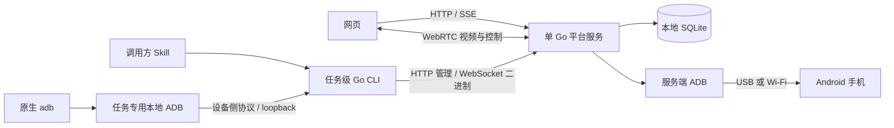
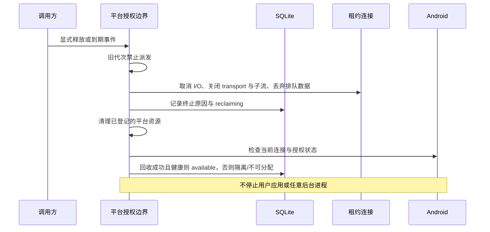

# Design

## Context

动机与交付范围见 [proposal.md](proposal.md)，业务依据见[项目规划](../../../docs/项目规划.md)。本文件为实施合同；用户已授权工程开发，并明确批准第 9 节 SQLite schema。

已确认 Go/Pion/SQLite、单 Go 平台服务、管理员访问令牌登录、Windows 原生/Linux 双容器、固定 15 分钟显式续租、网页人工入口及共享可调画质。UI 实际布局另行评审。用户稍后提供测试机；版本与硬件兼容以实际验证为准，不编造手机型号、Android 版本或性能数据。

## Goals / Non-Goals

**Goals:**

- 让设备发现、认领、数据派发、撤销与回收使用同一权威状态；即使跳过 Skill，也不能绕过租约。
- 在不解析任意 shell 业务语义的前提下，明确平台能够撤销的访问与不能撤销的手机副作用。
- 为原生 adb、网页和未来自动化工具定义同一设备身份与授权边界，避免在每个入口重复实现租约。
- 通过分离管理流、ADB 数据流和媒体流，保持元数据事务短小；慢浏览器或大文件不能无限占用内存。
- 交付真实可运行的纵向功能阶段，最终验收完整首版，而不是按技术层交付互不连通的骨架。

**Non-Goals:**

- 不复制参考项目应用代码，不继承其接口、数据库或 Python/Vue 实现。
- 不重写 Android USB 驱动、硬件编码器、浏览器解码器或通用 UI 控件。
- 不把任务端口、进程或租约当作操作系统沙箱，不终止任意手机后台程序。
- 不增加微服务、队列、远程数据库、通用插件框架、自动重试设备动作或未经批准的备用媒体路线。

## Decisions

### 1. 单服务、两个产品入口

**已确认**：一个 Go 服务提供静态前端、HTTP 管理 API、SSE 状态事件、WebSocket 租约网关与 Pion WebRTC。Windows 原生运行，Linux 与独立 ADB 容器通过 Compose 部署。相比分离前端 Web 服务，这避免多套部署与跨域认证；相比拆分媒体服务，十台规模不需要额外服务协调。

工程上采用标准 `net/http` 路由与中间件；内部按身份、设备、租约、ADB、媒体、回收、存储分模块，而不是按模块部署。前端使用 React/TypeScript、Vite、frontend-library 指定的 shadcn/ui Nova、Tailwind、Lucide；服务端状态用 TanStack Query，确有共享客户端状态才使用 Zustand。不先安装 Motion、dnd-kit 或面板库。

工程目录为 `cmd/droidharbor`、`cmd/droidharbor-cli`、`internal/`、`web/`、`api/`、`deploy/`、`skills/droidharbor/`。产品 Skill 不放进项目开发 skills 冒充已交付产品。

SSE 只传递状态通知，双向设备字节流使用 WebSocket，网页输入使用可靠有序 DataChannel。相比复用一个无边界 WebSocket 承载全部数据，这使授权、背压和故障范围更清晰；不另引入消息代理。

### 2. 认证、任务凭证与管理员会话

**已确认**：访问令牌登录，无用户账号体系。EXE 缺少 `.env` 时自动创建完整配置和高熵随机 `DROIDHARBOR_ADMIN_TOKEN`，明文保存在该文件；运行时仅用摘要认证，修改 token 并重启使旧版本管理会话失效。不保留管理员摘要文件、初始化脚本或旧凭证迁移；普通日志不回显 token，首次创建仍记录明确初始化结果。

- 网页通过同源 HTTP 提交令牌换取不透明会话，使用 `HttpOnly`、`SameSite=Strict` Cookie；写操作验证本次请求 Host 对应的浏览器 Origin 及 CSRF，不配置固定 origin。退出撤销该会话，管理员令牌轮换撤销所有旧管理员会话。会话使用独立于 AI 租约的可配置有效期，工程默认 12 小时，不因视频流量自动延长。应用不处理 TLS，明文 HTTP 仅用于可信内网/隔离网络。
- 管理员创建命名调用方 API 凭证，秘密仅创建时展示；数据库保存摘要、标识和撤销时间。调用凭证用于能力查询及创建任务，不作为所有任务数据通道的通行证。
- CLI 为每个任务在本地生成 256 bit 随机任务秘密，首次认领时通过管理 API 提交；服务端只保存摘要。后续查询本任务、续租、释放及创建连接使用这个任务凭证。这样即使认领响应丢失，CLI 仍持有任务凭证，不需要保存可回放的明文租约秘密。
- `callerId + taskId` 唯一。认领同时绑定请求幂等键、规范化请求摘要和任务凭证摘要；相同幂等键只接受相同任务秘密及相同参数。仅知道共享调用凭证、另一个 taskId 或旧幂等键，不能取回或重置另一任务秘密。
- 管理员可撤销调用凭证，撤销同时阻断其既有租约和连接并启动回收；调用凭证轮换不自动迁移旧任务。管理员拥有管理权，不是被任务隔离约束的普通任务。
- WebSocket Upgrade 同时校验任务凭证、leaseId、connectionId、generation、平台本次启动标识；token 不放在查询字符串。每次派发仍检查当前授权，握手通过不是永久授权。

这里使用普通随机 bearer 凭证与摘要校验，不自创签名协议，不引入 JWT 自包含授权。相较于长期 JWT，数据库撤销与内存状态能立即作用于现有连接；任务秘密由 CLI 预先生成解决首次响应丢失，不让共享调用凭证具有“找回其他任务凭证”的权限。

**已确认边界**：首版将共享调用机视为可信环境，不提供本机任务沙箱。原生本地 ADB Server 不认证发起命令的客户端；不承诺旧原生命令在本地端口复用后绝不借用新 Server 的授权。独立任务密钥保护 Server 到平台网关这一段；平台仍严格拒绝其他任务凭证和旧代次。若部署者需要运行不互信任务，须提供独立网络环境，仅更换 OS 用户不够。长期调用凭证可以创建新任务，但不能冒充已有任务通过平台认证。

### 3. 设备身份、链路与分配资格

`deviceId` 是平台生成的稳定标识，不使用 IP、动态无线端口或当前 ADB transportId 作为产品身份。每台设备可登记多个 USB/Wi-Fi 链路，一次租约固定到一台设备和明确的当前链路代次。

- 新发现的 endpoint 先处于待登记/维护状态；管理员完成手机授权、必要无线配对及归属确认后才可分配。使用官方 ADB 完成配对，配对码不持久化或写日志。
- 同一手机增加第二条链路时关联原 deviceId；服务端用已授权设备属性交叉核对，不能仅凭型号或 IP 自动合并。缺少可信身份或属性冲突时保持不可分配，管理员确认，不错误创建第二个可领用名额。
- 无线地址或端口变化时更新原 linkId，保留原 deviceId 与硬件身份记录；撤销旧 transport，新 endpoint 重新连接并核验，不追加永久占用旧地址的历史链路。已有租约不自动换路或释放，仍须显式重新建立数据通道。
- 连接状态为 online/offline/unauthorized，分配状态为 available/leased/reclaiming/quarantined/maintenance。连接状态来自当前探测，不把上次持久化的 online 当作启动后的事实。
- 标签按规范化集合精确执行“全部所需标签满足”；无匹配返回不可用，不改用其他账号环境。多个合格设备使用稳定顺序选取，不新增公平队列或抢占。
- 活跃链路失联立即关闭相关 transport，反馈连接中断；保留尚未到期的租约供调用方查询/显式续租，不自动选择其他手机或切到另一条链路重放动作。设备恢复后需显式重新建连，原连接不可复活。
- 管理员停用分配时，若仍有租约则先显式撤销与回收，再进入 maintenance；不能直接将 leased 改为 available。
- 已登记手机完成手机端授权后，可在设备列表对未授权/待核验且仍有连接的设备执行“同步状态”。一次性清单查询保留当前 tracker 生命周期，拒绝覆盖较新观测，再复用既有身份核验；不配对、connect、隐式换路或更改维护意图。

### 4. 租约一致性、派发与撤销

每条租约绑定 `callerId / taskId / deviceId / generation / bootId / expiresAt`。`generation` 是设备占用代次；`bootId` 是平台每次启动新生成的随机标识，不从备份恢复，避免恢复旧库时让旧凭证重新有效。

- 认领在短 `BEGIN IMMEDIATE` 事务内完成：验证任务幂等性，选择合格设备，确认无活跃租约，增加 generation，写租约并将设备置 leased。提交成功才返回；响应丢失后相同请求只返回原结果。
- 续租在同一设备的协调边界内检查当前凭证、代次和有效性，然后设为服务端处理时间起 900 秒，不在原 expiresAt 上累加。次数与累计时长不限。
- 运行中的实际到期判断使用单调时钟 deadline；API 返回对应 UTC expiresAt。服务重启不恢复旧 lease，因此无需将单调时钟跨进程持久化；调整系统时间不能延长已授予的 15 分钟。
- **已确认运维边界**：保留 `expires_at > claimed_at` schema 约束。较大日历时间回拨导致该约束不成立时，续租明确失败，既有授权保持原单调时钟期限；不伪造新的 UTC 时间、不修改约束、不自动延长。运维纠正系统时间后，调用方只有在原租约仍有效时才能显式再次续租。
- 过期和续租线性化：在过期前成功提交的续租更新 deadline；到期或撤销先发生则迟到续租失败，不能复活。续租响应丢失由调用方查权威状态，不将未知结果解释为成功。
- 建 transport、打开子流、进入真实派发、向客户端输出数据均检查有效代次和 deadline。设备派发与撤销经过同一个串行授权边界；大块 socket I/O 不长时间持有数据库写锁。
- 释放/到期/撤销先阻断授权，再取消 I/O、关闭全部子流和 transport、清空队列，登记回收。写入设置期限，取消必须能够打断阻塞写，不能让过期事件等待无限 socket 写入。
- 已交给下游 ADB/Android 的字节和动作属于不可撤回的在途副作用；新任务不会接收平台继续派发的旧代次队列，但平台不保证手机已接收的旧动作停止。
- 元数据写失败不得返回认领/续租成功；撤销时持久化失败也先在运行态拒绝访问，设备保持不可分配并报告故障，不能因写库失败继续放行。

### 5. 原生 ADB 网关合同

原生 adb 客户端连接的是任务专用本地 ADB Server 的 smart socket；该 Server 再通过 `adb connect` 连接 CLI 的 loopback 设备入口。CLI 将设备侧 ADB 字节流经 WebSocket 传到平台。`adb -H/-P` 与 `adb connect` 不能混作一个接口。

网关终止设备侧协议，处理 CNXN/AUTH/OPEN/WRTE/OKAY/CLSE，并将每个允许的 OPEN 映射到服务端 ADB 上的指定设备服务。平台到服务端 ADB 使用 smart socket 的长度前缀与 OKAY/FAIL；目标只来自租约映射，不采用调用方提供的真实手机 serial。

- 每任务生成独立本地 ADB 密钥，连接创建时登记其公钥。网关通过标准 ADB AUTH 验证对应私钥；不自动接受未知公钥，不弹出手机配对要求。旧任务凭证和密钥不能直接通过新任务网关的认证；该保证不扩展为可信调用机内原生 ADB Server 的客户端隔离。
- Windows 保持官方原生 adb 调用。官方 Server 会读取默认用户密钥，缺失时可能生成；CLI 不覆盖或删除已有默认密钥，不宣称环境变量能隔离 Windows 用户配置目录。网关支持有界的标准多密钥 AUTH 协商，但只有登记任务公钥的有效签名能通过；默认密钥尝试失败不等于任务密钥无效，不降级为免认证。
- WebSocket 传输二进制，不把 ADB 数据转 JSON/Base64；消息边界不被当作 ADB 包边界。遵守协商 maxdata、包长度、stream ID 和流控，错误关闭该连接，不把无效包转发至手机。
- 功能协商取“网关实现、锁定 platform-tools、目标设备”交集，不原样宣称真实设备所有 features；不宣称支持未实现的 TLS 设备配对协议或 delayed-ack 等扩展。
- OPEN 建立一条专属上游服务连接，WRTE/OKAY 实施有界背压；无需重写 USB、文件系统或 shell。shell_v2 和 sync 内容保留二进制语义，取消同时关闭上下游。
- 服务集合是协议范围，不是 shell 命令沙箱；允许 shell 就可能启动后台服务、改变应用或配置手机，平台不分析全部命令文本来伪称安全隔离。

| 首版命令/行为 | 网关服务与验收合同 |
| --- | --- |
| `adb connect`、`devices`、`get-state` | 本地 ADB 发现租约虚拟设备；不枚举平台其他物理手机 |
| `adb shell`、交互输入 | shell / shell_v2 按协商能力桥接，保留 stdin、stdout、stderr 与退出状态；不支持的设备不能伪造完整 shell_v2 |
| `adb exec-out screencap -p` | exec 原始二进制输出；截图不是网页压缩帧，不修改 PNG 字节 |
| `adb shell input ...`、查询设备属性 | 普通 shell 命令，保留真实退出与错误；原生 input 的字符能力不能冒充通用 Unicode 输入 |
| `adb push/pull` | sync 服务及已协商的文件能力；保留内容、错误、取消和进度；能力不支持时明确失败 |
| 无需额外 agent 的 APK 操作 | AI 可以组合 shell/sync；网页安装见第 8 节，不宣称全部 adb install 快速部署变体已兼容 |
| forward/reverse、任意 tcp/localabstract、root/remount/reboot/无线配置服务 | 不作为首版调用方公开服务；拒绝未声明 OPEN。平台内部 scrcpy 使用另一路受控适配，不受此调用方服务列表限制 |
| Appium/uiautomator2 | 保留连接描述、能力查询和资源生命周期边界，当前不运行、不接受兼容验收 |

本地原生 adb 可能在创建 forward 时仅完成本地监听，真正访问目标服务后才得到拒绝；不将本地 CLI 的“建立监听成功”当作平台支持转发的证据。使用矩阵必须验收到端服务，不仅验 adb 退出码。

### 6. 产品 CLI 与 Skill

CLI 提供 `capabilities`、`claim`、`status`、`renew`、`connect`、`disconnect`、`release`、`env`，输出稳定 JSON 和退出码，日志写 stderr。管理命令为短进程；`connect` 是本任务的前台长进程，不是全局 daemon。Skill 说明如何用 harness 通用后台进程能力保持该连接，但不要求专用插件或结束钩子。

任务工作目录保存本任务秘密、ADB 密钥、实例端口、leaseId 及资源归属，使用 OS 权限保护，不提交到 Git。原生 adb 命令显式指定独立 Server 和租约虚拟设备，不修改全局环境或 kill 默认 ADB。启动任务 ADB 时禁用无关设备自动发现/自动连接，确保不争用调用机 USB；锁定版本并验证实际支持的参数，不编造可用命令行开关。

Linux 的任务 HOME 与默认密钥位置保持一致，使用任务目录下的 `.android/adbkey`；Windows 通过 `ADB_VENDOR_KEYS` 加载任务密钥，同时接受官方 SDK 的默认用户密钥行为。两者都不修改系统全局环境、不操作默认 Server；任务密钥与平台任务凭证由 CLI 管理，不要求用户手工维护。原生握手不能代替 WebSocket 任务凭证和租约检查。

`connect` 接到停止/撤销时清理本任务 endpoint 和 ADB 进程；CLI 崩溃后下一次运行按记录核对进程身份再清理，不能只凭复用的 PID/端口杀进程。服务端到期撤销独立于本地清理成功与否。

Skill 流程：观察能力 → 生成任务身份/秘密 → 以所需标签认领 → 建立连接 → 先观察手机当前状态 → 使用原生 adb → 到期前显式 renew → 完成后 release。每次续租仍是调用方动作，不在连接进程或定时器里偷偷续租；长命令运行期间通过独立管理命令续租。

错误类别至少区分认证、无匹配设备、租约终止、设备断连、不支持能力、本地资源故障、操作结果未知。原生 adb 的 stdout/stderr 和退出码保持原义，不将上传开始、连接建立或超时当作设备动作成功。不重放点击/付款等副作用，不自动重领或换手机。

产品 Skill 依据 9R 实测采用按需观察：复用本任务解析的应用入口，截图确认页面、需要文本/定位时才读取原生 UI 树；动态页面 idle 超时后观察当前截图，提交查询前核对输入。应用登录失效需要用户处理，不由设备标签推断；原生 input 不提供通用 Unicode 承诺。

### 7. API 合同

统一 HTTP `/api/v1`，JSON 使用 camelCase，标识为不透明字符串，时间为 UTC RFC3339，HTTP 错误使用稳定 `code / message / requestId / details`。敏感字段不进入日志。默认鉴权，只有基本存活探针不返回设备或身份信息。CLI 接受 HTTP(S) 服务地址，按地址选择 WS/WSS，标准外部传输不引入应用证书参数。

| API | 授权与主要请求 | 成功/失败合同 |
| --- | --- | --- |
| `POST /admin/sessions` | 管理员令牌 | 创建安全 Cookie 会话；不在响应回显令牌 |
| `DELETE /admin/sessions/current` | 管理员会话 | 幂等退出并关闭其人工会话 |
| `GET/POST /callers`、`DELETE /callers/{id}` | 管理员会话 | 列表仅返回元数据；创建一次性可见调用凭证；撤销触发关联租约回收 |
| `GET /capabilities` | 管理员或有效调用/任务凭证 | apiMajor、协议版本、平台/ADB 能力；未实现 Appium/uiautomator2 不宣称支持 |
| `GET /devices`、`GET /devices/{id}` | 管理员完整视图；调用方仅选机必要摘要 | deviceId、标签、连接/分配状态；不泄露真实端口、密钥或其他任务身份 |
| `POST /devices`、`POST /devices/{id}/links` | 管理员；设备登记和 endpoint 归属 | 登记/关联后仍需授权与身份核对；不自动开放未知设备 |
| `GET /device-discovery` | 管理员 | 当前 ADB 快照；发现源不可用返回 503，不以空列表掩盖断连 |
| `PATCH /devices/{id}/links/{linkId}` | 管理员；设备预期 version、新 Wi-Fi endpoint | 保留设备/链路身份，关闭旧代次并重新核验；旧版本或地址占用返回 409 |
| `POST /devices/{id}/links/{linkId}/pair` | 管理员；配对 endpoint/临时配对码 | 通过服务端 ADB 配对，状态反馈；码不保存 |
| `POST /devices/{id}/links/{linkId}/connect`、`/verify` | 管理员；显式连接/归属核验 | connect 不等于身份通过；迟到连接结果不能覆盖更新后的地址；verify 冲突保持不可分配 |
| `POST /devices/{id}/refresh` | 管理员；已登记设备 | 获取当前清单及必要身份核验；较慢查询不能覆盖较新 tracker，保留维护意图，不进行配对或 connect |
| `PATCH /devices/{id}` | 管理员；名称/标签或启停分配、预期版本 | 信息修改与维护请求分别提交，不能伪装为一次原子操作；标签不迁移租约，维护必须撤销回收；冲突返回 409 |
| `POST /devices/{id}/recover` | 管理员 | 显式重试资源核验；清理未确认仍隔离，排队旧请求不得清理已进入新租约的设备 |
| `POST /leases` | 调用凭证；taskId、taskSecret、requiredTags、Idempotency-Key | 原子创建，返回 leaseId/deviceId/generation/expiresAt；没有 ttl 参数；相同请求返回原结果 |
| `GET /leases/{id}` | 对应任务凭证或管理员 | 权威租约、到期和回收结果；不回显任务秘密 |
| `POST /leases/{id}/renew` | 对应任务凭证 | 有效期更新为当前服务端时间 +900 秒；过期/撤销拒绝 |
| `DELETE /leases/{id}` | 对应任务凭证或管理员 | 幂等终止；回收中返回 202 及查询信息，不伪报 available |
| `POST /leases/{id}/connections` | 对应任务凭证；协议版本、任务 ADB 公钥 | 返回 connectionId、WebSocket 路径、有效期、支持能力；不返回真实手机/ADB 管理地址 |
| `GET/DELETE /leases/{id}/connections/{connectionId}` | 对应任务凭证 | 状态/幂等关闭；关闭连接不等于释放租约 |
| `GET /leases/{id}/connections/{connectionId}/tunnel` | 对应任务凭证，WebSocket Upgrade | 建立绑定租约与代次的二进制通道；状态失效立即拒绝 |
| `POST /devices/{id}/sessions` | 管理员；readonly/control、SDP offer | 创建人工 session，返回 answer/会话参数；无观看权限不能建立媒体流 |
| `POST /sessions/{id}/candidates`、`DELETE /sessions/{id}` | 会话所属管理员 | ICE 协商/关闭本人会话；不改变 AI 租约 |
| `GET/PATCH /devices/{id}/video-settings` | 读已授权观看者，写控制会话/管理员 | maxSize、maxFps、bitRate 独立字段；PATCH 带预期 revision；返回 requested/effective/status/revision/captureEpoch |
| `GET /sessions/{id}/screenshot` | 有效人工观看会话 | 原始设备截图二进制；失败明确，不拿陈旧视频帧伪装 |
| `GET /devices/{id}/preview` | 有效管理员网页会话；每次请求先鉴权 | JPEG 小图二进制，响应头携带 capturedAt/deviceId/linkGeneration 并禁止公共缓存；默认 5 秒共享更新，离线/失败明确返回错误，不建立视频会话 |
| `POST /sessions/{id}/transfers` | 控制会话；文件元数据、用途及覆盖选择 | 返回 transferId；只读拒绝；不把接收请求当作上传/安装完成 |
| `PUT /transfers/{id}/content`、`GET/DELETE /transfers/{id}` | 所属控制会话 | 流式上传、进度/结果、取消；文件不放入 SQLite，不承诺断点续传 |
| `GET /events` | 管理员或本任务凭证 | SSE，仅授权范围，eventId/bootId/entityVersion；断线读取快照，不承诺永久事件重放 |

错误映射：401 凭证无效，403 权限/任务不符，409 无匹配可用设备或配置版本冲突，410 租约过期/撤销，422 参数或能力不支持，503 设备/服务不可用。传输断开时动作可能已执行，客户端必须保留 `RESULT_UNKNOWN`，不能只看 HTTP 可重试性重放动作。一个错误码不能掩盖回收中、离线与不支持的差别。

幂等认领若原租约已终止，返回其终态而不是再分配设备；同 taskId 不允许换秘密夺取已有任务。状态事件只是缓存失效通知，实体快照为权威；先订阅后取快照、按版本忽略过时事件，连接缺口重新取快照。

OpenAPI 3.1 文档由实现与合同共同维护，未实现接口不能宣称可调用。API/CLI major 版本不兼容时显式失败，新增可选字段允许旧客户端忽略。

### 8. 网页媒体、控制和文件

#### 8.1 一台设备一份采集

平台向手机推送锁定版本的官方 scrcpy-server，使用独立 scid/socket 名称，禁用音频及编码失败自动降分辨率。采用设备侧监听、平台主动打开 `localabstract` 服务的连接方式，视频和控制各一条服务连接；通过 ADB smart socket 直达设备服务，避免额外发布 ADB 容器的动态 forward 端口。

每设备一个采集会话，每个浏览器一个 Pion PeerConnection。处理 scrcpy 头、参数集和时间戳后打包 H.264 RTP；不在 Go 中常驻解码/转码，不依赖 FFmpeg。手机旋转、重建编码器及参数修改产生新的 captureEpoch。

晚加入或丢包后的观看者必须从参数集和可解码关键帧恢复，不从任意 P 帧开始播放。使用有限关键帧/GOP 缓冲和每观看者有界队列；等待关键帧超时明确失败。RTCP/NACK/PLI 的行为须和锁定 scrcpy 版本的实际能力匹配，不能假设存在未提供的控制消息；必要采集重建会影响全部观看者，必须报告状态而不是无休止重启。

最后一个观看者离开时关闭该设备不再使用的采集资源；网页暂停显示属于本地行为，不要求中断其他观看者。异常断开的会话按连接状态回收，不能因为 tab 没发送 close 而永久采集。

#### 8.2 画质修改与坐标

新登记设备的业务默认值为 maxSize=1920、maxFps=60、bitRate=12000000；不改变既有 schema 或额外改写旧设备。网页只提供帧率与码率下拉，分别为 30/60/90/120 fps、4/8/12/20/40 Mbps，保留现有后台 maxSize 合同。PATCH 仍独立修改字段并校验 revision，手机编码器不支持时明确失败，不降档。

无观看者时只保存配置，状态为待下次采集应用；有观看者时明确广播切换状态，释放未完成输入并重建所需采集。取得可解码画面后才标记 effective；失败报告错误，不自动降档或宣称成功，用户可明确修改参数恢复。

分辨率按手机当前画面比例及编码器 alignment 计算；不能 CSS 拉伸、裁切或伪报标准 1080p。对齐产生的实际像素尺寸透明返回，显示保持比例，输入映射以实际帧尺寸为准。页面留黑边不算裁切；旋转/翻转的逆变换与设备旋转分别处理。

浏览器控制信封包含 sessionId、captureEpoch、序号、事件类型和载荷，服务端验证所属会话、权限及当前 epoch 后翻译为 scrcpy 控制协议。按键/触控边界可靠有序，移动事件只合并同指针中间位置，不丢失 DOWN/UP；焦点丢失、断连或切换释放本会话未完成的输入，不重放到新画面。

#### 8.3 人工操作与文本

使用锁定 scrcpy 默认 SDK 控制语义：右键唤醒/返回、中键 Home、第 4/5 键最近任务/通知栏、Ctrl/Shift 多指、键盘按下/抬起、显示变换、手机旋转、息屏投屏及面板。仅面向桌面 Chrome/Edge，移除全屏按钮。画面聚焦时使用原生 paste 事件携带文本，兼容 HTTP，不依赖后台系统剪贴板读取。

只读会话禁止所有设备写入，包括通过旁路 API 发起剪贴板写入、安装/文件上传、全设备采集配置修改；仍可本地缩放、旋转显示和下载截图。人工控制保持 AI 租约原样，不伪报 AI 已暂停。

网页中文输入通过 scrcpy 文本/剪贴板能力实现并真机验证；原生 `adb shell input` 的 Unicode 限制如实报告，不假设该命令已具备网页同等能力，也不擅自安装手机输入法或自动化 agent。

剪贴板历史仅保留当前网页会话、按设备最多 20 条，包含手机复制和发往手机的粘贴内容；相邻同内容的手机回声与发送确认合并一条，发送确认优先保留“发送到手机”来源。不自动写电脑剪贴板，不落数据库或浏览器持久存储。只读会话不主动收集新内容，数据不得进入日志。

#### 8.4 后端文件能力与网页截图

网页只保留截图，移除文件与安装入口。后端文件能力继续通过 HTTP 流式接收至受限临时目录，再通过平台 ADB 适配器上传/安装；原生 ADB push/pull/install 继续可用。不用 DataChannel 或 SQLite 搬运文件。普通文件默认 `/sdcard/Download/`，同名覆盖必须明确确认；安装失败不自动卸载旧应用或清数据。

状态区分 uploading/transferring/installing/succeeded/failed/cancelled/unknown。进度来源于实际字节传输，安装成功以 Package Manager 结果为准。取消关闭后续传输并清理平台临时文件；已经推到手机或已开始安装的副作用不可保证撤回，结果不明时显示 unknown。源文件不会被当作平台回收对象从手机任意删除。

原始截图按需经设备 exec-out 获得，不维护服务端视频解码后台循环。只读授权可以读取截图，但没有账号/会话授权不能借截图接口看设备。列表预览使用下述独立小图链路，不替代原始截图下载。

#### 8.5 列表共享低频截图

设备池与工作台左侧列表默认每 5 秒请求可见设备的预览；列表或条目不可见、页面隐藏时停止对应调度并取消不再需要的请求，恢复后读取当前结果，不补发错过的轮次。两处列表共享同设备采集与缓存，不各建一套。预览只读，不创建 AI 租约，不开启 scrcpy/WebRTC 视频会话。

预览端点要求有效管理员网页授权，逐次鉴权先于缓存读取；调用方的通用 API 凭证不能取得未认领设备画面。平台按稳定 deviceId 及当前链路代次合并同设备的并发请求，每 5 秒至多启动一次新采集；其他查看者共享当前结果或同一在途结果。通过当前已选定链路执行原始截图，仅在需要更新时解码、等比缩小并编码 JPEG。限制全局采集/图像处理并发、输入像素/字节和输出缓存容量；不建立无查看者仍运行的采集定时器，不落盘保存预览。

返回图像及真实 capturedAt、设备和链路代次；侧栏不显示拍摄时间文案，元数据仍用于校验新鲜度。HTTP 禁止公共缓存；离线、代次变化或失败清掉失效图像，迟到响应不得污染当前设备。

此链路允许按需处理静态图片，不改变实时投屏“手机编码、Go 转发、浏览器解码”的约束；不改变设备 requested/effective 画质配置，不降低原始截图接口分辨率。真实 CPU、网络及多查看者合并效果纳入首轮测量，不预先宣称零开销。

#### 8.6 工作台切换与独立小页面

设备池卡片整体点击即打开工作台，独立管理按钮不触发导航；键盘可激活卡片。完整工作台左侧常设带预览的设备列表，点击条目直接切换，不使用下拉框。切换时先停止本窗口对旧设备派发输入，释放其未完成按键/触控，结束旧人工观看会话并清空旧帧；随后为指定新设备建立人工会话，等待有效画面后才启用控制。设备离线或授权失败明确显示，不自动选择其他设备。只读模式不能因切换或打开小窗而隐式提升；旧设备的迟到画面/事件/输入不能进入新设备。其他窗口、观看者与 AI 租约保持原样。

独立小窗用同源 URL 传递稳定 deviceId 和只读/控制意图，不携带秘密；独立持有人工会话，不依赖 opener，主页面关闭/切换不终止小窗。首次按屏幕可用高度和视频比例计算宽度，取得真实尺寸后仅完成一次初始调整；保留小/标准/大尺寸操作与用户手动缩放，不持续回弹。

主界面采用左侧全局窄导航、官方 Resizable 设备列表、画面与常驻右侧工具。列表预览放大、状态以 AI 占用图标表示，异常可用性单独说明；离线置底置灰，选中强化。操作栏与手机同容器紧贴画面，不贴列表；右侧保留画质和剪贴板历史。浅/深/系统主题跨页面与小窗一致，移除管理员标识、全屏及画面圆角裁切。空白区域使用正常主题背景，视频自身内容保持原样。

#### 8.7 全局操作通知

登录、设备和凭证管理、工作台及工具的操作结果统一使用既有 Base UI/shadcn 全局 Toast，层级高于弹窗且可关闭；错误保留可换行的 requestId。状态、维护确认、一次性凭证和传输进度仍属于原页面内容。同一轮询故障按错误语义去重，requestId 变化不重复弹出，恢复后关闭；未知写结果只提供状态核对，不重放动作。

### 9. SQLite schema——已批准

用户已明确批准以下表、字段和约束，允许创建新库和对应版本化迁移。使用本地 SQLite、WAL、外键约束；不存媒体内容或明文凭证。一个平台进程拥有一份数据库和设备池，不支持多个平台副本共享文件。

| 表 | 关键字段 | 约束与用途 |
| --- | --- | --- |
| `caller_credentials` | id、name、secret_hash、created_at、revoked_at | secret_hash 唯一；撤销后禁止新任务并终止现有授权；名字不是身份 |
| `admin_sessions` | id、secret_hash、admin_credential_version、created_at、expires_at、revoked_at | Cookie 只持有随机会话秘密；轮换管理员令牌使旧版本会话失效 |
| `devices` | id、display_name、allocation_state、generation、maintenance_requested、video_max_size、video_max_fps、video_bit_rate、video_revision、last_error | generation 非负递增；画质为独立字段，连接 online 来自当前链路观测而非信任旧快照 |
| `device_links` | id、device_id、kind、endpoint、observed_serial、identity_evidence、enabled、last_seen_at | device_id 外键；kind 为 USB/Wi-Fi；当前 endpoint 唯一但不是永久设备身份，换地址须验证归属 |
| `device_tags` | device_id、tag | 联合主键，无重复标签；不存账号密码；标签修改不改变已有租约 |
| `tasks` | id、caller_id、external_task_id、task_secret_hash、created_at | `(caller_id, external_task_id)` 唯一；秘密摘要唯一，caller 外键；任务授权不可仅凭可猜 taskId 恢复 |
| `leases` | id、task_id、device_id、generation、boot_id、status、claimed_at、expires_at、ended_at、end_reason、claim_idempotency_key、claim_request_hash | active/ended；active device 唯一、active task 唯一；`(device_id,generation)` 唯一；认领幂等键按 caller 作用域唯一，需由关联 task/caller 显式约束 |
| `owned_resources` | id、device_id、owner_kind、owner_id、boot_id、kind、locator、state、cleanup_error、created_at | 仅记录需要跨崩溃回收的外部资源，locator 包含可核验的 scid/路径等；创建前先登记，回收状态显式更新 |
| `operation_records` | id、actor_kind、actor_id、device_id、lease_id、kind、status、created_at、finished_at、result_code、safe_details | 租约/人工/回收/上传安装的重要结果；不保存每个视频包、按键内容、shell 正文或秘密 |
| `schema_migrations` | version、applied_at | 迁移工具管理；不自动猜测未识别 schema |

`leases` 的 caller 作用域幂等约束落地时使用显式 `caller_id` 与复合外键 `(task_id, caller_id)` 关联 `tasks(id, caller_id)`，再建立 `UNIQUE(caller_id, claim_idempotency_key)`；不能写成 SQLite 不支持的跨表唯一索引。tasks 提供对应复合唯一键。active 部分唯一索引只检查 `status='active'`，不能在索引条件里使用会变化的当前时间。

有效期判断不依赖清理定时器：到期租约即刻无访问权，撤销协调器随后将 status 改 ended、设备置 reclaiming，资源回收后才允许再次认领。即使 ended 已提交，设备仍可处于 reclaiming/quarantined；两者不是同一状态。

事务边界：认领写 task/lease/device 与必要记录同一事务；续租仅更新仍有效的同代次 lease；终止记录与 reclaiming 同一事务；回收结论与 available/quarantined 同一事务。网络、ADB 命令和视频 I/O 不放在数据库事务中。写入错误直接反馈，不自动重试有设备副作用的操作。

首版不增加独立 tags、任务队列、视频帧表、全量输入审计表或实体通用 JSON 仓库。连接及子流对象放运行内存；外部资源才进入 owned_resources，避免为每个数据包写库。

### 10. 回收与启动恢复

资源分 task、human-session、device-capture 三种归属。AI 租约结束不能关闭仍有人工观看者的 device-capture；人工离开也不能清理有效 AI transport。回收结果记录可核验的连接/资源，而不是接受调用方 `clean=true`。

平台启动先获取单实例锁并生成新 bootId，在尚未接受分配前将旧 active 租约全部终止、关联设备进入 reclaiming。检查资源账本，定向关闭/移除仍属于平台的资源，探测设备授权与在线情况；成功且非维护状态才开放，归属不明或清理失败隔离。

使用“创建前登记 + 唯一 locator + 幂等定向清理”覆盖资源创建后崩溃：找不到资源即视为已清理，身份不吻合不能杀其他进程。Linux 平台重启时 ADB 可能仍活着，因此不能只靠进程退出假设手机端 scrcpy 已清理。

手机离线时保留不可分配状态，重新上线后继续核验；不重启手机、不 force-stop 用户应用、不删除业务文件、不清账号。正常后台程序继续运行不构成回收失败。

ADB 容器单独重启视为底层连接中断，关闭旧子流，状态置离线；平台本身未重启则未到期租约不会仅因 ADB 进程更新而续租或重新分配。调用方观察状态后可显式重建连接，已发送动作不重放。平台重启则无条件终止旧租约，二者不能混淆。

### 11. 部署合同与兼容矩阵

| 部署面 | 合同 |
| --- | --- |
| Windows | 原生 Go Windows Service；平台读取 `.env`，平台和服务端 ADB 使用明确账户、数据目录及启动责任；不依赖 Node/Python 常驻 |
| Linux 平台容器 | 单 Go 进程与内嵌静态前端；业务数据卷、dotenv/管理员摘要配置；无需 USB 访问权限 |
| Linux ADB 容器 | 锁定 platform-tools；负责 USB、无线配对与授权材料卷；对平台容器开放内部 smart socket，宿主不发布给调用方 |
| 容器网络 | 使用 Compose 专用 bridge；HTTP 显式发布；Pion 使用显式配置的媒体 UDP 端口并发布，配置内网/VPN 可达的 advertised 地址；不使用不可达容器私网地址假装协商成功 |
| USB | ADB 容器映射设备节点并配置设备访问规则；覆盖插拔后新节点和权限变化。平台容器不以 privileged 绕过设计 |
| WebRTC | 校验认证、信令、浏览器能力及实际媒体路径；无隐式 TURN 或公网穿透。VPN/防火墙阻断 UDP 时明确报告部署缺口，不静默切换媒体协议 |
| 备份 | 用 SQLite 一致性备份方式或停服务后完整备份，不能只拷贝正在写入的主库而遗漏 WAL；ADB 授权卷与平台数据分别备份，秘密按文件权限保护 |
| 恢复 | 校验 schema/版本后启动，生成新 bootId，旧租约不恢复；不声称备份包含手机应用数据 |

版本矩阵列明 Windows Server/Windows 调用方、Linux 宿主及容器基础镜像、CPU 架构、platform-tools、scrcpy-server、Go/Pion、桌面浏览器及手机系统的实际版本。只把实际运行的组合标为已验证，不把交叉编译当作运行支持；网页不考虑移动端。

### 12. 消融与未来接口

- 去掉独立前端服务器、消息队列、分布式租约和远程数据库，保留单服务+SQLite；这些组件不解决当前十台设备的核心问题。
- 去掉音频、录屏、eScrcpy 共存及每观看者独立编码，保留网页共享视频与控制。
- 去掉通用手机进程清理、应用复位脚本和自动续租，按已确认政策仅撤销入口与平台资源。
- 保留设备身份、租约/代次、连接描述、能力发现、资源归属和 API major 边界；Appium/uiautomator2 将来在这些边界中扩展，不预建空 adapter 或插件目录。
- API 的 schema 不暴露 ADB 真实 serial/固定端口作为稳定身份；媒体适配器不将 scrcpy 私有协议直接变成公开 Web API。

### 13. Windows 前台试用与诊断

- Windows 服务端仅含内嵌网页和 scrcpy-server 的 EXE 与说明，客户端含 CLI、Skill 与专属说明。双击控制台 EXE 零参数运行；缺 `.env` 时自动生成完整配置与随机明文 token，现有配置复用，错误明确失败。路径相对 `.env`；管理 token 只读文件，其他配置可由进程环境覆盖。旧数据由用户清理，不实现摘要文件兼容或迁移。
- `.env` 是管理 token 的唯一配置来源，不提供 `.env.example`、start.cmd 或 admin-init。数据库仍自动初始化；媒体默认自动协商本机 IPv4，可选显式地址覆盖。保留日志双写和初始化结果，不配置 TLS、证书或固定 origin；Windows Service 仍通过 `serve --env-file` 选择同一格式。
- 平台及专用 ADB runner 的日志同时写控制台和文件，20 MiB 轮转、最多 5 份压缩历史；日志无法创建直接失败，后续写入故障显式写 stderr。默认 info，可显式开启 debug 记录 requestId、匹配路由和请求耗时。
- 启动阶段、后台 ADB 清单、媒体采集、资源清理、传输和存储异常保留错误类型/原因链、OS errno、SQLite 结果码及关联 ID。数据库/设备错误正文可能包含业务数据，运行日志只提取已知系统原因，不写入任意错误字符串、请求参数或设备输出。HTTP panic 记录类型与调用栈后继续交给 HTTP Server 关闭异常请求。
- 本轮仅证明前台发布包及异常可观测性，不替代系统重启、自启动、Linux 热插拔、目标网络或浏览器矩阵验收。

## Risks / Trade-offs

- [原生 ADB 网关不是普通 TCP 代理] → 首个纵向阶段用官方原生 adb 完成握手、shell_v2、二进制截图、sync 和到期撤销；不能只用 Go mock 客户端证明兼容。
- [手机已收到的动作或后台程序可跨任务继续运行] → 作为已批准的状态保留边界，下一任务先观察；不把清理平台资源宣传成设备沙箱。
- [设备侧编码器、Android 隐藏 API 与浏览器 H.264 能力差异] → 锁定 scrcpy 版本，按真实矩阵验证；不自动换 codec、降档或启动服务端转码。
- [画质重建影响全部网页观看者] → 明确共享范围，revision 冲突检查、captureEpoch 与实际生效状态；不改变 AI 租约。
- [双链路身份无法自动证明] → 在设备登记阶段人工确认关联，冲突保持不可分配，不用型号/IP 猜测。
- [调用方同权限进程可读秘密或使用端口] → 记录运行环境隔离责任；loopback 和任务密钥用于减少误用，不提供 OS 沙箱。
- [原生 adb 的 input 不是通用 Unicode 输入接口] → 网页中文按 scrcpy 验收；AI 命令保留上游能力和真实错误，不添加未经批准的手机 agent。
- [USB 热插拔、bridge 网络及 VPN 可达性] → 两种部署各做实际插拔、配对、重启与媒体路径验收；部署失败不是功能成功。
- [没有当前生产硬件及新实现性能数据] → 先记录测量条件与资源/延迟，再请用户确认阈值，不在此提案硬编码 200 ms 或 24 小时达标承诺。

## Migration Plan

1. 评审本设计和第 9 节 schema，记录批准结果；确认真实部署/设备版本资料及原型范围，不修改用户已有软件。
2. 实现并实际运行最小完整纵向路径：设备登记 → 认领 → 原生 adb → 显式续租 → 释放/过期 → 回收；这不是最终首版验收。
3. 接入网页媒体/控制、共享画质、文件、完整 Skill 及两个调用方平台；完成已批准的 UI 原型后再实现页面。
4. 制作 Windows 服务和 Linux 双容器交付，分别验收启动、权限、持久化、ADB/平台独立重启和备份恢复。
5. 首次生产启用前处于维护模式，导入/登记设备及标签、初始化凭证并验证，全部通过后开放分配。无参考项目数据迁移。
6. 每次升级前暂停新分配并显式终止/回收受影响租约，取得一致性备份；schema 由版本化迁移推进，失败退出而非静默重建库。
7. 回滚服务版本仅在 schema 兼容时进行；否则停服务恢复升级前一致性备份和配套二进制，启动生成新 bootId 并重新回收，不恢复旧授权或回放动作。

## Open Questions

以下是实施环境资料和数值，由实施前置检查/真机测量补齐：

- 生产 WinServer、Linux 宿主、调用机架构、手机型号及 Android 版本，用于锁定实际发布兼容矩阵。
- 内网/VPN 网段、浏览器可达 IPv4 及可开放媒体端口，用于填入 `.env`；应用不承担域名/证书配置，不改变内网/VPN 和无隐式 TURN 的边界。
- 单文件上传容量和队列/缓冲资源限额，根据可用磁盘与首轮负载确定，并在 API 能力中公布；未完成前不能宣称无限容量。
- 在实际宿主和手机上取得资源、延迟、建流及稳定运行数据后，确认性能数值门槛。

数据库 schema 已批准；后续结构变更仍须确认。UI 实际布局审批与真机验收仍是实施门禁，不由开发者自行豁免。

### 核查来源

- [ADB 设备侧协议](https://android.googlesource.com/platform/packages/modules/adb/%2B/1a0fb8846d4e6b671c8aa7f137a8c21d7b248716/protocol.txt)：CNXN/AUTH、子流与 smart socket 的区别；具体实现仍以锁定 platform-tools 版本为准。
- [ADB 服务](https://android.googlesource.com/platform/packages/modules/adb/+/refs/heads/android15-release/SERVICES.TXT)与[命令合同](https://android.googlesource.com/platform/packages/modules/adb/+/HEAD/docs/user/adb.1.md)：设备服务、shell_v2、sync 和本地 ADB Server 参数。
- [scrcpy 开发协议](https://github.com/Genymobile/scrcpy/blob/master/doc/develop.md)：设备侧 server、独立 socket、scid、帧及控制协议版本绑定。
- [scrcpy 视频参数](https://github.com/Genymobile/scrcpy/blob/master/doc/video.md)：保持比例、编码器对齐、帧率上限及自动降分辨率行为。
- [SQLite 事务](https://www.sqlite.org/lang_transaction.html)：单写事务与 BEGIN IMMEDIATE；[Docker 动态设备](https://docs.docker.com/reference/cli/docker/container/run/#device-cgroup-rule)：热插拔不是一次设备映射即可完成。
